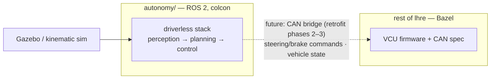
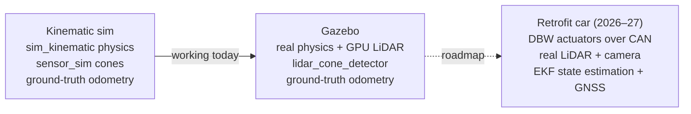

# Autonomy

FSAE driverless stack for Longhorn Racing Electric. The goal: retrofit Orion (the 2025-26 EV) so it drives itself, with a fully autonomous demo by April 2027 (acceleration + skidpad, stretch goal autocross).

**New here? Start with [ros2/GETTING-STARTED.md](ros2/GETTING-STARTED.md).**

## Layout

| Path | What it is |
|------|-----------|
| `ros2/` | The ROS 2 stack. [Setup guide](ros2/GETTING-STARTED.md), [full reference](ros2/README.md) |
| `docs/plans/` | Working docs: plans, change logs, roadmap. Context for contributors and AI agents, not onboarding material |
| `docs/rules/` | FSAE 2026 rules breakdowns relevant to driverless |
| `testing/` | [Hardware test results](testing/README.md) and the tools that recorded them. Raw data lives in [SharePoint, _VMS_ > Autonomous > Test Data](https://utexas.sharepoint.com/sites/ENGR-LonghornRacing/LHR%20Electric/Design/_VMS_/Autonomous/Test%20Data), not git |

## Software lanes

The code is organized so each lane owns whole packages. Lane ownership is tracked in Notion (VMS / Autonomous).

| Lane | Packages | Starter work |
|------|----------|--------------|
| Perception | `lhr_perception` (+ `lhr_sensor_sim` and `lhr_lidar_sim` as its sim stand-ins) | Autocross reliability: sparse LiDAR returns can cause incorrect track-side labels. See [known issues](docs/plans/gazebo-integration.md) |
| State estimation | `lhr_state_estimation` (+ `lhr_sensor_sim`'s `inertial_sim` as its sensor stand-in) | GNSS: no sim model exists yet, and position drift is unbounded without it. Slip handling, IMU lever arm |
| Planning & control | `lhr_track_builder`, `lhr_control`, `lhr_mission_manager` | Centerline ordering on tight corners. Skidpad mission and world ([#114](https://github.com/LonghornRacingElectric/lhre/issues/114)) |
| Safety | `lhr_safety` | Hardware half of the loop (CAN heartbeat, BEVO timer, relay, valve) for the 12/2 bench rig. Sim brake model, threshold tuning by fault injection |
| Sim & test infra | `lhr_gazebo`, `lhr_sim_kinematic`, `lhr_sim_bobsim`, `lhr_sim_fmu`, `lhr_trackgen`, `lhr_metrics`, `lhr_demo`, `lhr_vehicle`, `scripts/`, `testing/tools/gate/` | Extend the generated-track tests to model real sensor visibility and vehicle feedback |

## How the pieces fit

Where the stack sits in the monorepo — everything else in `lhre` is the
Bazel/firmware world ([ADR-009](../docs/architecture/009-autonomy-outside-bazel.md)):

Today the stack drives only simulators; nothing real is connected yet. The CAN
bridge to the VCU is planned in the
[retrofit roadmap](docs/plans/retrofit-roadmap-2026-27.md); the full target
picture — sensors, nodes, CAN, safety loop — is in
[on-car-architecture.md](docs/plans/on-car-architecture.md).

The road from sim to the retrofit car swaps the layer *under* the same upper
stack at every step (see the
[architecture comparison](ros2/README.md#architecture-comparison)):

## Status (October 2026)

- Full sim pipeline completes laps, both kinematic and Gazebo physics
- Laps also complete on estimated state (`estimator:=ekf`), with no
  ground truth in the control loop — dead reckoned, so position drift is
  unbounded until GNSS
- Timestamp-aligned LiDAR mapping avoided duplicates in the tested autocross
  run; geometry-only side inference still mislabels sparse cone fragments and
  the car leaves the course
- ZED 2i stereo inputs implemented; camera color-region classification is
  available as an opt-in debug image. Camera–LiDAR inspection-map fusion is
  implemented with LiDAR side fallback and planner wiring; ROS checks pass and
  manual autocross/EKF visuals were confirmed ([usage](ros2/src/lhr_perception/README.md#cameralidar-inspection-map))
- Acceleration event runs in sim, from the staged start through the 75 m
  mission to a stop in the exit lane
- `safety_node` trips the mission on stack faults (Gazebo, `safety:=true`)
  and fault injection exercises each check; off by default until the
  thresholds are tuned
- The 10/28 MVP gate runs and scores itself in Gazebo
  ([gate tools](testing/tools/gate/README.md))
- Retrofit hardware being ordered (details in Notion)
