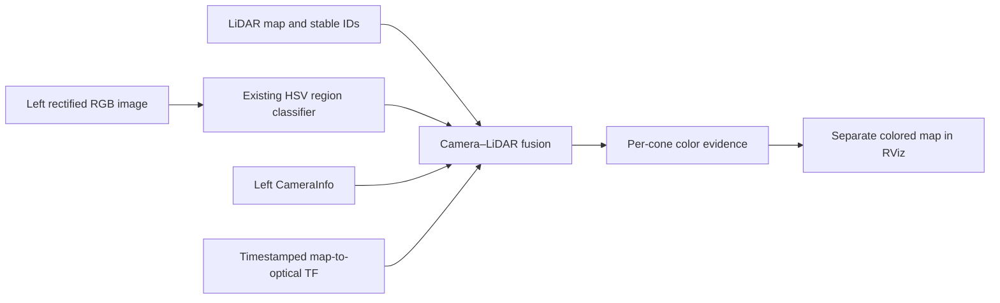

# Camera–LiDAR Fusion: Colored Map for Inspection

Date: 2026-10-12. Status: approach approved by Celina; this detailed spec is
awaiting review. Implementation has not started.

## Outcome and scope

Attach camera-derived blue, yellow, and orange labels to the existing LiDAR
map and inspect them in RViz. Celina selected a separate colored map as the
first fusion milestone. A successful result preserves each LiDAR cone's ID
and position, confirms colors from repeated camera observations, and leaves
unsupported or conflicting labels unknown.

The input camera classifier is implemented and has been visually exercised
by Celina in VNC. Its masks identify color patches, not validated cone objects.
This milestone adds spatial association and temporal label smoothing. It does
not establish physical-camera accuracy or autonomous-driving reliability.

Keep the original `/lhr/sensor/cones_detected` publisher and all track-builder
subscriptions unchanged. Do not infer a physical color from a LiDAR marker's
namespace or display color. No stereo depth, trained detector, camera-derived
positions, ground-truth cone labels, or control integration are included.

## Approach

Add an opt-in `camera_lidar_fusion` node in `lhr_perception`. It receives the
raw rectified left image and reuses `decode_image()` and `classify_regions()`.
It consumes neither the annotated debug image nor colors painted into that
image. Segmentation runs once for each image selected for fusion; the
independent debug classifier can still run alongside it.

This duplicates segmentation when both nodes run, but keeps the working
classifier interface stable and avoids introducing a message package solely
for region transport. A shared color-mask stream could remove that duplication
later. Integrating classification directly into the LiDAR detector would
couple mapping to image delivery and make isolated verification harder.



## ROS interface

| Topic | Type | Use |
| --- | --- | --- |
| `/lhr/sensor/cones_detected` | `visualization_msgs/msg/MarkerArray` | Complete persistent LiDAR map snapshots |
| `/lhr/sensor/zed2i/left/image_rect` | `sensor_msgs/msg/Image` | Raw left rectified view |
| `/lhr/sensor/zed2i/left/camera_info` | `sensor_msgs/msg/CameraInfo` | Calibration matching that image |
| `/tf`, `/tf_static` | Standard TF streams | Map-to-left-optical transform at image time |
| `/lhr/perception/cones_fused` | `visualization_msgs/msg/MarkerArray` | Complete colored map for inspection |

Use best-effort, volatile, depth-5 QoS for image/calibration subscriptions.
Use reliable, transient-local, depth-1 QoS for the map subscription and fused
publisher, matching the existing map's late-subscriber behavior. Standard ROS
remapping supplies alternative topic names; no topic-name parameters are added.

The input is the detector's full snapshot contract, not an incremental marker
stream. Read ADD markers in `cones`, `left_cones`, or `right_cones` by integer
ID; ignore their classification. Namespace DELETE markers alongside an ADD
are display transitions, not removal of that ID. Absence from the next full
snapshot removes the cone and its evidence. DELETEALL clears all state.
Reject a malformed snapshot with mixed timestamps/frames, non-finite positions,
or conflicting ADD markers for the same ID. This milestone supports map-frame
snapshots only. An empty MarkerArray clears the map.

Fused markers use namespaces `blue_cones`, `yellow_cones`, `orange_cones`, and
`unknown_cones`. Unknown is gray, visibly distinct from measured orange.
Keep input IDs, positions, scale, type, and orientation. These labels mean
physical color, not an inferred track side. Publish deletion markers for old
namespaces when a label changes and for IDs removed from the map. Marker
lifetimes remain infinite. A latched snapshot contains every active ADD marker.

Fused ADD markers retain their input map frame and map-snapshot timestamp;
that timestamp describes their positions, not camera acquisition. Deletions
use the same snapshot stamp. Camera evidence is tracked internally with the
source image timestamp. The output is a visualization contract, not a new
timestamped cone-observation API.

## Timing and calibration

Retain map snapshots and image/calibration messages for a bounded two-second
history, with additional count limits of 30 map snapshots and 60 images and
60 calibration messages. On a 10 Hz processing timer, select the newest
unprocessed image that has a matching CameraInfo and an eligible map snapshot.
Match CameraInfo by exact timestamp, optical frame ID, and image dimensions.
Use the newest snapshot at or before the image timestamp, no more than
`map_max_age_sec` older. Cone landmarks are stationary; their accumulated map
positions can therefore be projected at the camera time without pretending
that the LiDAR scan and camera exposure were simultaneous.

Require a finite rectified pinhole projection matrix with positive focal
lengths and the left-camera form
`[[fx, 0, cx, 0], [0, fy, cy, 0], [0, 0, 1, 0]]`, zero projection translation,
identity rectification, zero distortion, no binning, and full-image ROI.
Gazebo's ideal left stream satisfies this contract. Reject inconsistent or
unsupported calibration rather than substitute configured FOV or intrinsics.
The physical driver will need separate acceptance against this contract.

Ask TF for the transform from `map` into the image's optical frame at the
image timestamp. Image timestamps must be positive for voting: TF interprets
zero as a latest-transform request, so startup zero-stamp frames are dropped.
Never substitute the latest transform. Lookup is nonblocking;
an image awaiting TF may be retried until it is older than the retained
two-second history. Once processed, its timestamp cannot vote again. Older
images skipped in favor of a newer eligible image are discarded. Limit fusion
work to one image per processing-timer tick.

On image/map timestamp regression, or a backward ROS-clock jump, clear
queued messages, map association, votes, and published fused markers. Start
again from fresh inputs. A detector restart without a clock reset is handled
by snapshot disappearance and the per-ID position-jump guard below. The
MarkerArray contract has no epoch identifier; a restart reusing the same IDs
and nearly identical positions is indistinguishable from normal map updates.

## Projection and region association

The detector currently publishes planar map positions with z=0. A pixel at
that ground point may fall below the cone's colored surface. For matching
only, project `(x, y, z + sample_height_m)`. The default `0.1625` m is an
explicit simulation assumption corresponding to the small cone's nominal
half-height, not a LiDAR-measured vertical centroid. It also samples the lower
body of larger orange cones. Preserve the original position in output.
Document and expose this offset so real-cone geometry can be tested later.

Transform the sample point into optical coordinates, then use CameraInfo's
projection matrix to obtain pixel coordinates. Reject non-finite points,
points on/behind the optical plane, points beyond `max_color_range_m` in
3D camera distance, and projections outside the image. Mount geometry comes
from TF, whose static chain is generated from the existing vehicle config;
the fusion node carries no duplicated vehicle mount constants.

For each projected point, form candidate region associations when its pixel
lies inside a region's bounding box expanded by `pixel_margin` pixels.
The component must already pass the existing HSV classifier's area cutoff.
A cone receives a vote only when it has exactly one candidate region and that
region has exactly one candidate cone. Reject all participants in competing
matches, including multiple colors caused by overlapping HSV bounds. No
nearest-box or depth tie-breaking guesses are made in this milestone.

Bounding boxes can contain non-color pixels; projection plus a box is still
approximate association, not verified object identity. Merged color patches,
occlusion, and nearby cones can produce unknowns. Runtime inspection must
check for false matches as well as successful labels. Conservative rejection
is preferred over assigning one patch to several mapped cones.

## Persistent color evidence

Track a bounded window of the last five accepted color votes per cone ID.
Only uniquely associated observations from distinct, increasing image
timestamps vote; missing/ambiguous matches add no vote. Confirm a color when
it has at least three votes and at least 70% of the accepted-vote window,
with no tied winning color. Before confirmation, publish unknown.

Recompute the result after each accepted vote. Conflicting evidence can turn
a label unknown and later replace it with another color. Labels are not
immutable. Preserve the last computed result while the cone is out of view
or camera evidence is temporarily unavailable. Three adjacent camera frames
provide smoothing, not three statistically independent measurements.

Maintain current map positions separately from the position at which the
ID's evidence was initialized. If displacement from that reference exceeds
`id_reset_distance_m`, clear the votes and label and reset the reference.
This prevents substantial ID reuse or accumulated position movement from
carrying unrelated color evidence. Ordinary running-average map corrections
within the gate preserve history. Removing an ID clears its evidence.
An older snapshot may vote only for an ID still present in the current map
and belonging to the same evidence generation; removing or resetting an ID
must prevent queued old snapshots from reviving its previous label.

Every valid map snapshot publishes all active cones immediately, even before
any usable camera frame; new cones start unknown. A camera-driven label change
also publishes a complete snapshot. Missing camera/TF never stops map output.
This allows RViz inspection of both classified and unsupported cones.

## Parameters and launch

Read parameters at startup; invalid types or ranges fail with a specific
configuration error. Reuse the existing classifier's HSV bounds and
`min_region_area` parameter names/defaults. Their existing `cone_color_*`
launch arguments must forward to fusion even when the debug classifier is off.

| Fusion parameter | Default | Valid range / purpose |
| --- | --- | --- |
| `process_hz` | `10.0` | Finite, positive; maximum image processing frequency |
| `map_max_age_sec` | `0.5` | Finite, positive, at most 2.0; snapshot-to-image age |
| `sample_height_m` | `0.1625` | Finite, nonnegative; projection-only height offset |
| `max_color_range_m` | `20.0` | Finite, positive; camera-to-sample distance gate |
| `pixel_margin` | `6.0` | Finite, nonnegative; bounding-box association margin |
| `vote_window` | `5` | Positive integer; bounded accepted observations |
| `min_color_votes` | `3` | Integer in 1..vote_window |
| `min_color_fraction` | `0.7` | Finite, greater than 0.5 and at most 1.0 |
| `id_reset_distance_m` | `0.5` | Finite, positive; displacement clearing color history |

Add `enable_camera_lidar_fusion`, default `false`. Enabling it requires
`enable_stereo_camera:=true` and `perception:=lidar`; fail launch otherwise.
Support both `estimator:=truth` and `ekf`. The `sim` perception stand-in already
has ground-truth cone labels and is excluded from this milestone to avoid
mistaking those labels for LiDAR-camera evidence.

Expose every new fusion parameter as `fusion_<parameter_name>` in Gazebo
launch, matching the node's defaults. Forward float/integer settings with
explicit ParameterValue types. HSV arrays retain the validated YAML-array
handling used by the camera debug classifier. `use_sim_time` is true in the
Gazebo launch. Do not require `enable_camera_color_classifier`: it controls
the independent debug view, not fusion's access to the raw image.

Add a disabled-by-default MarkerArray display to the stereo RViz config for
`/lhr/perception/cones_fused`, using reliable/transient-local QoS. Users enable
it to inspect fusion and can hide the original orange LiDAR markers to avoid
overlapping symbols. Preserve existing displays and the saved view.

Proposed usage, after implementation and rebuilding:

```bash
./scripts/run_gazebo_demo.sh perception:=lidar estimator:=truth \
  enable_stereo_camera:=true enable_camera_color_classifier:=true \
  enable_camera_lidar_fusion:=true
```

Defaults are initial simulation tuning, not validated physical-camera limits.
Parameter changes require a node restart.

## Implementation boundaries

Keep projection/association and voting in a ROS-independent helper module,
with a thin `camera_lidar_fusion` ROS node owning queues, TF, subscriptions,
and marker publication. Reuse existing color helpers without changing their
public behavior. Register the new executable and declare `tf2_ros` as a direct
runtime dependency of `lhr_perception`. The existing container already installs
ROS TF and OpenCV, so no new image dependency is expected.

Update launch/RViz/tests in `lhr_gazebo`, package/workspace READMEs, and the
camera-fusion roadmap. No board, generated vehicle-model, track-builder,
control, or firmware changes are needed. This is a local perception design,
not a repo-wide structural decision requiring an ADR.

## Verification and acceptance

Pure tests must cover hand-derived pixel projections; optical axes and
nonzero mount translation/rotation; behind-camera/out-of-frame/range rejection;
height-offset behavior; unique and competing associations; HSV overrides;
confirmation, conflicts, relabeling, duplicate timestamps, ID removal/jumps,
and resets. Assert that LiDAR coordinates and IDs remain unchanged.

ROS tests must exercise timestamped TF, exact CameraInfo association, map-age
gating, queued TF availability, unsupported calibration, malformed inputs,
source-marker namespace transitions, label deletion/replacement, complete
snapshots, late RViz subscribers, and clock resets. Supply synthetic images and
real ROS messages/TF rather than replacing the component behavior with mocks.

Evaluate launch defaults and non-default overrides and feed those evaluated
parameters through real node startup in both truth and EKF modes. Verify the
unsupported `sim` branch and missing-camera configuration fail clearly. Verify
that disabled fusion adds no node and does not change existing topic wiring.

Run colcon build/test for affected packages and strict MkDocs. Preserve the
existing classifier/mapper tests. Report unavailable runtime checks explicitly.
Do not restart or stop an existing user simulation merely to run acceptance;
use isolated ROS domain/ports for automated integration where feasible.

Runtime acceptance starts with a stationary vehicle in the oval simulation,
then a moving oval and a tight-turn autocross case using truth odometry. Inspect
the fused map beside the raw image/debug boxes: visible isolated cones should
gain correct colors after the configured vote threshold; positions and IDs
must stay those of the LiDAR map; competing/out-of-view/new cones must behave
as specified; namespace changes must not leave duplicate RViz markers.
Disable camera input temporarily and verify map output persists. Repeat the
timestamp/projection checks with EKF and report misassociation caused by pose
error separately. Record observed fused color accuracy, unknown count, and
wall-clock image/fusion rates; no fixed 30 wall-clock FPS claim is made.

This milestone's completion requires the synthetic/ROS checks plus recorded
live inspection. If runtime is unavailable, report implementation and tested
coverage separately from unverified acceptance. Do not claim driving
improvement: track-builder integration is a later milestone.

## Related documents

- [Camera-fusion roadmap](camera-fusion.md)
- [ZED stereo design](zed2i-stereo.md)
- [Perception inputs and classifier](../../ros2/src/lhr_perception/README.md)
- [Gazebo camera interface](../../ros2/src/lhr_gazebo/README.md#stereo-images-in-rosrviz)
