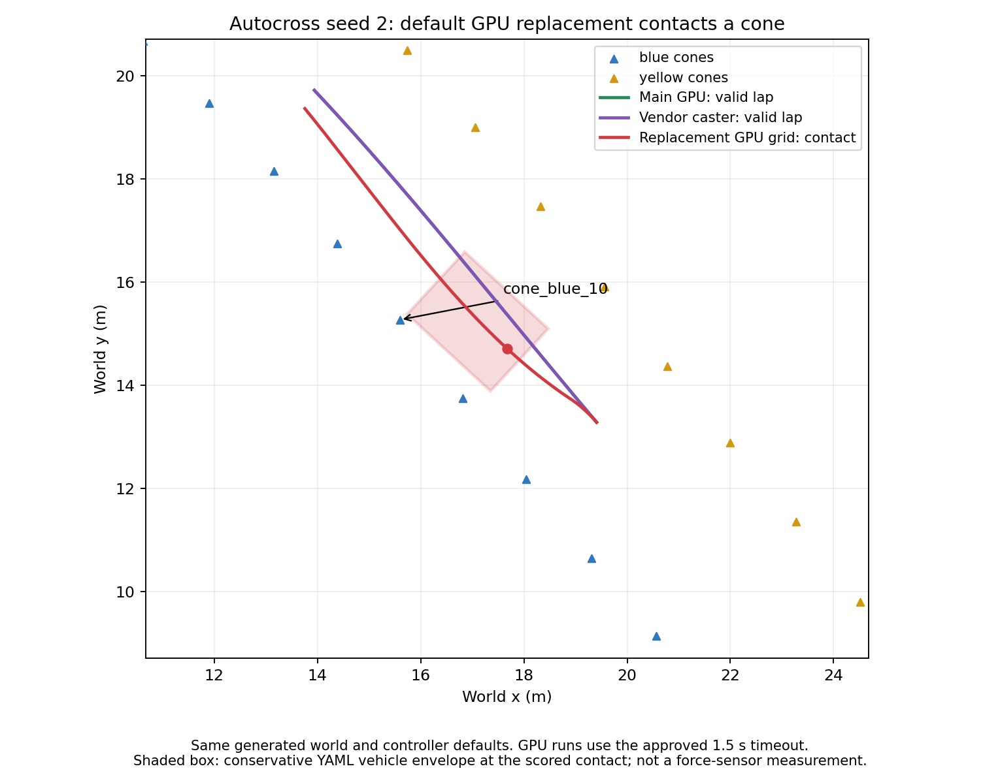

# PR #133 integration validation

The source integration and review fixes pass their unit/startup checks, but
the replacement default GPU grid has a reproducible seed-2 driving regression.
The GPU grid remains in PR #133; the user explicitly deferred this repair to
keep the current PR scope. **PR133-GPU-SEED2 is open, not an accepted gate.**
The default GPU LiDAR timeout also fails locally. A longer diagnostic timeout
does not erase either failed check.

## Provenance and scope

Initial comparisons used implementation `d588126` against main `0a157ab` on
2026-10-24, Ubuntu native / ROS 2 Jazzy / Gazebo Harmonic, NVIDIA RTX 3050
Laptop GPU. Gazebo's renderer log identified NVIDIA, not software rendering.
The later integration includes main `4cf75bb`; its official bounded runs used
`2921bf3`. Initial numbers below remain explicitly tied to their older tree.

All 15 packages built and 693 workspace checks passed on `d588126`, with strict
MkDocs, generated-model freshness and `gz sdf -k` passing. BobSim checks used
the repository-pinned submodule and canonical dynamics vehicle file.

World, generated-model and vehicle-YAML hashes, exact launch arguments,
measurement summaries and source/estimator selections were recorded beside
each local run. Raw traces and logs stay out of git. The comparison figure
and selected results are committed here; local raw outputs were under
`/tmp/lhre-pr133-acceptance`. They have not been uploaded to SharePoint.

Two accidentally overlapping comparison runs were discarded, marked invalid,
and repeated in isolation. They are excluded from the table. A single-run lock
prevents overlapping probe sessions afterward.

## PR133-GPU-SEED2: open, deferred

With identical seed-2 world bytes and default controller/detector settings,
the replacement GPU grid touched `cone_blue_10` in both isolated attempts.
Current-main-at-the-time's VLP-16 grid and the vendor-pattern source each
completed a valid circuit. The root cause is not established; this evidence
does not identify self-hits as its cause.

| Tested tree / source | Result | Maximum CTE | Cone contacts | Lap time |
| --- | --- | --- | --- | --- |
| `d588126`, GPU grid, first run | `invalid_lap`: `cone_contact` | 0.4731 m | `cone_blue_10` | none |
| `d588126`, GPU grid, isolated repeat | `invalid_lap`: `cone_contact` | 0.4721 m | `cone_blue_10` | none |
| main `0a157ab`, GPU VLP-16 grid | `lap` | 0.2522 m | zero | 33.8125 s |
| `d588126`, vendor caster | `lap` | 0.2467 m | zero | 33.8152 s |

GPU comparisons used the explicitly approved diagnostic override
`safety_lidar_timeout_s:=1.5`; the caster used the unchanged `0.3` s timeout.
Both GPU failures had zero safety trips. CTE measures rear-axle tracking;
the contact check uses the conservative swept YAML vehicle envelope and
nominal cone bases. It is not a Gazebo force-sensor measurement.



Reproduce from a built ROS workspace on the tested tree:

```bash
python3 src/lhr_gazebo/scripts/generate_world.py --style autocross --seed 2 \
  --output /tmp/pr133-autocross-seed2.sdf
ros2 launch lhr_gazebo gazebo_demo.launch.py \
  world:=/tmp/pr133-autocross-seed2.sdf track_style:=autocross seed:=2 \
  perception:=lidar estimator:=truth safety:=true lidar_source:=gazebo \
  safety_lidar_timeout_s:=1.5 gui:=false rviz:=false \
  output_csv:=/tmp/pr133-gpu-seed2.csv
```

For the caster comparison use `lidar_source:=mid360` and restore
`safety_lidar_timeout_s:=0.3`. For the `0a157ab` baseline, build that exact
checkout and omit `lidar_source`, which it does not support. Do not share a
ROS domain between concurrent comparisons.

Closure checklist:

- [ ] Reproduce and diagnose which missing/changed observations alter the path.
- [ ] Repair the cause in a follow-up without relaxing contact scoring to hide it.
- [ ] Repeat seed 2 with the GPU source and current scoring, retaining failed runs.
- [ ] Run seeds 1–5 and the truth/EKF comparisons, including completion and stop.
- [ ] Link the follow-up PR and final evidence here; close this item only after
  the repeated gate passes.

## Default GPU LiDAR timeout: open

Both main `0a157ab` and the PR GPU source tripped `LIDAR_STALE` at the default
`0.3` s timeout on this laptop. An isolated PR trace contained a `0.4` s
acquisition gap, not just delayed observer callbacks. The safety default is
unchanged. Diagnostic `1.5` s GPU runs are explicitly distinct from a default
gate pass. Related frame-delivery work is tracked in
[#123](https://github.com/LonghornRacingElectric/lhre/issues/123).

- [ ] Characterize acquisition gaps and transport timing under load.
- [ ] Repeat GPU driving at the unchanged default timeout after the repair.

## Current-tree bounded official gate

All 15 packages build on the integration with main `4cf75bb`; **737 workspace
checks pass, with zero errors, failures or skips**. Every bundled world,
including acceleration and autocross seeds 1–5, loads in the caster.

The official runner/scorer used one run each for autocross seeds 1–3 and
acceleration, with the same three `perception:=sim estimator:=truth` lap-time
baselines. Gate runs used `perception:=lidar estimator:=ekf safety:=true`.
The GPU used the approved `1.5` s diagnostic LiDAR timeout; the caster kept
the default `0.3` s. This is a bounded subset, not the full five-seed,
three-repeat MVP matrix. Bags include completion, mission state, truth/estimated
odometry and safety status. Process cleanup was restricted to campaign-tagged
processes; simultaneous simulations were not used.

| Source / event | Result | Maximum CTE | Cone contacts | Stop after finish |
| --- | --- | --- | --- | --- |
| GPU / autocross seed 1 | pass | 0.2576 m | 0 | 1.54 m |
| GPU / autocross seed 2 | **FAIL**, `cone_contact` | 0.4739 m | 1 | no verified finish/stop |
| GPU / autocross seed 3 | **FAIL**, `cone_contact` | 0.4726 m | 1 | no verified finish/stop |
| GPU / acceleration | pass | 0.0070 m | 0 | 1.45 m |
| Caster / autocross seed 1 | pass | 0.2454 m | 0 | 1.45 m |
| Caster / autocross seed 2 | pass | 0.2502 m | 0 | 1.37 m |
| Caster / autocross seed 3 | pass | 0.2310 m | 0 | 1.84 m |
| Caster / acceleration | pass | 0.0042 m | 0 | 1.45 m |

The GPU subset is **2/4 passing**; the caster subset is **4/4 passing**.
Both current-tree GPU contact failures remain under PR133-GPU-SEED2, which
now also includes seed 3 (`cone_blue_19`). They are not removed from the campaign or counted
as passes. The invalid runs did not produce a scored lap or FINISHED stop.
All three truth-stack baselines completed valid laps.

The committed `gate-gpu.csv` and `gate-mid360.csv` retain the official
per-check verdicts. In the raw scorer's text output, an invalid lap's absent
ratio is labelled "no baseline" even when baseline data exists; here the
ratio is unscorable because there was no completed lap.

## Other bounded checks

- Actual GPU self-hit scene: 197 clouds over 20 simulated seconds, with
  near/body returns and commanded stationary steering sweeps, yielded zero
  false cone detections. This does not establish driving performance.
- Vendor caster / EKF seed 1: valid 33.6082 s circuit, 0.2515 m maximum CTE,
  zero cone contacts or footprint excursions, no safety trips, and no duplicate
  cloud or mount-TF stamps. Default `0.3` s LiDAR timeout.
- Truth-mode `odom_nan`: expected `EKF_DIVERGED`, 0.030 s trip latency,
  2.32 m stop against a 3.27 m formula bound, final speed zero. Cone returns
  continued after injection, verifying sensor-pose isolation.
- Truth-mode `odom_spike`: expected `EKF_DIVERGED`, 0.031 s trip latency,
  2.24 m stop against a 3.27 m bound, final speed zero.

Fault timing above uses probe receive time expressed in simulation time and
clean raw plant odometry in truth mode. Simulated wheel-stop braking remains
optimistic; these numbers do not validate physical brakes. Initial clean runs
established circuit scoring, not post-finish stopping; the newly merged main
mission handling and official gate scorer must verify the latter separately.

## Remaining validation

The broader fault campaign was stopped when the user requested a tighter focus
on PR readiness. It produced 16 scored GPU/oval cases at `v_max:=3/5/8`:
15 caught the expected fault and stopped within the formula. One
`odom_nan` / `v_max:=5` run tripped `ODOM_STALE` in READY, never drove and never
injected the requested fault. That startup failure is retained as `no_drive`,
not counted as successful fault evidence. An interrupted following run is also
retained and is not scored as complete. No 36-case or full-speed campaign pass
is claimed; the 8 m/s cap produced about 5.97 m/s on the oval.

Final current-tree live checks focus on the PR changes. All three relevant
faults were caught with the expected reason and stopped within the formula:

| Source / estimator / fault | Speed at fault | Trip latency | Stop / formula bound | Final speed |
| --- | --- | --- | --- | --- |
| GPU / EKF / `lidar_drop` | 0.96 m/s | 1.331 s | 0.69 / 1.55 m | zero |
| Caster / EKF / `lidar_drop` | 5.03 m/s | 0.230 s | 3.20 / 4.28 m | zero |
| Caster / truth / `odom_nan`, repeat | 5.03 m/s | 0.031 s | 2.33 / 3.27 m | zero |

The GPU drop check proves selected-source routing at the measured speed, not
5 m/s braking performance. It used the diagnostic `1.5` s timeout; caster
checks kept `0.3` s. The truth-mode repeat retained 423 sampled above-ground
returns after injection (sampling every tenth cloud), consistent with the
caster staying on clean plant pose.

The first current-tree truth-mode NaN attempt tripped `LIDAR_STALE` in READY
before injection and never drove. It is retained separately as invalid
startup evidence; the repeat passed without changing the timeout. Together
with the `ODOM_STALE` startup run above, this means startup timing reliability
has not been established. No safety thresholds were loosened for either
startup failure. `focused-checks.csv` records both attempts and both drop checks;
`partial-fault-matrix.csv` preserves the earlier 16 scored rows.

Current-tree Gazebo/RViz/Foxglove visuals still need user verification.
