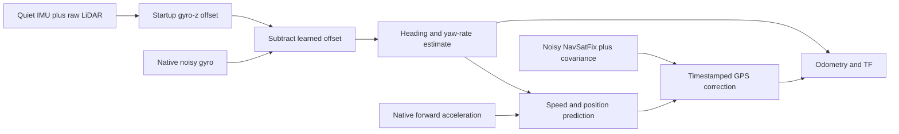

# Handoff: Gazebo IMU, GPS, heading drift and stationary jitter

Snapshot: **2026-11-14**, America/Chicago. Workspace:
`/home/black-book/lhre/autonomy/ros2`.

This is the continuation guide for the work that started with issue
[#171](https://github.com/LonghornRacingElectric/lhre/issues/171) and expanded
into IMU input fidelity, wheel-free estimation, cone-map distortion, GPS
fusion, heading jitter and live startup gyro calibration.

Read this file for the current state and next investigation. The adjacent
[experiment report](README.md) is the chronological evidence record. Its early
sections describe earlier configurations; later sections supersede statements
such as “live calibration is not integrated.” Do not treat every historical
result as a measurement of the current code.

## New continuation checkpoint (2026-11-14)

The sensor-verified stationary correction is now implemented as an experimental
opt-in and enabled by the gyro-heading visual wrapper. Fresh headless stationary
and moving captures plus 412 passing software tests are documented in the
[continuation results](README.md#sensor-verified-stationary-correction).
Post-confirmation temporal position scatter p95 fell from 0.402 m to 0.066 m,
and maximum false speed from 0.947 m/s to 0.009 m/s. The moving control released
all stationary corrections before physical motion and ran to 30 s without an
armed emergency or observed cone contact. This is not a full-lap/gate or
physical-car pass; moving error, uncertain heading and map consistency remain.
The sections below preserve the earlier checkpoint and its evidence.

## 1. Current status and continuation point

**Implemented and simulator-tested:** native Gazebo gyro/accelerometer noise
and startup bias, force-based wheel actuation, physics-rate IMU acquisition,
sample-timed EKF propagation, optional delayed GPS position fusion, selective
GPS angular gain, and optional live stationary startup gyro-z calibration.
A visual recipe now calibrates the gyro first, uses corrected gyro rate for
heading, and retains GPS position/speed correction.

**Still unresolved:** visible position/velocity jitter at rest, acceleration
bias and attitude/gravity effects, long-term bias drift, uncertain starting
heading in gyro-only mode, persistent-map consistency, and safety-freshness
stops. The latest live moving experiment ended on **ODOM_STALE**. There is no
successful full-lap/gate or physical-car validation for the new profile.

The last user observation was that jitter remains “in all directions.” The
user correctly expects EKF fusion to average/smooth IMU prediction and GPS to
some extent. We explained that the current filter still permits false motion:
startup calibration removes gyro bias, but there is no ongoing independent
zero-velocity correction. Both a drifting inertial prediction and noisy GPS
can therefore move the fused position.

**The user's actual latest visual session has not been recorded or inspected.**
Do not claim its remaining jitter is definitively only horizontal translation.
Our saved calibrated-profile test had maximum heading error below 0.016° at
rest and essentially zero GPS-induced yaw change, while position error reached
0.649 m and estimated speed reached 1.016 m/s despite zero physical motion.
If the user's view also rotates noticeably or moves vertically, verify the
actual parameters, publishers, TF and viewer frame before assigning the same
cause. This EKF is planar and publishes z=0 with yaw-only orientation.

The most useful next task is to **measure the remaining position jitter and
false velocity**, separating estimator movement from raw cloud flicker,
physical vehicle motion and viewer/camera behavior. Do not restart the
heading-bias diagnosis as though no work exists.

## 2. User intent, decisions and boundaries

The user wants:

- Sensor realism sized from the intended car IMU, with verifiable comparisons.
- A solution reproducible on the car, not simulator truth injected into the
  estimator as an ongoing correction.
- No reliance on real-car wheel-speed measurements; they are unreliable.
- Incremental hypotheses, experiments, results and progress updates. If an
  experiment blocks, explain the evidence instead of continuing blindly.
- Input requests when a real design decision or missing fact requires them.
- A concrete script for visual inspection, not only offline improvements.

Accepted decisions:

1. Use **native Gazebo noise/bias** first; a separate IMU fault-processing node
   was not selected.
2. Wheel fusion is off by default. The legacy override is diagnostic only.
3. GPS became explicitly authorized after earlier work tried to proceed
   without it. Do not retain the obsolete “GPS is prohibited” interpretation.
4. When asked about real-car initial heading, the user selected **“Test with
   uncertain starting heading.”** Policy comparisons therefore include
   assumed ±10° starting errors.
5. The user then requested a gyro-only-heading/GPS-position visual experiment
   “just as an idea.” That experiment uses the normal accurate Gazebo
   starting-pose seed; it does not solve the uncertain-heading requirement.
6. The root cause of the separate **LIDAR_STALE** safety issue was explicitly
   deferred. Record relevant failures, but do not silently expand into a
   general LiDAR-stale investigation.

No external messages, PR publication, deployment, commits or pushes were
requested as part of the latest work.

## 3. Repository and environment state

Checked at the start of this handoff pass:

| Item | State |
| --- | --- |
| Branch | `koa/gazebo-imu-noise` |
| HEAD | `da9d5a95a9a49679a05c5a313432dfb8a55626dd` |
| Worktree | Many modified and untracked files; implementation is not represented by HEAD alone |
| Earlier preserved prototype | `koa/mid360-hybrid-prototype` at `53bcae0a1f100a7614a9332061f23925f26c8b0b` |
| Supported runtime | Ubuntu 24.04, ROS 2 Jazzy, Gazebo Harmonic; diagnostic Gazebo version 8.15.0/DART |
| Workspace build | `./scripts/build.sh` / colcon, **not Bazel** |

The earlier branch was preserved before main was fast-forwarded. No new fetch
was performed for this handoff; do not infer that current HEAD is still the
latest remote main.

**Preserve untracked files as well as tracked edits.** Important implementation
files, tests, scripts and the whole test campaign are currently untracked.
A diff of tracked files or a bare commit ID is not a complete backup. Do not
run destructive reset/clean/stash-drop operations. Ignored recordings are
separate from source preservation and must not be committed.

Read the current root/autonomy AGENTS instructions and the relevant package
READMEs before changes. Important conventions:

- Vehicle dimensions, mounts and sensor settings come from
  `src/lhr_vehicle/config/vehicle.yaml` through `load_vehicle()`.
- Both Gazebo vehicle SDFs are generated; edit YAML/templates, regenerate both.
- Behavior changes need adjacent README changes.
- New node parameters used in Gazebo need typed launch forwarding in every
  applicable perception branch, plus actual node-startup checks for defaults
  and overrides.
- New documentation pages need root MkDocs navigation; strict docs must pass.
- Raw MCAP/bags/sensor traces remain under ignored `ros2/data/`; retained
  summaries, selected figures and scripts belong in testing.
- Use Bash when sourcing ROS `.bash` setup files. `/usr/bin/python3` and
  `/usr/bin` first in PATH avoid the prior pyenv/Python ABI issue.
- Use isolated `ROS_DOMAIN_ID` and `GZ_PARTITION` values for experiments. Stop
  only owned processes; do not globally kill Gazebo or ROS processes.
- The agent verified headless execution. GUI rendering remains a user check.

## 4. Original #171 scope and result

The original fidelity defect was real: Gazebo's physics IMU had no SDF noise,
while `inertial_sim` had `publish_imu=False` under Gazebo. Its synthetic IMU
noise and `gyro_bias` therefore did not affect the EKF input, even though the
metrics row recorded a bias setting.

Implemented:

- Native independent noise and startup bias on all three gyro and all three
  accelerometer axes, generated from canonical vehicle configuration.
- `gyro_bias:=` now reaches the **actual native z gyro** as an additional
  signed mean offset. It is separate from startup bias calibration.
- `imu_noise:=false` zeros nominal native noise/startup bias for controls;
  an explicitly requested `gyro_bias` fault remains independent.
- Both standard/stereo vehicle models are regenerated and freshness-tested.
- Metrics and source/data manifests retain relevant settings and provenance.

The model uses Livox's ICM40609 identification and a TDK ICM-40609-D component
specification approximation. The exact donated unit's chip suffix, firmware
filtering and residual calibration are not established. Applying a datasheet
noise model is **not** physical sensor calibration.

Historical wheel-assisted diagnostic maximum position errors:

| Course | Noise-free maximum | Native noisy maximum |
| --- | ---: | ---: |
| Autocross seed 1 | 0.0380 m, early emergency | 2.2968 m |
| Autocross seed 2 | 0.0526 m, completed lap | 1.8708 m, completed lap |
| Autocross seed 3 | 0.0553 m | 8.1924 m, invalid lap/contact |
| Acceleration | 0.0577 m | 3.2772 m |

These are a bounded historical campaign, not the current wheel-free/GPS
profile. It used the legacy wheel correction and a 1.5 s LiDAR timeout.
Native noise exposed failures of the **0.5 m maximum-position-error** gate.
Noise configuration and comparative reruns do not mean the resulting
estimator passes the gate. See [original results](README.md#results).

## 5. Earlier IMU/plant problems that were fixed

### 5.1 Wheel feedback removed from normal estimation

`use_wheel_speeds:=false` is the EKF/demo default. The EKF creates no wheel
subscription, and Gazebo omits the truth-derived wheel sensor publisher.
`true` retains the old comparison. Do not restore it as a real-car fix.
Actuation controllers still use their own simulated joint feedback; that is
separate from estimator wheel-speed fusion.

### 5.2 Missing acceleration was a plant/sampling issue, not a bridge conversion

The direct joint-velocity plant produced narrow physics acceleration pulses
that a synchronized 100 Hz IMU could miss. In a fixed diagnostic interval:

- Independent acceleration was about 1.00000004 m/s².
- Direct-velocity, 100 Hz IMU integrated to about 0.00000065 m/s².
- The same direct-velocity plant at 1000 Hz recovered about 1.00000005 m/s².
- Native and ROS six-axis values matched exactly at common timestamps.

Force-based wheel velocity PID recovered a much smoother acceleration signal.
Canonical assumed tuning is P=10 N·m·s/rad and symmetric ±100 N·m per wheel;
these are simulator settings, not measured motor limits. Standard-world
checks retained native noise and verified acceleration, braking and turns.
Some approximately 1.5% straight-line discrepancy remained; attitude/gravity
and sensor-mount effects were not fully separated.

### 5.3 Physics-rate acquisition and sample-timed EKF

A later stop/collision investigation found that even force-based actuation
could produce sharp impulses, and a publish-rate EKF could discard samples.
Current behavior:

- Native IMU runs at **1000 Hz**, matching the 1 ms physics step.
- Every ordered IMU timestamp advances prediction; odometry/TF output is 50 Hz.
- Forward acceleration uses trapezoidal interval integration.
- Duplicate/out-of-order samples are ignored; large gaps are warned about.
- IMU dropouts retain the last sensor timestamp rather than repeatedly
  integrating stale acceleration as though it were fresh.
- Process covariance uses continuous-time intensities, avoiding artificial
  confidence changes caused solely by prediction subdivision.

Noise density was preserved when acquisition changed: assumed bandwidth went
from 50 to 500 Hz and per-sample sigma increased by sqrt(10). The current
expected white sigmas are about 0.0017562 rad/s gyro and 0.0219283 m/s² accel.
This is a simulator acquisition choice, not a claim that Mid-360 outputs an
identical 1000 Hz/500 Hz stream.

**Increasing Hz did not remove inertial drift.** In a controlled stopped-car
window, physics position spanned only 0.00203 m while the EKF accumulated
8.745 m of estimated travel. Mean raw forward acceleration was −0.02684 m/s².
See [input diagnosis](README.md#acceleration-path-diagnosis),
[actuation fix](README.md#force-based-actuation-fix), and
[rate/timing work](README.md#physics-rate-imu-and-sample-timed-ekf).

### 5.4 GUI crash and misleading final SIGKILL message

The supplied crash trace ended in Qt font layout (`QFontEngineMulti`) and
Fontconfig (`FcCharSetHasChar`), followed by a segmentation fault. The later
`Escalating to SIGKILL on [Gazebo Sim Server]` message was server cleanup
after the GUI failed; it was not evidence that IMU noise killed the server.
The same log also had EGL warnings, but those do not establish the cause of
the font-stack crash.

The launch now scopes a packaged Fontconfig configuration to Gazebo. It scans
system fonts, uses the XDG font cache and avoids importing user font/matching
rules through the system `fonts.conf`. An explicit `FONTCONFIG_FILE` overrides
that protection. The visual wrapper unsets that override and `WAYLAND_DISPLAY`,
selects `QT_QPA_PLATFORM=xcb`, and puts `/usr/bin` first in PATH. Existing GUI
environment tests cover the configuration; a successful desktop GUI session
was not independently verified by the agent. See the
[Gazebo environment notes](../../ros2/src/lhr_gazebo/README.md).

## 6. Current estimation pipeline

The filter state is `[x, y, yaw, longitudinal_speed, yaw_rate]`.
It has no lateral-velocity, gyro-bias or accelerometer-bias state.



The diagram describes the latest gyro-only-heading recipe. The ordinary
launch defaults remain different:

| Setting | General Gazebo launch | `run_gyro_heading_demo.sh` |
| --- | --- | --- |
| `estimator` | truth | ekf |
| `use_wheel_speeds` | false | false |
| `imu_noise` | true | true |
| `use_gnss` | false | true |
| `simulate_gnss` | true, inactive unless enabled | true |
| `calibrate_gyro` | false | true |
| `gnss_heading_gain` | 1.0 | 0.0 |
| `yaw_rate_variance` | 0.0004 (rad/s)² | same |

The usual Gazebo EKF receives **one initial truth pose** as the surveyed-start
proxy. It does not continuously fuse truth odometry. Its perfect simulated
IMU orientation quaternion is not used for heading. Physics truth remains
available for metrics/independent diagnosis.

After successful startup calibration, corrected gyro rate advances heading,
and raw forward acceleration advances speed/position. GPS provides position
measurements, not an absolute heading or direct velocity measurement. Its
position update can correct correlated speed. With angular gain zero, GPS
cannot change yaw or yaw rate; actual gyro turns still change heading.

Remaining acceleration bias, gravity projection, roll/pitch and IMU lever-arm
terms are not corrected. The initial pose is assumed valid and held still
through calibration. Gyro-only heading preserves an initial heading error and
cannot correct later thermal drift.

## 7. GPS implementation and hardware provenance

### 7.1 Sensor model and coordinate system

- Standard input: `sensor_msgs/NavSatFix`, default `/lhr/gnss/fix`.
- Fixed WGS84 datum converted to local ENU; map x=east, y=north, z=up.
- Simulation datum 0/0/0 is synthetic, not the actual track coordinates.
- Virtual antenna is at `base_link`, not a surveyed physical antenna mount.
- Simulator defaults: 50 Hz, **0.8 m independent per-axis horizontal sigma**,
  1.2 m vertical sigma, 50 ms delivery latency.
- These accuracy/latency values are **assumptions**. The 0.05 m RTK-like
  comparison is also assumed, not a verified receiver specification.
- The model adds independent white ENU error and reports its covariance.
  Multipath, colored/correlated errors, outages and RTK convergence are absent.
- Only distinct plant samples are used. Asking for 100 Hz from 50 Hz truth
  does not fabricate fresh 100 Hz measurements.
- The planar EKF fuses horizontal coordinates only. Antenna compensation in
  the filter is planar; full attitude-dependent lever-arm handling is absent.

Repository evidence: telemetry notes mention LocusLock 10/50/100 Hz support
and a 50 Hz experiment. BEVO parses full-precision `$PPOS` position, horizontal
uncertainty, standard/RTK source and UTC fix time. Its checked-in example has
`sigma_h=0.792 m`, source 1. That example does not establish a guaranteed
accuracy or independent per-axis covariance. The on-car plan still lists
receiver/ROS driver and heading integration questions as unresolved.

There is **no physical receiver or BEVO-to-NavSatFix adapter in this work**.
Hardware use still needs timestamp validation, actual measurement covariance,
a surveyed mount/datum, heading initialization and real recordings.

### 7.2 Delayed correction and rejection

The EKF saves a bounded IMU history, normally 1 s. A delayed fix is applied at
its measurement timestamp, then subsequent corrected IMU prediction/gyro
updates are replayed to the current sensor time. Header timestamps are not
replaced by receipt time. Previously published TF and accumulated map points
are not rewritten.

Known horizontal covariance must be finite, symmetric and positive definite.
The configured antenna frame must match. No-fix/unknown-covariance, malformed,
duplicate/reordered, too-old, far-future and innovation-gated fixes are rejected.
The default squared Mahalanobis innovation gate is 25. Missing fixes leave
ordinary inertial propagation; there is no truth fallback.

GNSS and legacy wheel fusion cannot be enabled together: the delayed history
replays IMU events, not intervening wheel corrections.

### 7.3 Selective angular gain

`gnss_heading_gain` scales the yaw **and yaw-rate** Kalman gain rows. Position
and speed gain rows and GPS measurement covariance are unscaled at that
update; future position estimates can differ through coupled dynamics.
Joseph covariance uses the same modified gain. Do not replace this with
“restore yaw after correction” while keeping an incompatible covariance.
Default 1 preserves existing update behavior; 0 isolates heading from GPS.
A fractional constant gain is a non-optimal diagnostic policy, not a validated
motion-aware estimator. Tests verify default equivalence, state behavior,
positive covariance in coupled cases and preservation of actual gyro turns.

## 8. Live startup gyro calibration

The calibration module consumes raw angular velocity, acceleration and raw
XYZ LiDAR. It does **not** use the ideal IMU quaternion, GPS, truth or a
cone-map pose to fit the offset. LiDAR is used only to verify startup stillness;
there is no ongoing LiDAR localization update while driving.

Sequence:

1. Wait for initialization and a 2 s settling interval.
2. Start a candidate raw-scene anchor and collect a contiguous minimum 3 s
   window of quiet IMU and stable LiDAR observations.
3. Verify point geometry, registration quality, motion, sample coverage and
   fresh relative IMU/cloud timestamps.
4. Estimate the gyro-z mean; freeze that offset for the launch.
5. Publish calibration-ready status. Only then publish estimated odometry/TF.
6. Use the offset-subtracted gyro for both live updates and delayed replay.

No uncalibrated estimated pose is published and later retroactively reset.
In the supplied LiDAR/safety recipe, this also delays path initialization and
normal mission progression until calibration passes.

| Startup parameter | Default |
| --- | --- |
| `calibrate_gyro` | false |
| `gyro_calibration_duration_s` | 3.0 |
| `gyro_calibration_settle_s` | 2.0 |
| `gyro_calibration_timeout_s` | 15.0 |
| `gyro_calibration_max_gap_s` | 0.25 |
| `gyro_calibration_max_translation_m` | 0.03 |
| `gyro_calibration_max_yaw_deg` | 0.15 |
| `gyro_calibration_max_gyro_std_rad_s` | 0.01 |
| `gyro_calibration_max_accel_std_m_s2` | 0.15 |
| `gyro_calibration_max_gyro_mean_rad_s` | 0.03 |
| `gyro_calibration_min_samples` | 200 |
| `gyro_calibration_min_lidar_points` | 30 |
| `gyro_calibration_lidar_topic` | `/lhr/lidar/points` |
| `gyro_calibration_lidar_qos` | reliable |

The scan check uses canonical mounting/body dimensions; a base-height band
0.05–0.55 m and sensor range 0.8–20 m; 0.08 m planar downsampling; at least
70% correspondences within 0.3 m; post-fit p90 residual <=0.08 m; and both
planar geometry covariance eigenvalues >=0.1 m². At least three clouds are
required. These are provisional guards, not physical-car certification.

A sensor gap discards the candidate and requires a fresh complete window
within the original deadline. Detected motion, poor registration, frame
changes, nonfinite/noisy IMU, excessive mean rate or timeout fail closed and
require restart. Geometry ambiguity, dynamic clutter, motion below thresholds
and motion before the monitored interval remain limitations. The operator
must hold the vehicle still with a valid initial pose through startup.

Status is `/lhr/state_estimation/gyro_calibration`, a reliable transient-local
JSON String with state, reason, restarts, stamps and ready-window statistics.
The terminal prints `Gyro calibration ready` with the learned offset. The
calibration cloud subscription is removed after success.

Two early live attempts failed: best-effort depth-5 LiDAR delivery caused gaps,
then repeated candidate restarts/timeouts. All scans existed in the recorder;
replaying the same messages through the node succeeded with roughly 2 ms per
cloud. The final Gazebo profile uses **reliable delivery, depth 50**, matching
the bridge. Motion/freshness thresholds were not loosened. A `sensor_data`
option is exposed for actual best-effort hardware publishers. Late/stale
scene evidence still cannot release calibration.

## 9. Experiments and findings

### 9.1 Cone-path mismatch before GPS

The user saw a vehicle centered in the displayed path but physically close
to cones. Seed-3 tests found time-varying localization error corrupting the
persistent map:

- Noisy wheel-free EKF contacted `cone_yellow_54` at 23.329 s, 66.686 m progress.
- Truth-localization control progressed 101.589 m in 30 s with no observed
  cone contact; contact probe activity was independently checked.
- Identical-cloud physics-pose replay kept local map p95 below 0.0651 m;
  EKF/persistent mapping reached 5.3267 m before risk overlap.
- EKF current-scan-only replay stayed below 0.0761 m.
- A constant rigid rotation/translation cancelled in relative geometry.
- Roughly 49% of checked persistent EKF associations had the wrong physical
  birth identity, versus <0.1% in the physics-pose control.

Physical identities were analysis labels only. The live mapper never
received truth identities. Its running-average map does not re-register old
observations when localization changes. See
[cone-path study](README.md#cone-path-causal-study).

### 9.2 Initial GPS comparisons

Equal physical route section, 1–6 m before contact:

| Profile | Mean position error | Maximum position error |
| --- | ---: | ---: |
| Retained IMU-only baseline | 1.253 m | 1.560 m |
| Assumed 0.8 m GPS sigma | 0.237 m | 0.649 m |
| Assumed 0.05 m GPS sigma | 0.030 m | 0.074 m |

Both GPS runs still contacted cones. The baseline was retained from an older
capture, not freshly rerun beside them; these are diagnostic single trials,
not statistical collision-performance evidence. The tighter-profile run
later rejected large post-contact innovations and diverged; gating was not
loosened to force acceptance. Accurate position did not fix historical map
distortion or supply stationary heading.

### 9.3 Stationary hypothesis was reproduced

Four fresh captures used seed 3: two 0.8 m GPS repetitions, one assumed 0.05 m
GPS profile, and one GPS-off control. Physics and commands independently
confirmed zero motion over 2–20 s.

| Profile | Raw return ROI scatter p95 | Sensor-frame centroid scatter p95 | EKF-registered centroid scatter p95 | Maximum heading error |
| --- | ---: | ---: | ---: | ---: |
| GPS 0.8 m, repeat 1 | 0.0183 m | 0.0317 m | 1.687 m | 9.59° |
| GPS 0.8 m, repeat 2 | 0.0180 m | 0.0316 m | 1.821 m | 8.87° |
| Assumed 0.05 m GPS | 0.0175 m | 0.0303 m | 3.155 m | 13.53° |
| GPS off | 0.0186 m | 0.0315 m | 3.075 m | 9.03° |

Raw returns were fairly stable; estimated registration and persistence made
the large distortion. Default repeat-1 EKF replay accumulated 48 map entries
versus 27 with fixed/physics registration, including 21 excess entries with
duplicate physical birth identities. A near-truth duplicate metric alone
misses displaced replicas. Live and replay counts differ because the live
node can skip clouds; identical-input replay is a controlled counterfactual,
not an exact scheduling reconstruction.

Stationary gyro-z mean was about **−0.454°/s**, roughly −8.2° integrated over
18 s. That explains a steady component, but not the entire GPS-on wobble.
Detection at rest is useful for initial path construction; it was not disabled
as the proposed fix. See [stationary controls](README.md#stationary-cone-registration-experiment).

### 9.4 GPS caused heading jumps through covariance coupling

A fresh instrumented stationary run directly logged before/after historical
and current-time correction states. In 600 accepted fixes over 8–20 s:

| Actual live quantity | Result |
| --- | ---: |
| Median absolute heading change per GPS correction | 0.186° |
| p95 change | 0.903° |
| Maximum change | 1.968° |
| Changes exceeding 0.1° | 400 / 600 |
| Maximum absolute estimated speed before a correction | 1.016 m/s, despite zero physics speed |
| Nonzero yaw–position cross-covariance | 600 / 600 |

This is a measured cause, not only correlation between plotted streams.
Position-only GPS changed yaw even with zero antenna lever arm. The IMU-only
heading error grew smoothly; GPS-on heading error repeatedly reversed.

Offline gyro-offset subtraction reduced no-GPS maximum heading error from
6.803° to 0.036° on held-out 8–20 s samples, but GPS-on wobble persisted.
Subtracting a stationary forward-acceleration mean also did not fix it; that
was a fixed-attitude diagnostic, not a valid general accelerometer calibration.

Replay fidelity mattered: the ROS bag missed some startup IMUs. Complete
native samples matched every recorded ROS counterpart exactly. Using the
complete native stream reproduced the original live heading within 0.00263°
at 600 checked noncoincident timestamps. Earlier incomplete-input replay
results were retained as intermediate attempts, not trusted as exact live
reconstruction. See [attribution](README.md#gps-heading-jitter-attribution).

### 9.5 Gyro confidence versus limiting GPS angular gain

120 comparisons used recorded stationary/moving data plus straight and
slow-turn synthetic controls at seeds 3/7/11, with 0/−10/+10° initial errors.
All policies used the same offline gyro-offset subtraction. “Default gyro”
means default measurement variance, not uncalibrated input.

Measured gyro variance was 3.1844e-6 (rad/s)², versus the 4e-4 default: about
126 times more confidence. This barely affected stationary yaw wobble.

| Policy | Recorded stationary heading error p95 | Recorded moving final-2-s mean heading error with initial +10° | Median synthetic ±10° recovery time |
| --- | ---: | ---: | ---: |
| Default gyro variance, GPS angular gain 1 | 9.537° | 0.551° | 4.4 s |
| Measured gyro variance, gain 1 | 9.536° | 0.551° | 4.4 s |
| Measured gyro variance, gain 0.25 | 4.389° | 2.915° | 8.1 s |
| Measured gyro variance, gain 0.1 | 2.210° | 5.487° | 18.6 s |
| Measured gyro variance, gain 0 | 0.035° | 10.000° | No recovery in test window |

Synthetic recovery means two continuous seconds within 2° after motion starts
at 7 s; it is not the car gate. Synthetic controls are ideal planar models,
not vehicle/physical validation. They exclude slip and attitude dynamics.

Lower constant angular gain improves stationary smoothness but delays heading
recovery. Zero gain preserves an initial error. Therefore no low constant
value was selected as a new general default. Motion-aware gain remains
unimplemented. See [policy comparison](README.md#gyro-confidence-and-gps-heading-gain-comparison).

### 9.6 Latest live gyro-heading/GPS-position profile

Successful stationary and moving runs both calibrated over 2.5–5.5 s using
31 clouds and 3001 IMUs, with zero candidate restarts. Physics independently
verified no motion during calibration.

| Measurement | Stationary live | Moving live |
| --- | ---: | ---: |
| Learned gyro-z bias | −0.0079388825 rad/s | −0.0079296533 rad/s |
| First published odometry stamp | 5.518 s | 5.539 s |
| Heading error p95, 8–20 s | 0.0112° | 0.0138° |
| Maximum heading error, 8–20 s | 0.0155° | 0.0186° |
| Maximum heading change from a GPS correction | 1.02e-13° roundoff | 0° |
| GPS corrections checked in that window | 577 | 597 |

The moving run started DRIVING around 12.601 s. Its full recorded heading
error also stayed below 0.0186°. It covered **62.903 m** of truth-scored
route progress with **no observed native cone contact**, then entered
EMERGENCY on **ODOM_STALE** around 27.9 s. Partial-run mean/max position error
was **0.2548 / 0.9342 m**. This is not a full-lap or 0.5 m gate pass.
Contact probes delivered approximately 120,000 messages per successful
capture; “no observed cone contact” was not inferred from an inactive probe.

The stationary run later entered EMERGENCY on **CMD_STALE** around 14.547 s
while physically stationary. Safety checks/timeouts were not disabled to make
these outcomes disappear. Early live ODOM_STALE indications during calibration
are distinct from an armed safety trip: odometry is deliberately withheld then.

Remaining stationary position/velocity errors:

- Position-error median 0.150 m, p95 **0.407 m**, maximum **0.649 m**.
- Estimated speed before a GPS update reached **1.016 m/s**, physics speed zero.
- Persistent map had 28 maximum entries, no excess birth-identity duplicates;
  median frame local p95 error was 0.196 m, versus 0.096 m with physics
  registration and 0.053 m with only the current scan.

These position-error figures measure accuracy against truth, **not the
amplitude or standard deviation of visible jitter**. Do not interchange them.
The profile removes the demonstrated angular wobble but does not stabilize
the entire position/velocity model. See [live profile](README.md#live-calibrated-gyro-heading-and-gps-position-visual-profile).

## 10. What does not work, and what has not been implemented

| Approach / assumption | Finding or current limitation |
| --- | --- |
| Datasheet alignment alone | Makes the simulator less perfect; does not calibrate a particular physical IMU |
| Old synthetic `gyro_bias` under Gazebo | Did not affect the physics IMU; native wiring is now fixed |
| Raw direct-velocity plant at 100 Hz | Can alias essentially all acceleration pulses; plant/rate/timing changes addressed this |
| Higher IMU Hz alone | Does not remove bias or establish zero velocity after a stop |
| Earlier offline calibration | Improved replay only; it was not live until the later startup-calibration implementation |
| GPS position fusion alone | Reduced position error but did not supply stationary heading or repair map history |
| Higher gyro confidence alone | Barely reduced the measured GPS-on yaw wobble |
| Permanently zero GPS angular gain | Stable calibrated short-term heading, but no initial-heading recovery or later GPS heading aiding |
| Small fixed angular gain | A stationary/recovery tradeoff; not an adaptive solution |
| Fixed stationary forward-acceleration subtraction | Did not eliminate wobble; combines gravity and bias at one attitude |
| Stop cone detection at rest | Not implemented; initial detection is needed and raw returns were fairly stable |
| Increase association radius as the fix | Not established; can hide map splitting and create incorrect associations |
| Startup stillness check as ongoing stop detector | Not implemented; calibration stops checking after success and its subscription is removed |
| Zero command / quiet acceleration proves zero velocity | Invalid for coasting or steady translation |
| Ongoing zero-velocity updates | Absent |
| Continuous gyro/accelerometer bias states | Absent |
| Full gravity/attitude/IMU lever-arm correction | Absent |
| Ongoing LiDAR/cone-map localization correction | Absent; LiDAR is only startup evidence in this estimator path |
| Retrospective cone-map re-registration | Absent |
| Real GPS adapter and measured covariance | Absent |
| Real-car calibration, GUI rendering sign-off, complete gate | Not established by these tests |

The physical IMU combines gyro and accelerometer; these are not two separate
position sensors. Gyro-only heading also is not an absolute compass heading.

## 11. Current open problem: why fused position can still jitter

The user expects fusion to smooth two estimates. That expectation is valid,
but the IMU contributes a propagated position/speed estimate rather than an
independent absolute position measurement. Acceleration bias is integrated,
process uncertainty grows, and GPS measurements are noisy.

A scalar illustration of a Kalman correction is:

```text
position_after = position_prediction + K * (GPS_position - position_prediction)
```

A 20% correction toward a GPS reading 0.5 m away still moves the estimate
0.1 m. That is an illustration, not the measured gain of this implementation.
The current EKF continuously allows motion and has no independent stationary
velocity constraint after startup. GPS can also modify velocity through
cross-covariance, creating a prediction/correction cycle with false motion.

This is a supported explanation for remaining horizontal movement, **not a
complete attribution of the user's current all-direction visual jitter**.
We have not yet measured actual position-gain rows, separated every inertial
and GPS contribution, or inspected their latest viewer session. Do not claim
that all remaining movement is inevitable or that the covariance tuning is
proven optimal.

Current notable tuning:

- `sigma_accel=1.0` and `sigma_yaw_accel=1.0` are square roots of continuous
  process-noise spectral intensities, not per-step IMU noise standard deviations.
- `yaw_rate_variance=0.0004` is the gyro measurement variance in (rad/s)².
- GPS uses each fix's horizontal ENU covariance; the default simulated
  diagonal entries are 0.64 m².
- Initial covariance diagonal is `[1, 1, 0.1, 0.1, 0.1]` for the five states.
- Fixed gyro-offset uncertainty is not represented by a separate bias state.

Do not make heading look certain by arbitrarily shrinking its initial
covariance. Do not weaken all GPS position information just to suppress a
heading defect that already has a separate experimental control.

## 12. Recommended next steps, in order

### Step A: reproduce and classify the user's actual visual behavior

1. Confirm the exact wrapper/command, seed and displayed topics/frames.
2. Read runtime parameters: calibration enabled, GNSS enabled, angular gain 0,
   wheel fusion off. Confirm calibration-ready status.
3. Check that one estimator owns estimated odometry/TF; continuous truth must
   remain remapped to the truth topics, with only one initial pose seed.
4. Record estimated and truth odometry, IMU, GPS fixes/status, calibration
   status, commands, mission/safety status, cloud/cone markers and, for the
   actual viewer/TF question, `/tf` and `/tf_static`.
5. Distinguish XY translation, yaw rotation, Z/roll/pitch, raw point flicker,
   map-history movement and a camera-follow effect. The existing recorder
   does not record every TF topic; extend it explicitly if needed.

If yaw visibly rotates despite reported angular gain 0, compare numerical yaw
and actual GPS update deltas. If vertical motion appears, it is not an EKF Z
state in this planar implementation; inspect the correct display/physics/TF
source. Do not simply attribute either to GPS XY noise.

### Step B: quantify position/velocity fusion before changing it

Log prediction and correction states, position/velocity Kalman gain rows,
innovation/NIS, covariance diagonals/cross terms and sensor timestamps.
Compute temporal spread and per-update displacement separately from truth
error. Check for stale/bursty delivery and dropped recorded samples before
calling a replay exact. Preserve the actual GPS covariance and noise profile.

Compare changes on identical inputs and fixed windows. If testing process
noise or GPS weighting, report both smoothness and true position/speed error;
a smooth but wrong trajectory is not success. New runtime controls must be
forwarded through Gazebo with explicit types and startup checks.

### Step C: test a sensor-verified stationary correction

Prototype independent motion confidence, likely using raw LiDAR relative
motion plus IMU statistics, with hysteresis and freshness checks. Then test a
zero-velocity update while stationary. Do not use the already-false EKF speed,
a zero throttle command or small accelerometer magnitude as the sole gate.
The startup verifier is useful scaffolding, not a validated driving stop detector.

Counterexamples must include slow real translation, slow turns, coasting,
start/stop transitions, impacts, sparse/symmetric scenes and sensor dropout.
Do not silently clamp real motion. Separate an experimental fixed-attitude
accel offset from proper gravity/attitude and bias-state treatment.

### Step D: return to heading alignment and map consistency

The user requires uncertain starting-heading tests. A gyro-only visual mode
cannot meet that requirement by itself. Explore motion-dependent heading
information or a validated survey/alignment source while preserving real
turns and consistent covariance. GPS travel direction is not necessarily
vehicle body heading during slip.

Persistent map observations also need a retention/re-registration policy or
consistent local-frame design. Merely naming frames `map` and `odom` does not
remove inertial drift or fix old landmarks. Repeat identical-cloud controls
and then matched live runs across seeds before driving-success claims.

### Step E: validate the complete run and handle freshness failures separately

Keep ODOM_STALE, CMD_STALE, cone contacts, position errors and lap outcomes
separate. Do not disable safety checks or loosen thresholds to turn failures
into a pass without an explicit experiment and rationale. Respect the deferred
LIDAR_STALE root-cause scope. A successful heading experiment is not a clean
full run, and a clean partial trajectory is not a maximum-error gate pass.

## 13. Reproduction commands

### Visual test

The script is Bash-based and loads the ROS/workspace environment itself:

```bash
cd /home/black-book/lhre/autonomy/ros2
./scripts/build.sh
./scripts/run_gyro_heading_demo.sh
```

For stationary inspection:

```bash
./scripts/run_gyro_heading_demo.sh auto_go:=false
```

For the same wrapper headlessly:

```bash
./scripts/run_gyro_heading_demo.sh gui:=false rviz:=false foxglove:=false auto_go:=false
```

The recipe uses GUI/RViz/Foxglove by default, native noise, seed 3, LiDAR,
EKF, wheel fusion off, GPS on, calibration on, angular gain 0, safety on,
LiDAR timeout 1.5 s and `data/gyro-heading-visual.csv`. Trailing args override
these values. Changing angular gain back to 1 is a different experiment.
The initial missing estimated TF/map is expected while calibration is pending.
Wait for the calibration-ready log before expecting normal estimated displays.

### Runtime sanity checks

In another correctly sourced shell using the same ROS domain:

```bash
ros2 param get /ekf_node calibrate_gyro
ros2 param get /ekf_node gnss_heading_gain
ros2 param get /ekf_node use_gnss
ros2 param get /ekf_node use_wheel_speeds
ros2 topic echo /lhr/state_estimation/gyro_calibration --once --qos-durability transient_local
ros2 topic info /lhr/vehicle/odom --verbose
```

The expected recipe values are true, 0.0, true, false. The calibration status
must actually say ready; a parameter alone is not evidence it completed.

### Record fresh stationary and moving experiments

Use Bash for these setup files, fresh output directories, and isolated domains.
Never overwrite a retained attempt just to make a command succeed.

```bash
bash
cd /home/black-book/lhre/autonomy/ros2
source /opt/ros/jazzy/setup.bash
source install/setup.bash
export PATH="/usr/bin:$PATH"
export ROS_DOMAIN_ID=125 GZ_PARTITION=handoff-gyro-still
python3 src/lhr_gazebo/scripts/record_ekf_stop.py data/handoff-gyro-still-1 \
  --stationary --perception-study --gnss --calibrate-gyro \
  --gnss-heading-gain 0 --stop-sim-time 20
python3 src/lhr_gazebo/scripts/analyze_gyro_heading_demo.py \
  data/handoff-gyro-still-1 data/handoff-gyro-still-analysis-1

export ROS_DOMAIN_ID=127 GZ_PARTITION=handoff-gyro-moving
python3 src/lhr_gazebo/scripts/record_ekf_stop.py data/handoff-gyro-moving-1 \
  --perception-study --gnss --calibrate-gyro \
  --gnss-heading-gain 0 --stop-sim-time 30
python3 src/lhr_gazebo/scripts/analyze_gyro_heading_demo.py \
  data/handoff-gyro-moving-1 data/handoff-gyro-moving-analysis-1
```

The recorder has wall-time/disk bounds and owns its process groups. Sequential
parameter dumps can delay the stop check and extend a capture beyond its
requested simulation time; score declared fixed windows and inspect actual
end time. A stationary run may have no metrics CSV if it never reached DRIVING;
the live-profile analyzer handles that as unavailable lap data.

### Reproduce earlier comparisons if the local recordings still exist

```bash
python3 src/lhr_gazebo/scripts/audit_gnss_heading.py \
  data/heading-attribution/gps08-live data/handoff-heading-audit-1 --plot
python3 src/lhr_gazebo/scripts/compare_heading_policies.py \
  data/heading-attribution/gps08-live data/handoff-heading-policies-1 \
  --moving-capture data/gnss-study/standard-50hz --plot
```

The earlier analyzers have study-specific course/datum assumptions. Read their
adjacent [Gazebo guide](../../ros2/src/lhr_gazebo/README.md) before applying them
to a different track or coordinate system. Matplotlib is required for plots.

## 14. Code ownership and entry points

Paths below are relative to `autonomy/ros2`. Open them in this worktree; many
are uncommitted and are not represented by the current main branch online.

| Path | Purpose |
| --- | --- |
| `scripts/run_gyro_heading_demo.sh` | User's visual recipe; calibrated gyro heading and GPS position |
| `src/lhr_vehicle/config/vehicle.yaml` | Canonical physical/sensor configuration and assumed simulator drive tuning |
| `src/lhr_vehicle/lhr_vehicle/__init__.py` | Vehicle loader, IMU/GNSS configuration and validation |
| `src/lhr_gazebo/templates/model.sdf.in` | Native IMU/actuation model template |
| `src/lhr_gazebo/scripts/generate_vehicle_model.py` | Generates/checks both SDF variants |
| `src/lhr_gazebo/lhr_gazebo/imu_model.py` | Runtime native-noise/bias overlay controls |
| `src/lhr_gazebo/launch/gazebo_demo.launch.py` | Typed forwarding, sensor/estimator selection, metadata, startup controls |
| `src/lhr_state_estimation/lhr_state_estimation/ekf.py` | Five-state math, prediction/corrections, selective angular gain |
| `src/lhr_state_estimation/lhr_state_estimation/ekf_node.py` | Live sensor callbacks, calibration gate, corrected gyro use, odometry/TF/status |
| `src/lhr_state_estimation/lhr_state_estimation/gnss.py` | WGS84/ENU conversion, delayed correction history/replay and update diagnostics |
| `src/lhr_state_estimation/lhr_state_estimation/gyro_calibration.py` | Startup sensor evidence, scan registration, offset fit, failure/restart rules |
| `src/lhr_sensor_sim/lhr_sensor_sim/gnss_sim_node.py` | Noisy, delayed simulation-only NavSatFix; registered as `gnss_sim` |
| `src/lhr_metrics/lhr_metrics/metrics_node.py` | Truth-aligned scores and configuration metadata |
| `src/lhr_perception/lhr_perception/lidar_cone_detector.py` | Sensor filtering, scan registration, accumulated detections |
| `src/lhr_perception/lhr_perception/cone_map.py` | Association and running-average persistent landmarks |
| `src/lhr_gazebo/scripts/record_ekf_stop.py` | Bounded live capture, stationary/calibration/heading options, probes/contacts/parameters |
| `src/lhr_gazebo/scripts/analyze_gyro_heading_demo.py` | Latest live-profile calibration, pose, GPS-isolation and contact audit |
| `src/lhr_gazebo/scripts/analyze_stationary_cones.py` | Raw/fresh/map precision, same-cloud controls and independent stationarity audit |
| `src/lhr_gazebo/scripts/audit_gnss_heading.py` | Actual GPS jumps plus held-out calibration counterfactuals |
| `src/lhr_gazebo/scripts/compare_heading_policies.py` | Recorded/synthetic confidence/gain and initial-heading stress controls |
| `src/lhr_gazebo/scripts/analyze_cone_path.py` | Earlier map/association/path causal replay |
| `src/lhr_gazebo/scripts/analyze_gnss.py` | Study-specific GPS variance/rate/age and common-route error audit |
| `src/lhr_gazebo/scripts/record_imu_reference.py` | Earlier bounded native/reference capture and owned-group cleanup helper |
| `src/lhr_gazebo/scripts/check_imu_acceleration.py`, `analyze_ekf_stop.py`, `evaluate_imu_only.py` | Earlier input, stopped-car and offline calibration diagnostics |
| `src/lhr_gazebo/scripts/validate_imu.py`, `verify_imu_bags.py`, `compare_imu.py` | Native-noise checks, bag cross-checks and comparative reporting |

Package documentation:
[state estimation](../../ros2/src/lhr_state_estimation/README.md),
[Gazebo](../../ros2/src/lhr_gazebo/README.md),
[vehicle](../../ros2/src/lhr_vehicle/README.md),
[sensor simulation](../../ros2/src/lhr_sensor_sim/README.md),
[perception](../../ros2/src/lhr_perception/README.md),
[metrics](../../ros2/src/lhr_metrics/README.md).

Relevant tests include `test_ekf.py`, `test_imu_timing.py`, `test_gnss.py`,
`test_gnss_node.py`, `test_heading_gain.py`, `test_gyro_calibration.py`,
`test_live_gyro_calibration.py`, and Gazebo launch/model/analysis tests such as
`test_gnss_launch.py`, `test_heading_attribution.py`,
`test_heading_policy_controls.py`, `test_stationary_cone_analysis.py` and
`test_cone_path_analysis.py`.

## 15. Evidence and local recordings

The campaign directory contains chosen figures, comparison CSVs, summaries,
source/data manifests and `evidence-sha256.json`. JSON/CSV artifact names are
listed as plain filenames because raw/code/config links on the published site
must not use relative non-Markdown targets.

| Evidence family | Retained artifacts | Local raw/complete analysis location |
| --- | --- | --- |
| Native #171 | `manifest.json`, `comparison.csv`, clean/native gate tables, stationary checks, bag cross-checks | See original report's per-campaign paths |
| Input/actuation/timing | `acceleration-path-*`, `force-fix-*`, `stopped-car-*`, `hz1000-*`, IMU-only calibration summaries | Earlier diagnostic capture paths in their manifests |
| Cone-path study | `cone-path-manifest.json`, contact/control/repeat summaries, frame/comparison CSVs | `data/cone-path-study/`, especially `ekf-native-r4`, `truth-native-r2` |
| Initial GPS study | `gnss-manifest.json`, comparison, standard/RTK/baseline/map summaries | `data/gnss-study/standard-50hz`, `rtk-like-50hz` |
| Stationary registration | `stationary-manifest.json`, four run summaries, comparison, verification | `data/stationary-cone-study/` |
| GPS jump attribution | `heading-attribution-manifest.json`, summary, per-fix jumps, comparison, verification | `data/heading-attribution/gps08-live`, `final-analysis` |
| Angular-gain policies | `heading-policy-manifest.json`, comparison, sources and verification | `data/heading-policy-study/r1/` |
| Latest live profile | `live-gyro-manifest.json`, comparison, successful-run/map summaries, verification | `data/live-gyro-heading/` |

Latest successful raw captures: `stationary-r3` and `moving-r1`. Earlier
`stationary-r1/r2` retain calibration delivery failures. Final live-profile
analyses are `stationary-verified`, `moving-verified` and `stationary-map`.
The exact wrapper smoke log is `data/live-gyro-heading/script-smoke.log`.
Intermediate analyzer attempts remain in ignored data; select the final
analysis named by the manifest/report rather than an arbitrary older folder.

Source hashes in the latest live-profile manifest were rechecked against the
checkout when writing this handoff and matched. Older manifests intentionally
fingerprint historical code; do not rewrite them to pretend all results came
from the latest implementation. The master evidence hash file excludes itself.

Recordings are local and ignored; no SharePoint upload of these latest
campaign files has been verified. Their paths are not portable data access
links. If moved or lost, preserve/locate the raw data before promising exact
reproduction. `/tmp` logs are convenience output, not the durable evidence
source. The [testing rules](../README.md) govern archival/publication.

## 16. Validation and safe continuation checklist

Latest recorded software verification, before this documentation-only pass:

| Check | Result |
| --- | --- |
| Full colcon build | 16 packages passed |
| `lhr_state_estimation` | 63 tests passed |
| `lhr_gazebo` | 325 tests passed |
| `lhr_metrics` | 74 tests passed |
| Affected total | 462 tests passed, including lint |
| Exact visual-wrapper headless smoke | Calibration-ready and READY reached; bounded stop |
| Generated vehicle models | Covered by Gazebo freshness/schema tests |
| Bash wrapper syntax | Passed |
| Strict documentation | Passed for the live-profile checkpoint; rerun for this handoff |
| Latest source/evidence fingerprints | Previously verified; latest live source hashes rechecked in this pass |

Tests cover missing/noisy sensor evidence, known translation/rotation,
restart/timeout handling, learned offset, no premature odometry, corrected
delayed history, gyro-turn preservation, selective gain/covariance behavior,
invalid settings and real-node default/override startup in both perception
branches. They do not certify physical sensor calibration or vehicle driving.

Appropriate continuation checks:

```bash
./scripts/build.sh
colcon test --packages-select lhr_state_estimation lhr_gazebo lhr_metrics
colcon test-result --verbose
python3 src/lhr_gazebo/scripts/generate_vehicle_model.py --check
bash -n scripts/run_gyro_heading_demo.sh
```

Run strict docs from the repository root:

```bash
cd /home/black-book/lhre
uv run --group docs mkdocs build --strict --site-dir /tmp/lhre-imu-stop-docs
```

No software tests were needlessly rerun just to write this Markdown handoff;
its new page/index/navigation are checked with the strict documentation build.
After code changes, run relevant tests and preserve new source/data provenance.

Before making a new claim:

- Identify actual runtime settings and input timestamps, not just launch text.
- Keep calibration samples separate from held-out evaluation samples.
- Distinguish bias, white noise, temporal jitter, truth error and map error.
- Distinguish live data, offline same-input replay and synthetic model controls.
- Distinguish stationary heading success from position/velocity success.
- Distinguish initial-heading recovery from short-term gyro turn tracking.
- Preserve contacts, safety trips and invalid/early-ended runs.
- Do not turn partial-window p95 into a completed-lap maximum-error gate claim.
- Keep the user updated and request input only when a real choice is needed.
