# Native Gazebo IMU noise and bias — 2026-11-08

**Continuation guide:** [Detailed IMU/GPS drift handoff](HANDOFF.md) (2026-11-14): current behavior, experiments, failures, reproduction commands and next steps. The results below are chronological; later sections supersede earlier implementation status.

Issue [#171](https://github.com/LonghornRacingElectric/lhre/issues/171): the
Gazebo EKF previously received an IMU without configured measurement noise
or bias, while `gyro_bias` affected only the disabled inertial-sim IMU.

Both generated vehicle models now have native six-axis gyro/accelerometer
noise and startup bias from vehicle YAML. `gyro_bias` adds a signed z-rate
offset to the actual physics sensor; `imu_noise:=false` disables nominal
noise and startup bias. No EKF tuning or gate thresholds changed.

## Results

Mean / maximum position error in metres; the EKF gate limit is **0.5 m maximum**.

| Course | Clean outcome (scored seconds) | Native outcome (scored seconds) | Clean mean / max (m) | Native mean / max (m) | EKF check, clean / native |
| --- | --- | --- | --- | --- | --- |
| Autocross seed 1 | emergency (3.14 s) | lap (33.66 s) | 0.0187 / 0.0380 | 1.4986 / 2.2968 | pass / **FAIL** |
| Autocross seed 2 | lap (33.82 s) | lap (33.86 s) | 0.0374 / 0.0526 | 1.1684 / 1.8708 | pass / **FAIL** |
| Autocross seed 3 | lap (33.72 s) | invalid_lap (31.62 s) | 0.0337 / 0.0553 | 5.0984 / 8.1924 | pass / **FAIL** |
| Acceleration | mission_finished (18.18 s) | mission_finished (18.12 s) | 0.0471 / 0.0577 | 1.2400 / 3.2772 | pass / **FAIL** |

These EKF checks are only one part of each gate verdict. Full verdicts, completion,
stop, health, cone-contact and off-course checks are retained in the result tables.

**Clean diagnostic gate: 3/4 scored trials pass all checks.**

- `autocross_s1_r1`: completes, stops, lap_time, health.

**Native diagnostic gate: 0/4 scored trials pass all checks.**

- `acceleration_r1`: ekf.
- `autocross_s1_r1`: ekf.
- `autocross_s2_r1`: ekf.
- `autocross_s3_r1`: completes, stops, cones, ekf, lap_time.

Native seed 3 hit a cone and produced an invalid lap; its error is measured up to
that invalidation, not a completed-lap error. Clean seed 1 is an early LiDAR-stale
failure. The direct completed-lap seed-2 control is 0.0526 m clean versus 1.8708 m
native maximum error. The noise model exposes a real failure of the current EKF
accuracy criterion. No estimator retuning was done as part of this change.

`LIDAR_STALE` means the safety watchdog judged the input too old. Its root cause
was not established; no further LiDAR investigation is part of this report.

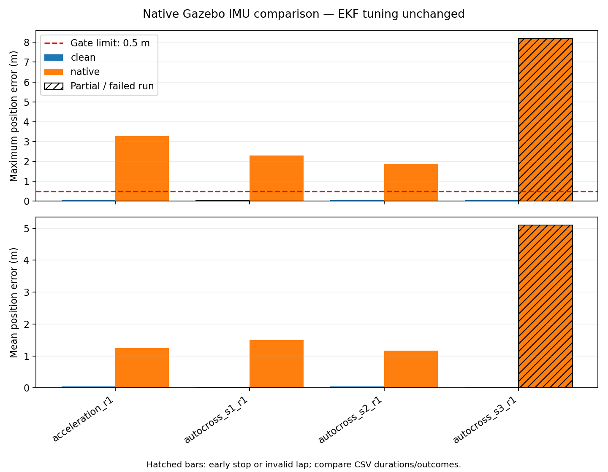

Hatched bars identify early-stop or invalid-lap measurements.

This is a bounded gate rerun: autocross seeds 1–3 once each and acceleration
once per IMU mode, with a truth-stack baseline for each autocross seed.
It is not the full five-seed, three-repeat gate; skidpad was not run.
The diagnostic campaigns use `safety_lidar_timeout_s:=1.5` in **both** modes.
They cannot establish a pass at the default 0.3 s timeout. Early failures
are retained, and their maximum errors are not comparable to full-lap maxima.
One trial per course does not establish a statistical distribution. The host
was not reserved for benchmarking. An unrelated BobSim test overlapped the
first clean diagnostic trial (the retained seed-1 LiDAR-stale failure) and
part of its next truth baseline; it was stopped before clean seeds 2/3 and
all native-noise driving trials.

The default-timeout probes used seed 1 with otherwise identical settings.
The clean EKF run tripped `LIDAR_STALE` after 14.92 scored simulation seconds
(mean/max position error 0.0388/0.0541 m). The native-noise probe tripped the
same fault in READY, before metrics collected a driving sample: its error
is **unavailable**, not zero. Both truth-stack baselines completed.

## Direct sensor verification

The actual bridged `/lhr/imu/data` topic was sampled with `auto_go:=false`,
`perception:=sim estimator:=ekf seed:=1`. Each configuration retained 1,501
samples over 15 simulation seconds after discarding five seconds to settle.

| Measurement | Expected | Observed |
| --- | --- | --- |
| Gyro white-noise σ, x/y/z | 0.0005553604 rad/s each | 0.0005519094 / 0.0005549672 / 0.0005645379 rad/s |
| Accel white-noise σ, x/y/z | 0.0069343487 m/s² each | 0.0070221640 / 0.0070260654 / 0.0072272917 m/s² |
| Native startup gyro bias, x/y/z | Independent Gaussian draws, σ = 0.0058177642 rad/s | 0.0043696917 / 0.0036629174 / 0.0024272628 rad/s |
| Native startup accel bias, x/y/z | Independent Gaussian draws, σ = 0.1307553333 m/s² | −0.2378398004 / −0.0478326007 / −0.3314491974 m/s² |
| Clean z gyro mean | 0 rad/s | approximately 0 rad/s |
| `imu_noise:=false gyro_bias:=0.03` z gyro mean | +0.03 rad/s | +0.03 rad/s |
| `imu_noise:=false gyro_bias:=-0.03` z gyro mean | −0.03 rad/s | −0.03 rad/s |

Accel bias is the noisy mean minus the clean mean, including removal of
world gravity from z. Noise spread is measured around each axis's own mean;
startup offsets are not confused with white-noise variance. The cadence,
noise-spread, signed-bias and startup-bias checks passed. The acceleration
startup-bias check was also evaluated from the retained stationary summary.
These are simulator measurements, not new hardware measurements.

## Model and limits

[Configuration and datasheet conversions](../../ros2/src/lhr_vehicle/README.md#native-gazebo-imu)
record the Livox ICM40609 identification, TDK ICM-40609-D DS-000330 rev 1.2
specifications, SI conversions, assumed one-sided 50 Hz bandwidth at 100 Hz
sampling, and the assumed ±3σ mapping of initial offset scales. The public
chip suffix, firmware bandwidth and residual calibration of the donated
unit are not confirmed. Startup bias is constant within a run; thermal drift,
scale-factor errors, axis coupling and clipping are not modeled. The
[hardware acceptance report](../2026-10-04-mid360-acceptance/README.md) measured
larger temperature-dependent gyro bias; this simulation does not reproduce
that unit's full behavior.

The IMU mount is unchanged. Gazebo's ideal orientation quaternion remains
available, but the EKF uses angular rate and acceleration, not that quaternion.
Wheel speeds still come from truth motion through inertial sim, so wheel slip
remains a separate fidelity gap. The estimator still receives its one-time
truth pose initialization and metrics still compares timestamp-aligned
estimates against truth. The 0.5 m EKF check uses **maximum** position error.

## Reproduce

From `autonomy/ros2` on Ubuntu with ROS Jazzy and Gazebo Harmonic:

```bash
source /opt/ros/jazzy/setup.bash
export PATH=/usr/bin:$PATH
./scripts/build.sh
source install/setup.bash
python3 src/lhr_gazebo/scripts/validate_imu.py data/imu171-repro-stationary

SEEDS="1 2 3" REPEATS=1 ACCEL_REPEATS=1 SKIDPAD_REPEATS=0 RUN_S=180 \
  OUT="$PWD/data/imu171-repro-clean" \
  EXTRA="imu_noise:=false use_wheel_speeds:=true safety_lidar_timeout_s:=1.5" \
  ../testing/tools/gate/run_gate.sh
SEEDS="1 2 3" REPEATS=1 ACCEL_REPEATS=1 SKIDPAD_REPEATS=0 RUN_S=180 \
  OUT="$PWD/data/imu171-repro-native" \
  EXTRA="imu_noise:=true use_wheel_speeds:=true safety_lidar_timeout_s:=1.5" \
  ../testing/tools/gate/run_gate.sh

python3 src/lhr_gazebo/scripts/compare_imu.py data/imu171-repro-comparison \
  --campaign clean=data/imu171-repro-clean \
  --campaign native=data/imu171-repro-native
```

The gate runner exits nonzero on failed checks; in a shell using `set -e`,
run each campaign separately so a failed clean campaign does not suppress
the native campaign. The wheel correction is now an explicit legacy opt-in; these reproduction
commands include it to match the original trial conditions. For default-timeout
probes, keep `use_wheel_speeds:=true`, use `SEEDS=1`, no
acceleration/skidpad, and omit `safety_lidar_timeout_s:=1.5`.

`seed` now also reaches Gazebo's random generator. ROS scheduling and random
number consumption can differ between configurations, so identical seeds
are not a claim of bitwise identical trajectories or other sensor errors.
The settings and course geometry are matched; repeated campaigns are needed
before making population-level accuracy claims. Historical 10/24 error
numbers use an older revision and are not substituted for this clean control.

## Verification and evidence

- `./scripts/build.sh`: all 16 packages built.
- `lhr_gazebo`: 292 tests passed; final ament flake8/pep257 checks also passed across the changed packages (62 Python files checked by flake8).
- Completed test XML reports 1,067 tests, zero errors/failures, two optional native-FMU skips. **The full workspace suite is incomplete:** three unrelated BobSim solver tests did not complete. After setting its documented native paths, that process was interrupted after 206.42 seconds; its partial XML must not be read as a full pass.
- Generator `--check`: both committed models in sync; `gz sdf -k`: both valid.
- Strict MkDocs build passed, including this report/navigation (final build log retained locally).
- Independent bag cross-check: **8/8 available diagnostic EKF measurements pass**. Largest maximum-error discrepancy is **0.00004875 m**; largest mean-error discrepancy is **0.00324400 m**. This checks the stamped recorded poses, not just the CSV/scorer's verdict.


All trials used base commit `da9d5a95a9a49679a05c5a313432dfb8a55626dd` plus
the uncommitted implementation on `koa/gazebo-imu-noise`. Vehicle YAML
SHA-256: `123ad891ed3db8737fffe52b529775337c824bb150e2c602345abb0b0ec398dd`.
The retained manifest fingerprints source/config/model/world files and the
unchanged gate runner/scorer, since a base commit alone does not identify a
dirty working tree. Runtime: Gazebo Harmonic 8.15.0, ROS 2 Jazzy, system Python
3.12.3 on native Ubuntu; no GUI/RViz was opened.

Selected evidence is stored next to this report: `comparison.csv`, the full
clean/native gate result tables, default-timeout result tables,
`stationary.csv`, `stationary-checks.json`, `manifest.json` and
`verification.txt`. The figure is generated by
[compare_imu.py](https://github.com/LonghornRacingElectric/lhre/blob/main/autonomy/ros2/src/lhr_gazebo/scripts/compare_imu.py).
The acquisition/check script is
[validate_imu.py](https://github.com/LonghornRacingElectric/lhre/blob/main/autonomy/ros2/src/lhr_gazebo/scripts/validate_imu.py).

Raw bags, stamped stationary samples, per-run metrics, launch logs and
arguments remain locally under
`/home/black-book/lhre/autonomy/ros2/data/imu171/` (gitignored). No raw bags
were committed or uploaded to SharePoint during this work. Re-score a retained
campaign with `python3 ../testing/tools/gate/score_gate.py <campaign-path>`
after sourcing ROS and the workspace. The comparison preserves missing
measurements and every failed gate check. Independently recompute the EKF
error columns from the stamped poses in those bags:

```bash
python3 src/lhr_gazebo/scripts/verify_imu_bags.py data/imu171-repro-bag-check.csv \
  --campaign clean=data/imu171-repro-clean \
  --campaign native=data/imu171-repro-native
```

The independent checker uses NumPy interpolation with unwrapped truth yaw,
not the metrics accumulator or TruthAligner. It selects the original scored
interval and allows 0.02 m / 0.002 rad discrepancies for endpoint rounding
and delivery differences. Missing error rows are not silently invented.
The retained `bag-crosscheck.csv` shows reported and recomputed values plus
their differences for every available diagnostic EKF measurement.


## IMU-only checkpoint

A later checkpoint on 2026-11-08, after the wheel/IMU trials above, excluded
wheel speeds because the real car's wheel feedback is unreliable.
**Work stopped at a confirmed acceleration-input discrepancy.** Live startup
calibration and bias-state estimation have not been integrated or validated.
The wheel-free Gazebo configuration does not meet the position-error gate.

`use_wheel_speeds:=false` is now the EKF and both demo launches' default.
There is no wheel subscription, wheel messages cannot correct the disabled
filter, and Gazebo does not launch the synthetic wheel sensor in this mode.
The explicit `true` override retains the old comparison; the original report
and its numbers above used wheel corrections. Metrics records the new mode.

### Verified steps

1. Build: all 16 ROS packages built. Launch/default/override checks proved
   wheel exclusion and the legacy opt-in in both Gazebo perception branches;
   the kinematic launch forwards the same typed option.
2. Four changed packages passed 432 tests: Gazebo 299, state estimation 12,
   demo 47, metrics 74. Final flake8 checked 78 files with no issues; pep257
   passed. This is a focused checkpoint, not a new full-workspace/BobSim pass.
3. Recorded native physics IMU data and an independent truth reference on a
   straight acceleration course, with nominal noise on/off. The reference
   controller used truth to create repeatable input trajectories. The
   estimator replay used no wheels and no truth corrections after one initial
   surveyed-pose proxy. Initial zero velocity was an explicit held-still
   condition. This was not a closed-loop IMU-only driving success.
4. Used a fixed declared stationary interval, two through seven seconds after
   the first IMU sample, to compute gyro offsets and a known-level effective
   forward-acceleration offset. All variants used the same recorded samples.
   They ignored Gazebo's ideal orientation quaternion. Truth independently
   checked the held-still contract and scored errors; it did not determine
   the offset or select a favorable calibration window.
5. Repeated the input check using the **unchanged installed world/model**, with
   its normal noise-free launch overlay and rendering enabled. The same
   discrepancy remained. A lightweight capture-world change is therefore
   insufficient to explain the missing forward-acceleration signal.

### Blocking measurement

From the standard-world noise-free recording, at simulation times 12–15 s:

| Quantity | Measurement |
| --- | --- |
| Reference body-forward speed | 0.65 → 3.65 m/s |
| Expected average forward acceleration, Δv/Δt | 1.00000004 m/s² |
| ROS IMU forward acceleration, mean | 0.000000324 m/s² |
| ROS IMU forward acceleration, standard deviation | 0.00000557 m/s² |

At that checkpoint, the exact origin in physics, actuation, sensor generation
or transport had **not** been isolated. The follow-up diagnosis below isolates
the sampling/actuation interaction; the earlier measurements remain unchanged. A real IMU-only estimator needs the
acceleration that changes vehicle velocity; static calibration cannot create
that missing dynamic input. No additional LiDAR-stale investigation was done.

### Calibration results, same acceleration input recording

| Capture / replay variant | Mean yaw error (rad) | Maximum position error (m) |
| --- | --- | --- |
| Noise-free, standard world, raw | 0.00000113 | 78.7805 |
| Native noise, raw | 0.0321052 | 139.3348 |
| Native noise, stationary gyro offset removed | 0.0004370 | 139.3626 |
| Native noise, gyro + effective forward offset removed | 0.0004370 | 78.7396 |

The yaw improvement is measured in an offline replay, not a live bias-aware
EKF. Forward-offset subtraction at one known-level pose is not a general
accelerometer calibration and cannot separate arbitrary tilt from bias.
The planar mount-lever-arm diagnostic also failed to recover the missing
straight-line acceleration. The existing five-state filter was not replaced
or tuned to hide these failures. The simulator's acceleration-input fidelity
must be resolved, or real IMU recordings supplied, before proceeding with
position-performance claims for calibration and bias estimation.

### Evidence and reproduction

Selected evidence: `imu-only-summary.csv`, `imu-only-input-signal-check.csv`,
three `imu-only-*-calibration.json` files, and `imu-only-manifest.json`.
Raw MCAPs, stamped replay CSVs, private world/model copies, arguments and logs
remain under `autonomy/ros2/data/imu-only/` (gitignored). An attempted
lightweight autocross reference capture timed out after 150 wall seconds;
it is retained as unsuccessful, not scored or substituted for a finished
run. The following noisy-autocross capture was not started because the
capture batch stopped on that failure. The straight-line input check then
used one bounded standard-world capture to confirm the blocker.

From `autonomy/ros2`, after building:

```bash
source /opt/ros/jazzy/setup.bash
source install/setup.bash
export PATH=/usr/bin:$PATH
export ROS_DOMAIN_ID=86
export GZ_PARTITION=imu-only-reproduce
python3 src/lhr_gazebo/scripts/record_imu_reference.py data/imu-only-reproduce-clean \
  --style acceleration --seed 1 --noise false --full-rendering
python3 src/lhr_gazebo/scripts/evaluate_imu_only.py data/imu-only-reproduce-replay \
  data/imu-only-reproduce-clean
```

Use a fresh output directory; the capture refuses to overwrite an existing
one. For the noisy lightweight capture use `--noise true` and omit
`--full-rendering`. The capture privately omits GPU LiDAR/rendering when not
requested, but retains IMU/vehicle physics. No production sensor model was
changed by the harness. The fixed input check is the 12–15 s interval above;
`imu-only-input-signal-check.csv` records expected, raw and offset-corrected
acceleration for all three completed straight-line captures.

## Acceleration-path diagnosis

Follow-up on 2026-11-08 isolated the earlier blocker to **sampling of the
direct joint-velocity plant**. Gazebo's native IMU already contains the
missing-signal problem at 100 Hz; the ROS bridge copies its values exactly.
At 1000 Hz, the same direct-velocity plant produces short acceleration pulses
whose integral agrees with the independent speed change. The default 100 Hz
sensor samples between those pulses. This is temporal aliasing, rather than
an acceleration signal absent at every physics step.

All four controlled captures used Gazebo Sim 8.15.0, DART, acceleration seed 1,
native noise **disabled**, no wheel estimator inputs, and the same truth-based
reference controller. The copied worlds omit GPU LiDAR/rendering as documented
above. Changes were confined to private diagnostic models; production vehicle
models and actuation were not changed. Each capture stopped at IMU simulation
time 16 s. The measurements below use the fixed 12–15 s interval, subtracting
the negligible stationary forward offset measured over 2–7 s.

| Private model | Speed-change reference acceleration (m/s²) | Integrated IMU average (m/s²) | Difference |
| --- | ---: | ---: | ---: |
| Direct velocity, 100 Hz IMU | 1.00000004 | 0.00000065 | Essentially all acceleration missed |
| Direct velocity, 1000 Hz IMU | 1.00000004 | 1.00000005 | Below 0.000001% |
| Force PID, 100 Hz IMU | 0.996428 | 0.981269 | 1.52% |
| Force PID repeat, 100 Hz IMU | 0.996357 | 0.980716 | 1.57% |

The 1000 Hz capture has acceleration standard deviation 2.93 m/s²: merely
raising the output rate exposes pulses; it does not add an antialiasing filter
or reproduce the real IMU's bandwidth. A phase check on this capture found
nearly zero average acceleration at timestamps divisible by 10 ms, explaining
why the synchronized 100 Hz capture misses them. The pulses reach about
9.81 m/s²; their average over the interval is approximately 1 m/s².

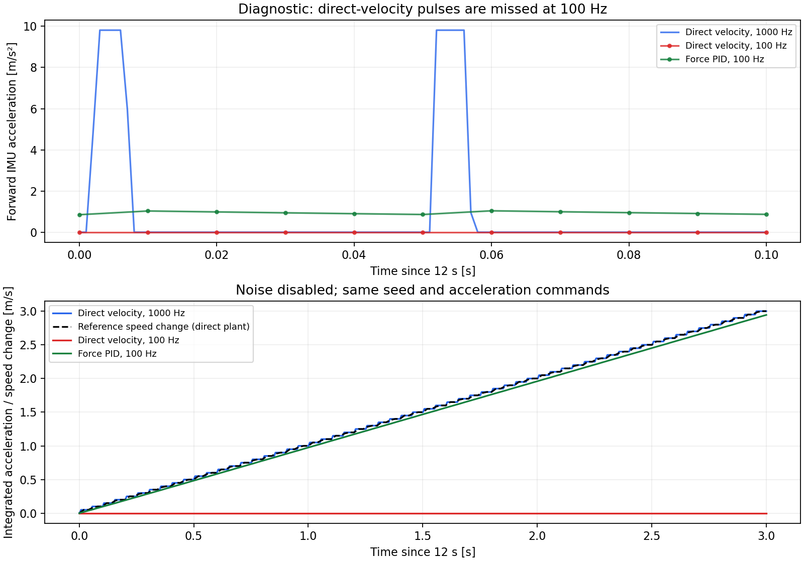

Native/ROS comparison matched 1,601; 16,100; 1,609; and 1,610 timestamps,
respectively. Every matched gyro/acceleration component had **zero numerical
difference**. One ROS sample in the first force capture was not received by
the separate native subscriber; matched coverage there was 99.94%. This does
not imply packet-perfect delivery in every future run.

The force experiment uses Gazebo's existing
[JointController force-PID option](https://github.com/gazebosim/gz-sim/blob/gz-sim8/src/systems/joint_controller/JointController.cc),
P=10, no integral/derivative gains, and ±100 N·m command limits on each of the
four wheel controllers. These are experimental settings, not measured motor
limits. They recover a much smoother signal without a synthetic IMU processor
or truth-derived acceleration injection. The changed plant has a small speed
response lag. The remaining approximately 1.6% mismatch has not been isolated;
body-frame specific force and a speed difference are only approximately
equivalent during this nearly level, straight test. There is no attitude or
gravity correction in this comparison.

**Next checkpoint:** validate force-based actuation during braking and turns,
with the native noise/bias enabled, before promoting any controller change.
Keep its physical limits in the canonical vehicle configuration when promoting
it. Then resume stationary calibration and bias-state integration. These input
tests are not an EKF position gate, an autonomous driving result, or physical
car validation. The earlier wheel-free error results remain failed. No further
LiDAR-stale investigation was performed.

### Reproduce and verify

From `autonomy/ros2`, in a sourced ROS Jazzy workspace with Gazebo Transport
13 / Messages 10 Python bindings available:

```bash
source /opt/ros/jazzy/setup.bash
source install/setup.bash
export PATH=/usr/bin:$PATH
export ROS_DOMAIN_ID=88
export GZ_PARTITION=imu-accel-reproduce
python3 src/lhr_gazebo/scripts/record_imu_reference.py data/accel-repro-direct100 \
  --style acceleration --seed 1 --noise false --capture-native --stop-sim-time 16 --direct-drive
python3 src/lhr_gazebo/scripts/record_imu_reference.py data/accel-repro-direct1000 \
  --style acceleration --seed 1 --noise false --capture-native --stop-sim-time 16 --direct-drive \
  --imu-rate 1000
python3 src/lhr_gazebo/scripts/record_imu_reference.py data/accel-repro-force100 \
  --style acceleration --seed 1 --noise false --capture-native --stop-sim-time 16 \
  --force-drive
python3 src/lhr_gazebo/scripts/check_imu_acceleration.py data/accel-repro-summary.csv \
  data/accel-repro-direct100 data/accel-repro-direct1000 data/accel-repro-force100
```

Use fresh output directories. Run captures sequentially on the isolated domain
and partition. Repeat the force command with a new output directory for the
fourth control. The checker exits unsuccessfully for mismatched native/ROS
values, insufficient interval coverage, a moving calibration interval, or an
acceleration response inconsistent with the controls. Its 10% recovery limit
is a diagnostic distinction from the missing-signal control, not an acceptable
position-error threshold.

Retained raw files: gitignored `ros2/data/imu-accel-path/`. Reviewable evidence:
`acceleration-path-summary.csv`, `acceleration-path-manifest.json`, and the
figure above. The manifest hashes private models, bags, native CSVs, logs,
arguments and relevant source/configuration files. Four input-path controls
passed; `lhr_gazebo` passed 299 tests, and both changed diagnostic scripts passed
flake8 and pep257. An initial sandboxed test attempt could not write ROS logs;
the rerun with local ROS permissions passed. No new full-workspace test result
is claimed.

## Force-based actuation fix

The follow-up fix replaces direct wheel-velocity commands inside Gazebo's
four wheel controllers with bounded torque-based speed tracking. Both default
and stereo SDFs were regenerated. The command adapter still sends the same
wheel speed targets; there is no IMU processing node, truth-derived estimator
input, or increase to the 100 Hz IMU output rate. Native noise/bias remain on
by default, wheel fusion remains off, and live calibration/bias states remain
unimplemented.

`simulation.gazebo_drive` in the canonical vehicle YAML supplies P=10 N·m per
rad/s and a symmetric ±100 N·m per-wheel drive/brake command clamp. I and D
are zero. These are **ASSUMED simulator tuning values**, not measured Orion
motor limits. Positive, finite configuration values are required. This change
adds a small wheel speed response lag. It does not validate motor electrical
dynamics or tire-slip fidelity.

### Standard-world verification

All three captures used the **unchanged installed standard world and generated
vehicle** (`--full-rendering`), Gazebo 8.15.0/DART, seed 1, GUI/RViz off,
and a truth-based reference controller. Neither `--force-drive` nor a private
actuation override was used: the installed default was exercised. Truth was
used to generate/score a repeatable trajectory; these are not EKF-controlled
driving or LiDAR-perception gate runs.

| Check | Noise off | Native noise/bias on |
| --- | ---: | ---: |
| Forward speed change, 12–15 s | 2.98975 m/s | 2.98970 m/s |
| Integrated forward IMU, stationary offset removed | 2.94282 m/s | 2.94415 m/s |
| Acceleration discrepancy | 1.57% | 1.52% |
| Braking speed change, 28–32 s | −5.00025 m/s | −5.00025 m/s |
| Integrated IMU braking, stationary offset removed | −4.97770 m/s | −4.96957 m/s |
| Braking discrepancy | 0.45% | 0.61% |
| Mission / recorded final speed | FINISHED / 0.0 m/s | FINISHED / 0.0 m/s |

On the noisy oval run over 12–44 s, integrated gyro yaw change was 6.983415 rad
versus the independently unwrapped reference yaw change of 6.982356 rad:
**0.001058 rad** absolute difference. This checks gyro preservation during
turns; it is not a full six-axis acceleration/attitude validation.

All 11,102 ROS samples across the three runs had a native counterpart with
identical six-axis values at the same timestamp. ROS median and maximum IMU
sample gaps were 0.01 s. The noisy runs retained the configured six-axis
white-noise spreads and startup offsets; for example, the acceleration run's
stationary forward offset was −0.237892 m/s². Noise was not disabled to obtain
the recovered signal.

The comparisons subtract stationary sample means **offline** over the declared
2–7 s held-still interval. They do not alter recorded sensor data or enable
live calibration in the EKF. The remaining approximately 1.5% longitudinal
discrepancy has not been isolated; body-frame specific force, pitch/gravity,
mount geometry and a forward-speed difference are not interchangeable without
the corresponding corrections.

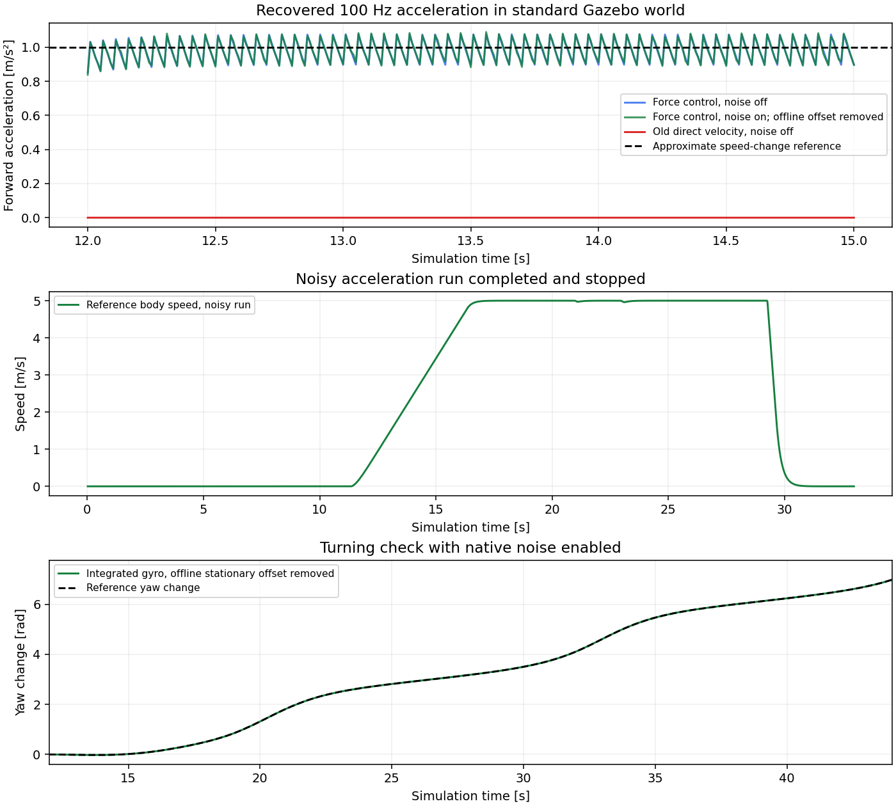

### Remaining estimator error

Replaying the same new acceleration captures through the existing wheel-free
filter still fails the 0.5 m position limit. Noise-free maximum position error
is 1.228 m. With native noise/bias it is 64.010 m raw, and 1.168 m after
offline gyro/forward-offset subtraction. These are simulator replays with one
initial surveyed-pose proxy and known zero speed, not a live estimator gate
or a calibration implementation. Fixing the missing dynamic signal enables
meaningful estimator work; it does not solve the drift by itself.

Next work is live stationary calibration and bias-state estimation, including
the attitude/gravity/mount treatment needed to explain the residual. No wheel
speed input was restored, and no additional LiDAR-stale investigation was done.

### Reproduce the fixed default

From `autonomy/ros2`:

```bash
source /opt/ros/jazzy/setup.bash
export PATH=/usr/bin:$PATH
./scripts/build.sh
source install/setup.bash
export ROS_DOMAIN_ID=90
export GZ_PARTITION=imu-force-fix-reproduce
python3 src/lhr_gazebo/scripts/record_imu_reference.py data/force-repro-clean \
  --style acceleration --seed 1 --noise false --full-rendering --capture-native \
  --post-terminal-sim-sec 3
python3 src/lhr_gazebo/scripts/record_imu_reference.py data/force-repro-native \
  --style acceleration --seed 1 --noise true --full-rendering --capture-native \
  --post-terminal-sim-sec 3
python3 src/lhr_gazebo/scripts/record_imu_reference.py data/force-repro-oval \
  --style oval --seed 1 --noise true --full-rendering --capture-native --stop-sim-time 45
python3 src/lhr_gazebo/scripts/check_imu_acceleration.py data/force-repro-checks.json \
  data/force-repro-clean data/force-repro-native data/force-repro-oval --motion
python3 src/lhr_gazebo/scripts/evaluate_imu_only.py data/force-repro-replay \
  data/force-repro-clean data/force-repro-native
```

Use fresh directories and run sequentially. The motion checker requires the
stationary noise spread within 25% of configured sigma (or negligible spread
with noise off), at least 99% native matches with identical values, no ROS
sample gap over 31 ms, acceleration/braking integral discrepancies below 10%,
and completed straight runs stopped below 0.01 m/s. The turning check requires
over 2 rad of reference yaw change and gyro-integral error below 0.02 rad.
Those are input-path regression thresholds, not estimator acceptance limits.

The previous direct-velocity diagnostic commands above now include
`--direct-drive` explicitly; their original captured data and manifest remain
unchanged. Earlier gate/replay results in this report predate the actuation
fix and must not be treated as current-default gate results.

Raw evidence remains gitignored under `ros2/data/imu-force-fix/`. Reviewable
files here are `force-fix-motion-checks.json`, `force-fix-replay-summary.csv`,
`force-fix-manifest.json`, and the figure. All 16 packages built; affected
packages passed **380 tests** (vehicle 79, Gazebo 301). Both generated SDFs
passed `gz sdf -k` and generator freshness checks. Script/docstring lint and
the strict documentation build passed. Initial diagnostic-script formatting
failures were corrected before the passing rerun. This is not a new
full-workspace/BobSim test result or a physical-car validation.

## Stopped-car investigation

The user reported that, after getting stuck, the Gazebo vehicle stopped while
the ROS vehicle kept moving. The supplied command used autocross seed 3,
LiDAR perception, EKF estimation, native noise enabled, wheel updates disabled,
safety enabled, and a 1.5 s LiDAR timeout. The investigation reproduced those
settings headlessly on an isolated ROS domain/Gazebo partition. The latest
user CSV rows had the force-control vehicle hash, so this was not merely the
older direct-velocity model.

### Reproduction before the rate/timing fix

In `data/imu-stop/seed3-native`, simulation seconds 18.10–30.08:

| Quantity | Measurement |
| --- | ---: |
| Planar physics position span | 0.000535 m |
| Maximum physics body speed | 0.00342 m/s |
| Estimated speed, beginning → end | 3.436 → 3.128 m/s |
| Estimated travel during the stopped interval | 39.331 m |
| Maximum commanded speed during that interval | 0.0 m/s |
| Mean / standard deviation of forward IMU acceleration | −0.02498 / 0.02904 m/s² |

All 3,009 recorded ROS IMU samples matched native Gazebo six-axis values
exactly, with 10 ms maximum sample gaps. Mission status entered EMERGENCY at
18.00 s following the recorded STEER_TRACKING trip; this investigation did not
change or diagnose that safety check. It reproduced stopped-physics/moving-TF
behavior, not the identity of a specific cone contact. The metrics row had
already closed on vehicle_off_course; its zero scored cone contacts does not
identify subsequent physical interactions.

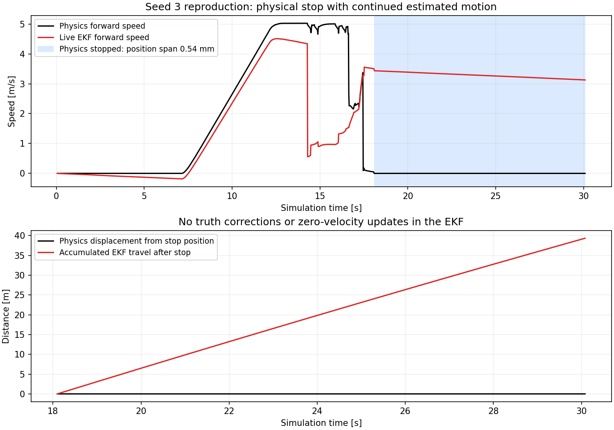

Three contributors were identified:

1. The former 100 Hz native IMU still aliased sharp deceleration events after
   the force-controller fix. Force actuation fixed smooth-driving pulses,
   not every impact.
2. The old ROS node kept only the latest acceleration and predicted at 50 Hz.
   Intermediate IMU impulses could be discarded. Replaying the recorded
   100 Hz stream at its stamps changed the velocity result but did not repair
   the already aliased sensor data.
3. The wheel-free EKF integrates raw acceleration without startup calibration,
   bias states, full attitude/gravity or lever-arm corrections, or independent
   zero-velocity observations. At zero acceleration it retains an erroneous
   velocity. Low acceleration alone cannot distinguish standstill from steady
   translation; zero command alone does not establish that coasting has ended.

### Same-motion 1 kHz diagnostic probe

A second seed-3 capture added a separate **noiseless 1000 Hz IMU** and 1000 Hz
3D reference publisher to a private copy of the model/world. The production
100 Hz noisy IMU and estimator were retained. No GPU sensor was removed.
This run also reproduced physical standstill with substantial estimated
motion. It was not bitwise identical to the first run; scheduling changes
trajectories even with a fixed seed.

The diagnostic compared velocity impulses in a common world frame. It aligned
the probe's initial heading to the reference, rotated measured specific force,
removed gravity, and derived sensor-point velocity independently from 3D model
position/attitude plus the canonical IMU lever arm. Stationary offsets were
removed offline from the production IMU. Ideal attitude and truth were used
**only for diagnosis**, never sent to the runtime EKF.

Over the selected abrupt-deceleration/tilt interval, 14.0–16.3 s:

| Sensor input | 3D velocity-change vector error |
| --- | ---: |
| Noiseless 1000 Hz probe | 0.001655 m/s |
| Production 100 Hz IMU, offline bias/gravity corrected | 8.901386 m/s |
| Same noiseless probe sampled at production 100 Hz timestamps | 8.902063 m/s |

The last row isolates temporal sampling from noise: almost the same large
error occurs without sensor noise. These are post-hoc diagnostic windows,
not a preregistered estimator gate or physical-car results. The earlier
force-control verification covered smooth driving/braking; it was too narrow
to establish impact fidelity.

Raw evidence stays under gitignored `ros2/data/imu-stop/`. The selected JSON
summaries and source/data hashes are retained here. No LiDAR-stale
investigation was added. No runtime estimator change was made during the
initial diagnosis; the following section describes the separately authorized
rate/timing implementation.

### Reproduce the current configuration

From `autonomy/ros2` after building and sourcing ROS/install:

```bash
export PATH=/usr/bin:$PATH
export ROS_DOMAIN_ID=94
export GZ_PARTITION=imu-stop-reproduce
python3 src/lhr_gazebo/scripts/record_ekf_stop.py data/stop-repro --high-rate-probe
python3 src/lhr_gazebo/scripts/analyze_ekf_stop.py data/stop-repro data/stop-repro-analysis
```

The default bounds the run at 30 simulation seconds (180 wall-second cap).
`--emergency-at 20` requests a controlled mission stop without resetting the
estimate. `--noise false` supplies a clean control. The script stops only its
own process groups. Current commands exercise the new 1000 Hz/sample-timed
configuration below; original 100 Hz recordings, arguments, models and source
snapshots retain the earlier failure evidence. Do not interpret changed
trajectories or different stop windows as a paired percentage improvement.

## Physics-rate IMU and sample-timed EKF

The user authorized keeping force control, raising IMU acquisition to physics
rate, and processing every stamped sample. Both generated models now request
**1000 Hz** at the default world's 1 ms physics step. The EKF predicts on each
ordered IMU callback with a trapezoidal acceleration interval; the 50 Hz timer
only publishes. Duplicate/out-of-order stamps are ignored, the first sample
establishes timing, and initialization does not inherit earlier acceleration.
The subscriber buffers 1000 messages. During a dropout, output keeps its last
sensor timestamp instead of repeatedly integrating an old sample with fresh
odometry stamps. Gaps over 0.1 s warn.

This change also makes process covariance continuous-time: subdividing the
same time interval no longer shrinks assumed process uncertainty. The
`sigma_accel` / `sigma_yaw_accel` names and defaults remain, but their units
are now square-root spectral intensities (m/s^1.5 and rad/s^1.5). Existing
custom process tuning needs review. A regression test compares covariance
at 50 and 1000 prediction steps over one second.

### Noise fidelity

Datasheet white-noise densities and startup-bias distributions are unchanged.
Assumed one-sided noise bandwidth increases from 50 to 500 Hz along with
sample rate: per-sample sigma increases by sqrt(10), preserving sigma²/rate
and therefore integrated white-noise intensity. This is simulator acquisition,
not a claim about Mid-360 output frequency or measured hardware filtering.
There is no IMU decimation in this path.

Measured six-axis stationary sigmas in the final run were within
1.75% of their configured values.
Expected gyro sigma is 0.00175620 rad/s and acceleration sigma 0.02192834 m/s².
The per-sample white noise was not left at the old smaller value.

### End-to-end verification and unresolved stop error

Final configuration: seed 3, native noise/bias enabled, wheel fusion disabled,
LiDAR/EKF/safety running, GUI viewers disabled. A diagnostic emergency request
at 20 s produced a controlled stop. The additional noiseless 1 kHz IMU and
3D publisher were read-only measurement probes. Reference/ideal attitude was
used only for analysis, never fed to the runtime estimator.

- Recorded 29,628 ROS IMU samples; median spacing
  0.001 s. Odometry median spacing remained
  0.020 s. Initial discovery can omit startup messages;
  count is not a claim that recording began at simulation zero.
- Every recorded primary ROS sample matched its native six-axis counterpart.
- Live speed agreed with the integral of the captured IMU stream to
  3.6e-14 m/s.
  Output ticks no longer discard the intervening captured impulses.
- Across the fixed diagnostic windows, the final noisy primary signal's
  offline bias/gravity-corrected world-frame velocity-impulse error was below
  0.006 m/s relative to the independent sensor-point motion. The trajectories
  differ from the earlier run, so this is not a paired collision-performance
  percentage improvement.

**Increasing rate did not completely solve stationary false motion.** Over
21.74–30.06 s the physics car's planar position spanned
0.002030 m, but the EKF speed was
-0.939 → -1.161 m/s,
accumulating 8.745 m of estimated travel.
Mean raw forward acceleration at rest was
-0.02684 m/s², close to the initial stationary bias.
The new sampling/integration path is working; raw inertial drift, attitude
and lever-arm errors, and lack of an independent velocity correction remain.
The 0.5 m position gate is not met. No zero-speed command clamp or
truth-based state reset was introduced.

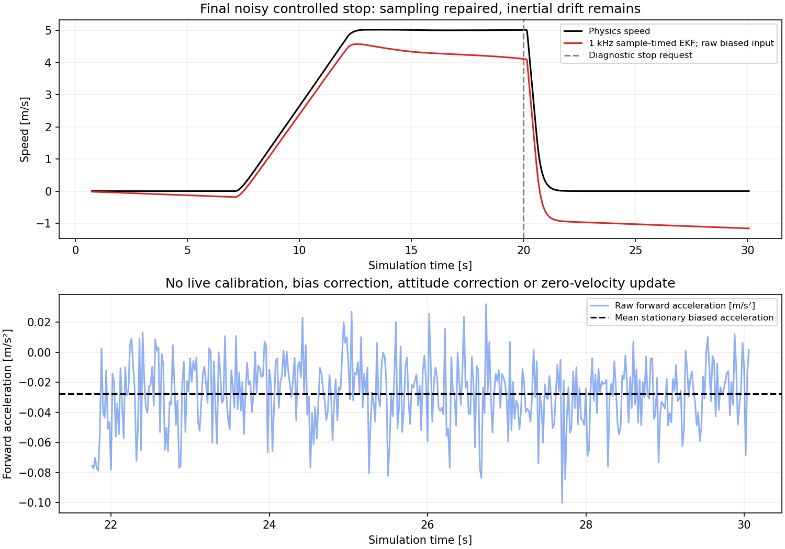

Live calibration, bias states, attitude/gravity and lever-arm treatment, and
qualified stationary evidence remain follow-up work. The intermediate clean
controlled stop also retained about −0.39 m/s of velocity error, so attributing
all residual error to white noise or constant startup bias would be incorrect.
Those intermediate and final trajectories are not matched performance trials.

To repeat this controlled verification with the current code, append
`--emergency-at 20 --high-rate-probe` to the recorder command in the preceding
section. The analyzer emits JSON summaries and a CSV trace. The default probe
windows were selected for diagnosis, not acceptance testing.

All 16 packages built. Affected tests passed: state estimation 18, vehicle 80,
Gazebo 301 (**399 total**). The new tests cover an impulse between publish
ticks, stale-data timestamps, duplicate/reordered samples, initialization,
noise-intensity preservation and covariance time-step invariance. Both SDFs
passed generator freshness and schema validation. Strict documentation passed.
This is a focused simulator checkpoint, not a full-workspace/BobSim pass,
physical-car validation, or a successful autonomous gate.

## Cone-path causal study

The user observed an apparently centered vehicle/path in ROS while the physics
vehicle approached cones, touched one, and subsequently had poor cone mapping.
The study tested three explanations: changing pose error corrupts persistent
mapping; cone pairing makes unsafe paths despite accurate geometry; or the
controller cuts corners despite a safe path. Production estimation, perception,
planning and control behavior were not changed during this study.

### Experiments and findings

All live runs used autocross seed 3, LiDAR, native IMU noise/bias enabled,
wheel updates disabled, safety enabled and the user's 1.5 s LiDAR timeout.
GUI/RViz/Foxglove were disabled. Private model copies added read-only 1 kHz
IMU/3D-reference publishers and passive contact probes. Actual detector,
planner and controller parameters were captured from running nodes. Notably,
this command uses `stack_window_sec=0`, `min_cluster_points=1`, sensor-frame
height filtering and a 1.5 m map-association radius. Cloud stacking was off;
the persistent cone map still retained and averaged observations.

| Experiment | Result |
| --- | --- |
| Noisy EKF, 22 s repeat | Map distortion reproduced; conservative footprint overlap began at 21.022 s; no native cone contact before the capture ended |
| Noisy EKF, 30 s | Front-right wheel contacted `cone_yellow_54` at **23.329 s**, after **66.686 m** of reference-route progress |
| Truth localization, same noisy sensors/planner/controller, 30 s | **101.589 m** of route progress, **zero observed cone contacts**, with 120,284 delivered contact messages confirming probe activity |
| Identical clouds, physics-pose replay | Pre-risk per-frame local map error p95 stayed below **0.0651 m** |
| Identical clouds, EKF poses and persistent map | Corresponding error p95 reached **5.3267 m** before conservative overlap |
| Identical clouds, EKF poses but current-scan-only map | Error p95 stayed below **0.0761 m** |
| Fixed 90-degree rotation plus translation of physics poses/map | Local geometry matched the physics-pose control within **1.8e-14 m** |
| Production planner with exact positions of observed cones | Minimum conservative forward-path clearance **0.4437 m**; complete nearby geometry and known-color controls were also clear |

The identical-cloud experiment keeps vehicle motion and sensor returns fixed.
The current-scan control shows that the large error comes from inconsistent
history, not simply an instantaneous global pose offset. Constant rigid frame
changes cancel, as expected. The map does not estimate/correct vehicle pose,
and it does not retroactively move old landmarks when dead reckoning drifts.

Offline physical identities were assigned to landmarks when they were first
observed. Instrumentation inspected the actual running-average updates; it
did not replace the production associator. Before conservative overlap, the
EKF replay attached observations of a different physical cone to an existing
landmark in **1691/3460 checked updates (48.87%)**. The physics-pose replay did
so in **3/3465 (0.087%)**. The independent shorter EKF repetition gave
**1606/3317 (48.42%)**, with the same sub-0.1% physics-pose baseline. All fresh
detection lists aligned in these comparison windows. Truth identities were
analysis labels only and were never given to the live estimator or planner.

### The visual mismatch is measurable

In the actual-contact recording at 20.5 s, before conservative overlap:

| Measurement | Value |
| --- | ---: |
| Estimated car distance from recorded live path | **0.1566 m** |
| Physics car distance from physical course center | **0.6206 m** |
| Accumulated EKF-map local error, p95 | **5.0297 m** |
| Same-cloud physics-registered map local error, p95 | **0.0346 m** |

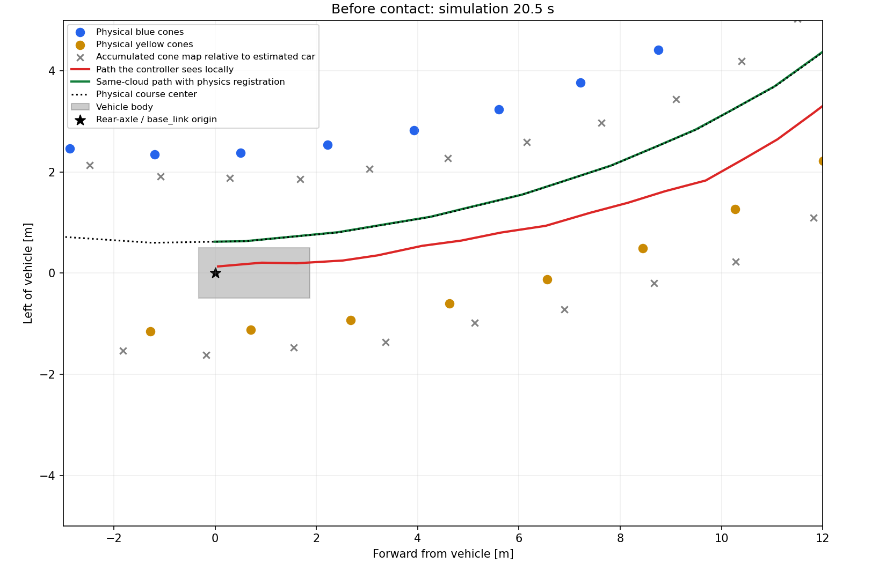

Red is the path the controller sees relative to its estimated car. Green is
the path reconstructed from the same clouds with physics registration; it
nearly overlays the physical course center. Gray crosses are accumulated cone
positions relative to the estimated car; colored circles are physical cones.
These are analysis overlays, not truth inputs to the driving algorithm.

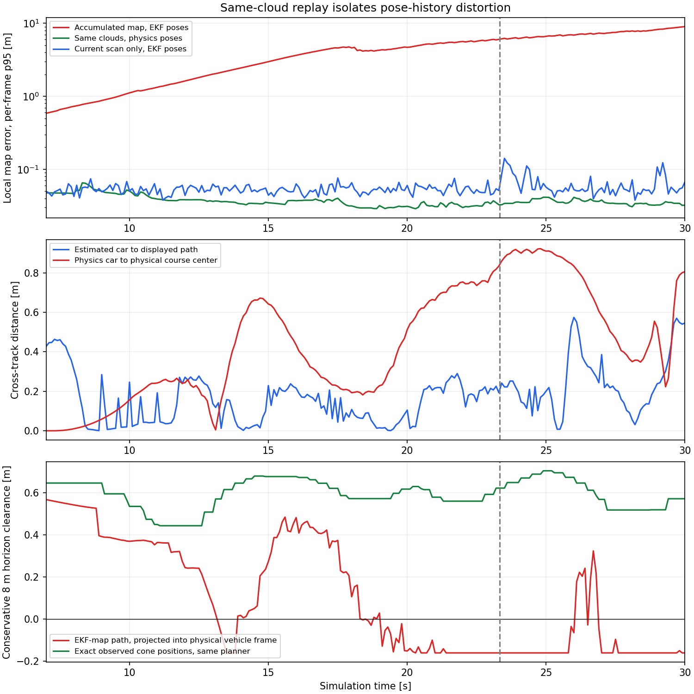

The recorded live maps independently confirm the problem. Their per-frame
nearest-physical-cone error p95 had median **0.9490 m** with EKF localization,
versus **0.0386 m** in the truth-localization control. This nearest-neighbor
measure can underestimate identity errors, unlike the birth-identity replay.

### Interpretation and limits

**The pose-history/map-association hypothesis is strongly supported for this
scenario.** Drift distorts and mixes persistent landmarks, producing a path
that can look centered on the estimate while losing physical cone clearance.
The map was already distorted before contact; contact is not required to
explain the initial failure. The exact-cone controls and successful
truth-localization run do not support intrinsically unsafe pairing or pure
pursuit corner-cutting as the primary cause here.

They do not prove the planner/controller universally safe. Some paths built
from imperfect detections still have negative conservative clearance even
with physics-pose replay. False detections, sparse visibility, pairing
robustness and explicit footprint constraints remain secondary issues. The
individual post-contact height-filter/attitude effects were not isolated.

Local map error compares positions in the current vehicle frame against
physical cone locations, not raw global coordinate differences. Landmark
identity labels require a physics-replayed detection within 0.35 m of a world
cone; unidentified landmarks are excluded from identity statistics. The study
also checks all live-map points by nearest geometry. Replay is not bitwise
identical to asynchronous live processing: median bidirectional map-set
agreement was **0.0905 m** in the noisy EKF run and **0.0032 m** in the truth
control. Live-map and physical-contact results therefore supplement replay
results rather than claiming an exact reproduction of every callback.

The before-risk statistics use driving-time scans after 7 s and stop 0.3 s
before the earlier of physics contact and conservative footprint overlap:
21.102 s for the actual-contact run. Truth-control summaries use the same
bounded early-course context; route/contact coverage is reported separately
over the complete recording. Clearance uses the conservative body/wheel box,
circumscribed cone circles and path tangents over the next 8 m. Negative
clearance indicates risk, not an exact mesh contact or penetration depth.
The native contact event is the independent evidence of actual contact.

These are exploratory simulator experiments on one seed, including two noisy
EKF repetitions. They are not physical-car validation, a full lap/gate pass,
or statistical proof across courses. No LiDAR-stale investigation was added.
The next corrective work should address inertial calibration/attitude/bias
and pose-consistent local mapping, then repeat these controls before claiming
that the collision problem is fixed. A current-scan-only replay is not itself
a validated production replacement.

### Reproduce

From `autonomy/ros2`, after sourcing ROS Jazzy and `install/setup.bash`, run
captures sequentially with fresh output directories:

```bash
export PATH=/usr/bin:$PATH
export ROS_DOMAIN_ID=96
export GZ_PARTITION=cone-path-reproduce
python3 src/lhr_gazebo/scripts/record_ekf_stop.py data/cone-repro-ekf \
  --perception-study --stop-sim-time 30
python3 src/lhr_gazebo/scripts/record_ekf_stop.py data/cone-repro-truth \
  --perception-study --estimator truth --stop-sim-time 30
export ROS_DOMAIN_ID=98
python3 src/lhr_gazebo/scripts/analyze_cone_path.py \
  data/cone-repro-ekf data/cone-repro-ekf-analysis
python3 src/lhr_gazebo/scripts/analyze_cone_path.py \
  data/cone-repro-truth data/cone-repro-truth-analysis
python3 src/lhr_gazebo/scripts/plot_cone_path.py \
  data/cone-repro-ekf-analysis data/cone-repro-figures
```

Matplotlib is required for plotting. Bags use MCAP Zstd compression; the
recorder stops before disk headroom drops below 150 MiB. Parameters are queried
directly without the ROS CLI daemon. Raw clouds/bags and complete traces remain
gitignored under `ros2/data/cone-path-study/`. Retained comparison tables,
summaries, selected figures and a source/data-hash manifest accompany this
report. The first attempt stopped before driving because CLI discovery missed
the parameter service; two early captures used the wrong contact subscription
topic and are not used as evidence of contact absence. Their artifacts remain
in the attempt registry. Corrected probes were audited using ground contacts.
The nested contact-topic setting follows Gazebo's
[Contact implementation](https://github.com/gazebosim/gz-sim/blob/gz-sim8/src/systems/contact/Contact.cc).

Nine diagnostic controls passed. The four new analysis tests cover coordinate
rotation, quaternion interpolation/extrapolation, path-horizon trimming and
clearance signs. The Gazebo package passed **305 tests**, script/docstring lint
passed, and the strict documentation build passed. Production filter,
detector, planner, controller and canonical vehicle hashes stayed unchanged
through this investigation.

## Periodic GNSS experiment

Periodic uncertain GNSS fixes are now an opt-in EKF input. The filter corrects
antenna position at each measurement timestamp with its reported covariance,
then replays subsequent IMU samples to the current sensor time. Wheel fusion
remains disabled. This is neither a pose snap to truth nor an added heading
measurement. The existing one-time Gazebo truth start-pose initialization is
unchanged. GNSS-off estimation behavior is preserved.

### Receiver evidence and assumptions

The repository does contain useful receiver information:

- [Telemetry notes](https://github.com/LonghornRacingElectric/lhre/blob/main/apps/telemetry/GRAFANA.md)
  describe a 50 Hz GPS experiment and say the LocusLock receiver supports
  10/50/100 Hz; the publisher repeats those supported rates.
- [BEVO parser and test](https://github.com/LonghornRacingElectric/lhre/blob/main/apps/BEVO/cand/main.rs)
  carry `$PPOS` full-precision latitude/longitude, ellipsoid height,
  horizontal one-sigma error, standard/RTK source and Unix fix time. One test
  sentence, described as originating in a 2026-10-10 recording, contains
  `sigma_h=0.792 m` with standard-fix source. That sample is not a receiver
  accuracy guarantee, nor does it establish independent per-axis covariance.
- The [CAN/telemetry specification](https://github.com/LonghornRacingElectric/lhre/blob/main/lib/spec/groups.textproto)
  keeps this position in doubles because float latitude/longitude loses about
  0.4 m of resolution. The earlier
  [on-car plan](../../docs/plans/on-car-architecture.md) still lists the ROS
  driver, heading, output rate and second-unit questions as unresolved.

No guaranteed accuracy specification, measured RTK covariance or surveyed
antenna mount was found. The simulator therefore labels its defaults
**ASSUMED**: 50 Hz, independent white Gaussian ENU sigma 0.8 m per horizontal
axis and 1.2 m vertically, with 50 ms delivery delay. The virtual antenna is
at `base_link`; WGS84 datum 0/0/0 defines synthetic map east/north/up. The
0.05 m horizontal comparison is an assumed RTK-like profile, not a measured
specification. Rate and accuracy are independently configurable.

The simulator publishes `sensor_msgs/NavSatFix`, not truth odometry. It uses
distinct plant samples only (50 Hz truth cannot supply 100 Hz fresh fixes).
Multipath, correlated error, dropout and RTK convergence are not modeled.
These white-noise trials are optimistic relative to receivers with correlated
errors. Real-car use still needs a receiver/BEVO-to-ROS adapter, validated
measurement timestamps/covariance, surveyed ENU datum and antenna mount,
and independently established startup heading.

### Results

Two new 30 s headless captures used autocross seed 3, LiDAR, native noisy/bias
IMU at 1000 Hz, no wheel updates and safety enabled with 1.5 s LiDAR timeout.
The GNSS-off comparison reuses the prior causal-study baseline. It is not a
fresh matched trajectory or statistical performance comparison. Sensor and
control settings match apart from the GNSS input; source/configuration and
raw-data fingerprints are saved in the accompanying manifest.

Position and heading errors below compare EKF odometry with independent
passive 3D physics truth interpolated at the odometry's own timestamp. All
three profiles use **1–6 m of physical route progress**, before their first
contact. This avoids comparing differently terminated scoring intervals.

| Profile | Samples | Mean position error | Maximum position error | Mean absolute heading error | First native cone contact |
| --- | ---: | ---: | ---: | ---: | --- |
| IMU only, retained baseline | 103 | 1.253 m | 1.560 m | 4.45° | 23.329 s, front-right wheel / yellow 54 |
| GNSS, assumed 0.8 m sigma | 103 | 0.237 m | 0.649 m | 1.97° | 12.830 s, chassis / yellow 25 |
| GNSS, assumed 0.05 m sigma | 95 | 0.030 m | 0.074 m | 0.53° | 14.328 s, chassis / blue 28 |

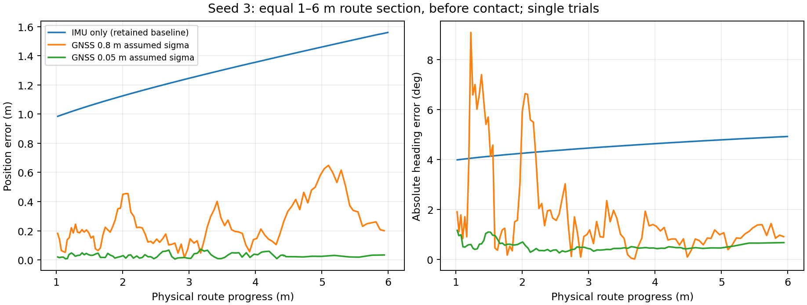

**Position correction works; the collision problem is not fixed.** Both GPS
runs failed the lap and contacted cones. Changed trajectories and single
trials do not establish that GPS improves or worsens collision probability.
Nor do these results establish a full-lap 0.5 m EKF gate pass.

The independent fix audit found median acquisition period **20 ms** and median
fusion age **50 ms** in both runs. Measured ENU raw-error standard deviations
were `[0.810, 0.799, 1.197] m` and `[0.0506, 0.0499, 1.198] m`, consistent
with configured variances `[0.64, 0.64, 1.44] m²` and
`[0.0025, 0.0025, 1.44] m²`. All 639 standard-profile and 708 RTK-like fusion
decisions before first contact were accepted. Across the complete recordings,
1494/1494 standard decisions and 765/1492 RTK-like decisions were accepted.
The 727 RTK-like innovation-gate rejections occurred after first contact;
full-trace position error eventually reached 1.819 m. The gate does not
provide automatic relocalization after an impact. It was not loosened to
force acceptance or hide this failure.

### Why accurate GPS did not settle the cone problem

On the RTK-like run, the same-cloud offline map audit used frames starting at
7 s and ending at 13.682 s (300 ms before conservative footprint overlap,
before native contact at 14.328 s). In that window, pose error stayed below
0.069 m, but the median frame's persistent-map local p95 error was **3.096 m**.
Registering the same clouds with physics poses reduced that statistic to
**0.0435 m**; using only the current scan gave **0.0522 m**. Association auditing
found 41/1661 inconsistent cone birth identities (2.47%) with estimated poses,
and 0/1660 using physics registration. Live/replayed map agreement had median
0.112 m and maximum 0.171 m at seven snapshots; the replay supports the
mechanism but is not an exact reconstruction of every live scheduling event.

At 6 s, near the end of startup, RTK-like heading error was still 0.0572 rad
(3.28°). Position fixes do not directly measure standstill heading, and
previously accumulated cone observations are not retrospectively registered
again when GNSS changes pose. The same-cloud controls support time-varying
pose/map inconsistency as a remaining problem; they do not isolate a single
unique cause of every contact. Existing inertial attitude/bias limitations
and planner clearance are still relevant. Fixing map history and obtaining
reliable heading/local relative motion are the next experiments, not claims
completed by this implementation. Safety observations were retained without
investigating the separately deferred LiDAR-stale issue.

### Reproduce and verify

See [GNSS launch controls and reproduction commands](../../ros2/src/lhr_gazebo/README.md#periodic-gnss)
and [filter timing/rejection behavior](../../ros2/src/lhr_state_estimation/README.md#periodic-gnss-correction).
The recorder saves actual node parameters, fix messages, acceptance/NIS
status, native contacts and raw sensor/pose probes. `analyze_gnss.py` audits
fix noise, covariance, rate, age and equal-route errors;
`analyze_cone_path.py` supplies the same-cloud map controls. The GNSS analyzer
is specific to seed 3 and the experiment's synthetic datum.

Retained review artifacts are `gnss-comparison.csv`, `gnss-baseline.json`,
`gnss-standard.json`, `gnss-rtk-like.json`, `gnss-rtk-map.json`, the figure above
and `gnss-manifest.json`. Raw MCAP/clouds/traces remain gitignored under
`ros2/data/gnss-study`; the baseline remains under `ros2/data/cone-path-study`.
The manifest fingerprints these local recordings and final source separately;
post-capture changes were documentation, analyzer formatting, recorder default
lookup and explicit rejection of unsupported GNSS-plus-wheel mode. They did
not change the captured GNSS-on/wheels-off behavior.

Verification: all 16 ROS packages built. Affected state-estimation, sensor-sim,
vehicle, Gazebo and metrics suites passed **510 tests** including lint.
Tests cover delayed-vs-on-time replay equivalence (state and covariance),
outlier state restoration, frame/covariance validation, antenna lever arm,
measurement-stamp preservation and real node startup with default/non-default
controls in both perception branches. Both generated vehicle models passed
freshness checks. Strict documentation build passed. This remains simulator
validation; physical-car integration and successful autonomous gate are open.

## Stationary cone registration experiment

On 2026-11-14 the user proposed that detecting cones before the vehicle moves
lets a jittering field of view introduce misplaced landmarks. Four fresh,
headless captures tested that explanation: two default-GNSS repetitions, one
assumed 0.05 m GNSS profile, and one GNSS-off control. All used autocross seed
3, native IMU noise/bias, no wheel fusion, LiDAR perception, safety enabled
and the same 20 s capture duration. Production EKF and detector behavior was
not changed. The recorder adds only `auto_go:=false`; it does not constrain
physics or replace estimated localization with truth.

**The stationary mapping failure reproduced. Sensor-relative returns stayed
tight; changing estimated pose/heading corrupted registration and persistent
mapping. Continuing LiDAR sensing at rest is not itself the defect.**

### Verify that the vehicle really stayed still

Actual node parameter dumps confirmed `auto_go=false` in all four runs.
Mission states were OFF/READY, never DRIVING. In every scored **2–20 s** window,
the independent 1000 Hz 3D physics probe measured zero translation from the
window's start, zero heading change and zero linear speed. All recorded speed
commands were zero (at least 360 samples per capture). This does not assume
that a zero command proves stationarity: physics supplies the independent
check. Startup settling before 2 s is excluded from scoring, but startup
observations remain in the accumulated maps.

### Identical-cloud controls

Every recorded cloud was replayed through the actual detector with the saved
parameters, using five registration/map conditions:

1. Vehicle-frame pose identity and a fresh map each scan: sensor-relative
   cluster-centroid precision without accumulated pose history.
2. Recorded EKF pose and persistent mapping.
3. Physics pose and persistent mapping: diagnostic control, never live input.
4. A physics pose held fixed at the window start and persistent mapping.
5. Recorded EKF pose with a current-scan-only map.

A separate raw-return ROI audit computes centroids of returns within 0.35 m
of each known cone in the vehicle plane, using a 0.05–0.55 m base-frame height
band and at least three returns. It is independent of the detector's production
height filter. Raw and fresh-centroid scatter are radial distance from each
cone's own temporal median, with at least ten observations per cone; they
measure precision, not absolute detection accuracy. Known cone positions and
birth identities are used only for offline scoring.

| Profile | Raw ROI scatter p95 | Fresh sensor-frame centroid scatter p95 | EKF-registered centroid scatter p95 | Maximum heading error | Maximum EKF / physics map entries |
| --- | ---: | ---: | ---: | ---: | ---: |
| GNSS 0.8 m, repetition 1 | 0.0183 m | 0.0317 m | 1.687 m | 9.59° | 48 / 27 |
| GNSS 0.8 m, repetition 2 | 0.0180 m | 0.0316 m | 1.821 m | 8.87° | 40 / 27 |
| GNSS 0.05 m, assumed | 0.0175 m | 0.0303 m | 3.155 m | 13.53° | 51 / 27 |
| GNSS off | 0.0186 m | 0.0315 m | 3.075 m | 9.03° | 50 / 28 |

The median frame's persistent-map nearest-physical-cone p95 errors were
**1.701, 1.768, 3.436 and 0.796 m**, respectively. Physics registration reduced
those to **0.0536, 0.0537, 0.0543 and 0.0534 m**. Fixed-pose registration
matched the physics control. Current-scan-only errors were approximately
0.053 m per median frame, despite using the same EKF pose: applying one rigid
transform consistently preserves current vehicle-relative geometry. It does
not preserve consistency when accumulated observations have different pose
errors at different times.

The duplicate metric tracks each new map entry's physical cone identity at
birth, rather than looking only for entries still near the correct cone.
Maximum excess entries sharing a birth identity were **21, 13, 24 and 22**,
respectively; physics/fixed/current-scan controls had zero. The simpler
0.35 m near-truth duplicate count alone reported zero because most replicas
were displaced beyond that radius. Such a zero must not be interpreted as
absence of map splitting. Birth association is an offline geometric audit,
not a production identity source.

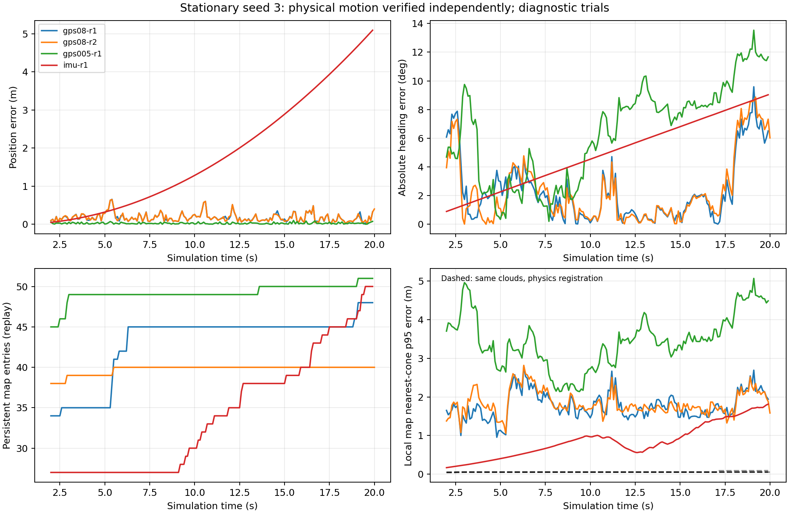

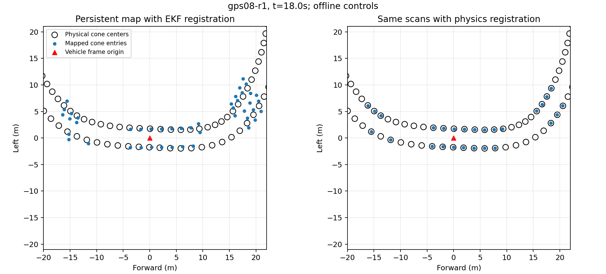

### Live confirmation and replay limits

The live detector also retained excess/distorted landmarks: maximum recorded
live map counts were **40, 40, 53 and 51**, and the median live snapshot's
nearest-cone p95 errors were **1.686, 1.756, 3.684 and 0.856 m**. Live processing
can skip clouds when callbacks/TF are delayed. The controlled replay consumes
every recorded cloud, so it is a counterfactual with identical inputs across
registration conditions, not an exact reconstruction of live scheduling.
These live/replay counts are deliberately reported separately.

There were 180 or 181 scored replay frames per capture. The map controls
include the full sensor mount transform; the same physical course, detector
filters and association settings are held fixed. A persistent physics map
with 27/28 entries is a diagnostic baseline, not a declaration that every
visible physical cone must be detected. Nearest-cone accuracy can understate
identity swaps, so birth duplicates, raw precision and map size are retained
as separate metrics.

### Heading source and next corrective step

The native gyro-z mean while the independent physics angular motion was zero
was **−0.45346, −0.45432, −0.45407 and −0.45436 degrees/s**, respectively.
Integrated over 18 s that is about **−8.2°**. This demonstrates a nonzero
stationary gyro rate under the configured native startup bias. The EKF has
no live gyro-bias estimate or stationary update, so this is a concrete source
of heading drift. GNSS fusion may also change correlated states; this study
does not attribute every heading excursion solely to the gyro or claim that
higher GPS accuracy generally worsens heading. The RTK-like run's maximum
position error stayed at 0.100 m while its heading error reached 13.53°:
accurate position did not establish heading at rest.

The next bounded implementation should estimate/subtract gyro bias during a
verified stationary startup window and validate it on held-out stationary
samples before repeating these same map controls. A production stationary
check must use sensor evidence such as IMU statistics plus LiDAR scene motion;
zero throttle, small acceleration or unreliable wheel speeds alone are not
sufficient. Do not subtract raw acceleration averages as bias without gravity
and attitude compensation. Keep detection active while withholding persistent
map commitment until initialization is trustworthy, then address consistent
map retention/re-registration under pose corrections. Neither a pose clamp
nor an enlarged association radius is validated by this experiment.

This is simulator diagnosis on one seed, with two repetitions of the default
GPS profile. It does not validate calibration on the real Mid-360, a moving
run, collision recovery, a successful gate, or a production map fix. No
LiDAR-stale investigation was performed.

### Reproduce and verification

See [stationary recording, analysis and plotting commands](../../ros2/src/lhr_gazebo/README.md#stationary-cone-registration-diagnostic).
For a desktop inspection append `auto_go:=false` to the existing GPS launch
command; compare RViz Fixed Frame `base_link` and `map`. The offline analyzer
uses `--start-s 2 --end-s 20` by default and preserves earlier map history.

Raw bags, IMU/physics traces, live parameter dumps and per-frame CSVs remain
gitignored under `ros2/data/stationary-cone-study`. Retained review artifacts
are `stationary-comparison.csv`, the four `stationary-*-r*.json` summaries,
`stationary-manifest.json`, `stationary-verification.json` and the figures.
The manifest fingerprints scripts, relevant production sources, configuration,
models and raw recordings. Diagnostic additions do not modify production
filter/detector behavior.

All **16 packages built**. The Gazebo package passed **319 tests**, including
eight new scoring tests and script/docstring lint. Counterexamples verify
that moving physics, nonzero speed commands or DRIVING state cannot be
reported as stationary, fixed sensor offset is not confused with jitter,
empty observations remain unknown, and displaced outliers are distinguished
from near-truth duplicates. Strict repository documentation build passed.

## GPS heading jitter attribution

On 2026-11-14 the user correctly distinguished steady heading drift from the
back-and-forth heading wobble seen with GPS enabled. This checkpoint measures
individual GPS updates directly, then tests gyro-offset subtraction on the
same recorded inputs. It adds read-only status instrumentation to the live
filter. It does **not** integrate automatic startup calibration, change the
GNSS update, zero velocity, constrain heading, modify map retention or claim
the collision problem is fixed.

### Direct live measurements

A fresh stationary seed-3 capture used LiDAR, native noisy/bias IMU, no wheel
fusion, assumed 50 Hz / 0.8 m horizontal GPS sigma / 50 ms latency, safety
and `auto_go=false`. Physics independently measured zero translation, heading
change and speed in both the declared **2–5 s calibration** and **8–20 s
held-out evaluation** windows. Commands were zero and mission state never
entered DRIVING. The recorder requested 20 s but parameter-dump blocking
allowed the capture to extend to 32.412 s; all reported comparisons use the
fixed windows above, not the extra recording tail.

For each fix, instrumentation records the heading/speed immediately before
and after the historical position update (`fix_*`) and before/after correction
plus IMU replay at the same current timestamp (`current_*`). Direct and replay
changes are distinct measurements; the latter is not an intervening physical
rotation. Rejected/old fixes are not counted as applied jumps.

Across **600 accepted fixes** in the 8–20 s window:

| Directly measured live quantity | Result |
| --- | ---: |
| Median absolute current heading change per GPS correction | 0.186° |
| p95 absolute current heading change per GPS correction | 0.903° |
| Maximum absolute current heading change per GPS correction | 1.968° |
| Corrections changing heading by more than 0.1° | 400 / 600 |
| Sum of absolute heading changes from corrections | 168.607° |
| Signed net sum of those changes | +0.503° |
| Median / p95 / maximum absolute estimated speed before correction | 0.217 / 0.648 / 1.016 m/s |
| Fixes with nonzero yaw–position cross-covariance | 600 / 600 |

The sum of absolute changes describes back-and-forth variation, not net
rotation or a 168° final heading error. The actual physics speed was zero.
Historical direct-update heading changes agreed with the current-time
correction/replay deltas here to numerical precision, so the discontinuities
are produced by the position update itself, rather than ordinary propagation
between snapshots. Position-only GPS affects yaw through nonzero covariance
between position and yaw, even though the virtual antenna lever arm is zero.
This confirms a source of the observed wobble at the actual live update level.

### Same-input gyro calibration comparison

A single gyro-z offset was estimated from native IMU samples in the
predeclared 2–5 s window: **−0.455772°/s**. Physics only verifies the stationary
contract and scores error; it does not determine the offset. On the disjoint
8–20 s hold-out window, the corrected gyro mean was **+0.002065°/s**. The
noise was retained; there was no truth-based yaw reset or zero-rate clamp.

All offline conditions restart at 5 s with the same original one-time
surveyed-start-pose proxy and initial filter covariance. They receive the
same IMUs and, when enabled, the same fixes/covariances at the recorded live
consumption times. Score data are not used to select or fit an offset.

| Offline condition | Maximum absolute heading error, 8–20 s | p95 absolute heading error |
| --- | ---: | ---: |
| Raw gyro, GPS off | 6.803° | 6.530° |
| Corrected gyro, GPS off | 0.036° | 0.035° |
| Raw gyro, GPS on | 7.854° | 4.969° |
| Corrected gyro, GPS on | 10.625° | 9.537° |
| Corrected gyro plus stationary forward-offset diagnostic, GPS on | 14.404° | 13.484° |

**Gyro-offset subtraction removes almost all steady no-GPS drift, but it does
not remove GPS-on heading wobble.** The larger GPS-on error in a corrected
single trial does not establish that gyro calibration is generally harmful;
it shows that subtracting this bias is not sufficient to fix the estimator's
stationary behavior. A GPS correction can imply false longitudinal motion,
which makes the linearized motion model couple position innovations back
into heading. Direct instrumentation confirms that coupling; these tests do
not partition every speed error between inertial offsets and GPS noise.

The final row is explicitly a diagnostic: subtracting the stationary mean
forward acceleration combines sensor bias and gravity projection at the
fixed recorded attitude. It is not a general accelerometer calibration and
is not suitable for arbitrary pitch/roll or driving without further modeling.
It also failed to remove false speed or heading wobble, so a simple fixed
forward offset is not established as a sufficient solution.

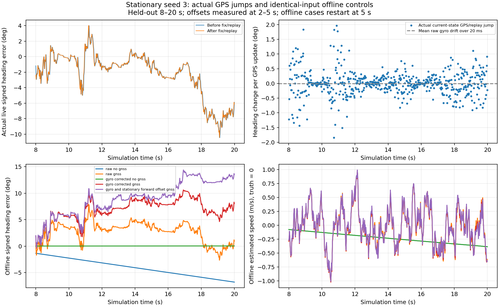

The live and restarted offline trajectories should not overlay: the offline
cases intentionally reset covariance at 5 s. A separate original-start replay
checks whether the implementation can reproduce the original live behavior.

### Replay fidelity and limits

The bag contained **32,019 ROS IMU samples** while the passive native sensor
recording retained **32,412**. Every recorded ROS sample matched its native
counterpart exactly at the same timestamp, across all gyro and acceleration
components. The complete native stream is therefore used for controlled
replays, avoiding bag-recorder gaps. This uses the actual noisy sensor inputs,
not a replacement truth IMU or ideal orientation.

An original-start replay matched live odometry heading at **600** held-out,
noncoincident output/correction timestamps: median difference **0.00167°**,
p95 **0.00256°**, maximum **0.00263°**. Simultaneous output/correction stamps
are excluded because callback order is ambiguous. The earlier ROS-bag-only
replay differed by degrees after missing startup inputs; it is retained under
ignored data as an intermediate attempt and is not used as the validated
live reconstruction. Live before/after jumps do not depend on replay fidelity.

This is one instrumented stationary seed/profile plus exploratory replays of
the earlier stationary capture, not a statistical driving comparison,
physical receiver/IMU validation, or a successful gate. Live startup
calibration remains unimplemented. No LiDAR-stale investigation was added.

### Next bounded implementation

The next prototype should combine gyro calibration with an independently
verified stationary-state update that constrains false velocity and prevents
position noise from acting as evidence of a heading change at rest. IMU plus
LiDAR scene evidence is needed to establish standstill; zero command or
unreliable wheel speed alone is insufficient. This needs moving/slow-turn
counterexamples so it cannot suppress actual motion. After that, repeat the
same held-out stationary and map controls before a driving test. Bias
subtraction alone should not be presented as the jitter fix.

### Reproduce and verification

See [recording and attribution commands](../../ros2/src/lhr_gazebo/README.md#gps-heading-jump-attribution)
and [status field definitions](../../ros2/src/lhr_state_estimation/README.md#gnss-heading-update-diagnostics).
The new `audit_gnss_heading.py` produces per-fix CSVs, controlled state traces,
a JSON summary and an optional Matplotlib figure. Old status recordings
without before/after fields retain unknown live attribution rather than
reporting zero jumps.

Raw inputs, original/intermediate/final analyses and parameter dumps remain
gitignored under `ros2/data/heading-attribution`. Retained review artifacts are
`heading-attribution-summary.json`, `heading-attribution-comparison.csv`,
`heading-attribution-jumps.csv`, `heading-attribution-manifest.json`,
`heading-attribution-verification.json` and the figure above. The manifest
fingerprints diagnostic and production sources plus raw recordings.

All **16 packages built**. State estimation passed **38 tests** and Gazebo
passed **322 tests** (**360 affected tests**, including lint). New cases cover
a position-only fix changing yaw through known cross-covariance, rejection
clearing prior diagnostic context, unknown old status, gated fixes and known
constant gyro-offset subtraction. Strict repository documentation passed.

## Gyro confidence and GPS heading gain comparison

The user proposed trusting the gyro more and limiting GPS influence on heading,
and explicitly requested **uncertain starting heading** in the comparison.
This checkpoint tests both ideas separately. It adds opt-in constant controls
but preserves runtime defaults. It does not implement adaptive motion detection,
live gyro calibration or a stationary-state correction.

### Controlled comparison

There are **120 policy/initial-heading combinations**: eight input datasets,
three starting-heading offsets (0/−10/+10 degrees), and five policies. Offsets
are deliberate stress assumptions, not a measured hardware uncertainty.
Every policy uses the same gyro offset fitted only from a declared 2–5 s
stationary window, a common 5 s restart and the same initial covariance.
GPS fixes, their position covariance and consumption timestamps are held
fixed. No wheel speed or ideal IMU attitude enters the filter.

The policies are default gyro variance with full GPS angular gain; gyro
variance measured from the calibration samples with full gain; and measured
gyro variance with GPS angular gains 0.25, 0.1 and 0. All cases subtract the
same gyro offset: “default gyro” here means default measurement variance,
not an uncalibrated gyro.

Recorded inputs are the earlier instrumented stationary capture and the
retained moving standard-GPS seed-3 capture. Native/ROS IMU values are checked
for exact equality at shared timestamps, and the complete native stream is
used to avoid recording gaps. Calibration stationarity is verified from the
independent physics probe and zero recorded commands. Recorded stationary
scoring uses 8–20 s; moving scoring uses 8–12.5 s, before native cone contact
at 12.830 s. These are fixed-input replays: they do not simulate how a changed
estimate would change steering, trajectory or collision outcome.

Six additional **ideal planar synthetic controls** cover straight acceleration
and slow turning at seeds 3/7/11. They remain stationary until 7 s, then
accelerate to 3 m/s in the straight case, or to 1 m/s followed by a 0.08 rad/s
turn beginning at 11 s. Canonical noise densities and startup-bias scales
supply seeded IMU errors. IMU acquisition is 100 Hz with 50 Hz noise bandwidth;
GPS is 50 Hz with assumed 0.8 m per-axis horizontal sigma and 50 ms delivery
delay. These are model-level controls, not Gazebo or real-car tests. The
synthetic model has no slip or roll/pitch; it cannot establish real vehicle
heading recovery under those conditions.

### Results

The measured stationary gyro variance was **3.1844e-6 (rad/s)²**, versus the
existing **4e-4 (rad/s)²** default: roughly 126 times more confidence in the
measured rate. That change alone had almost no effect on stationary heading
wobble. The gyro measures angular rate; tightening its variance does not
remove existing yaw uncertainty or GPS's yaw–position covariance coupling.

| Policy, all with the same gyro-offset subtraction | Stationary absolute heading error p95 | Stationary GPS-induced heading-jump p95 | Recorded moving final-2-s mean heading error with initial +10° |
| --- | ---: | ---: | ---: |
| Default gyro variance, GPS angular gain 1 | 9.537° | 0.934° | 0.551° |
| Measured gyro variance, gain 1 | 9.536° | 0.934° | 0.551° |
| Measured gyro variance, gain 0.25 | 4.389° | 0.298° | 2.915° |
| Measured gyro variance, gain 0.1 | 2.210° | 0.148° | 5.487° |
| Measured gyro variance, gain 0 | 0.035° | 0.000° | 10.000° |

Stationary position-error p95 stayed approximately **0.410–0.413 m** across
these policies. The prototype leaves immediate GPS position/speed gain rows
and measurement covariance unchanged. Future position estimates can still
change through the coupled dynamics. It does not weaken all GPS measurements
to obtain a smoother heading.

The moving table's final two seconds are 10.5–12.5 s. Its +10° example is shown
to make the startup-recovery cost concrete; the retained CSV includes both
signs and all zero-offset cases. A lower gain improves stationary appearance
but can leave the car several degrees wrong during the early moving interval.
These partial-window p95 numbers are not full-lap maximum-error gate results.

Across the **12 synthetic uncertain-heading controls** (two motion types,
three seeds, two error signs), recovery is the first two continuous seconds
with absolute heading error at most 2° after motion begins at 7 s:

| Policy | Controls reaching the criterion | Median recovery time after motion starts | Final-2-s mean absolute heading error range |
| --- | ---: | ---: | ---: |
| Default gyro variance, gain 1 | 12 / 12 | 4.4 s | 0.045–0.404° |
| Measured gyro variance, gain 1 | 12 / 12 | 4.4 s | 0.046–0.390° |
| Measured gyro variance, gain 0.25 | 12 / 12 | 8.1 s | 0.014–0.763° |
| Measured gyro variance, gain 0.1 | 12 / 12 | 18.6 s | 0.514–1.808° |
| Measured gyro variance, gain 0 | 0 / 12 | Not reached within 40 s capture | 9.933–10.067° |

Recovery is a diagnostic criterion, not a car acceptance requirement. It is
not assigned to stationary datasets, where position-only GPS provides no
physical starting-heading reference. Apparent correction of an erroneous
stationary heading through false estimated motion would not establish
observability or valid recovery.

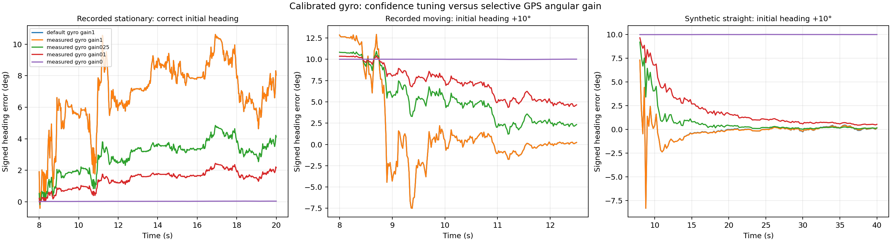

### Implementation and runtime controls

`gnss_heading_gain` scales both yaw and yaw-rate rows of the GNSS Kalman gain
before the state update. The Joseph covariance update uses that same modified
gain. This is an intentionally non-optimal gain prototype, not a claim that
positive-semidefinite covariance alone proves statistical consistency of the
whole motion model. Zero angular gain preserves real gyro-driven rotation;
it removes GPS angular correction rather than freezing heading.

The core and delayed-history defaults remain gain 1. The live node exposes
`gnss_heading_gain` (default **1.0**, finite [0,1]) and Gazebo now forwards the
existing `yaw_rate_variance` (default **0.0004**, finite positive). Both are
explicit float launch controls in both `sim` and `lidar` perception branches.
Metrics records both settings. Default and non-default values were verified
through actual estimator and metrics node startup, not declaration alone.
These knobs are constant startup settings, not a stationary/moving policy.
They do not apply the offline gyro offset to live sensor data.

### Evaluation and next step

The evidence supports **selectively reducing GPS angular influence**, rather
than expecting gyro-rate covariance tuning alone to fix wobble. It also
rejects a permanently zero GPS angular gain for the user's uncertain-heading
requirement: starting-heading error is retained while the gyro tracks changes.
A constant small gain trades stationary precision for delayed recovery; this
is why the default has not been changed to 0.1 or 0.25.

The next prototype should activate stronger heading correction when genuine
motion provides useful direction information and restrict it when that
information is absent. It needs a motion-confidence signal independent of
the EKF's already-demonstrated false stationary speed, with slow-turn,
startup, stopping and sensor-dropout counterexamples. LiDAR relative motion
is a candidate; a validated detector has not been added here. Starting from
an uncertain heading may still require an alignment procedure before normal
cone-clearance driving. These replays do not validate such a procedure.

### Reproduce and verification

See [policy controls and comparison command](../../ros2/src/lhr_gazebo/README.md#gyro-confidence-and-gps-heading-policy-comparison)
and [filter behavior](../../ros2/src/lhr_state_estimation/README.md#experimental-heading-controls).
`compare_heading_policies.py` generates the synthetic inputs deterministically
and saves all per-case state traces plus the comparison CSV. Local raw inputs
and complete traces stay ignored under `ros2/data/heading-policy-study`;
review artifacts are `heading-policy-comparison.csv`, `heading-policy-sources.json`,
`heading-policy-manifest.json`, `heading-policy-verification.json` and the figure.
Input capture hashes and final source fingerprints identify the recordings
and code used for this checkpoint.

All **16 packages built**. State estimation passed **53 tests**, Gazebo **325**
and metrics **74** (**452 affected tests**, including lint). Cases verify
unchanged default math, selective angular state updates, matching covariance
updates, positive definiteness in coupled examples, invalid-value rejection,
real gyro turns with zero GPS angular gain, known straight/turn geometry,
sustained rather than momentary heading recovery, and typed launch forwarding.
Strict repository documentation passed. No new live driving trial, successful
autonomous gate or physical-car validation is claimed.

## Live calibrated gyro heading and GPS position visual profile

The user requested a live visual experiment that calibrates the gyro first,
then derives heading only from the corrected gyro while retaining GPS position
corrections. This is now implemented as an opt-in profile and tested headlessly
through the actual ROS/Gazebo stack. The interpretation of “position heading”
here is position drift. It is not an adaptive heading policy or a claim that
gyro-only heading solves uncertain initial alignment.

### Run the visual recipe

From `autonomy/ros2`:

```bash
./scripts/build.sh
./scripts/run_gyro_heading_demo.sh
```

The wrapper opens Gazebo, RViz and Foxglove on autocross seed 3, uses the xcb/
font environment workaround, and enables noisy native IMU, no wheel fusion,
simulated GPS, `calibrate_gyro:=true` and `gnss_heading_gain:=0.0`.
Trailing launch arguments override recipe defaults. To inspect the stationary
scene without automatic driving:

```bash
./scripts/run_gyro_heading_demo.sh auto_go:=false
```

Watch for `Gyro calibration ready` in the terminal. The estimated map/vehicle
TF appears after calibration; normal READY hold and auto-go follow. The
physical Gazebo vehicle is visible during calibration. The actual wrapper was
also executed with `gui:=false rviz:=false foxglove:=false auto_go:=false` and
reached calibration-ready and READY before a bounded SIGINT stop. GUI rendering
itself remains for the user to check.

### What the live implementation does

Calibration waits 2 s for settling, then requires at least 3 s of quiet
three-axis IMU data and independent raw-LiDAR scene stability. Canonical
vehicle mount/body dimensions supply point filtering. Planar rigid scan
registration must have observable geometry and good overlap/residuals;
maximum permitted anchor-relative motion is 0.03 m and 0.15°. The exact guards
and all typed startup parameters are documented in
[the estimator guide](../../ros2/src/lhr_state_estimation/README.md#live-startup-gyro-calibration).

Only gyro-z mean is subtracted. Raw IMU publications/noise remain unchanged;
acceleration and gravity/attitude/lever-arm corrections are not added. No truth
or GPS enters offset fitting. The offset is frozen after success. The usual
one-time Gazebo start-pose seed remains; it supplies initial heading, not an
ongoing truth correction. This mode cannot recover an initially wrong heading
or correct later thermal gyro-bias changes.

Until calibration succeeds, the node publishes neither estimated odometry nor
TF. In this LiDAR/safety recipe there is therefore no initial mapped path or
normal mission start using an uncalibrated heading. Gaps discard the candidate
window and require fresh evidence within the original 15 s deadline. Detected
motion, bad registration, noisy/nonfinite IMU, frame changes or timeout fail
closed. This is a bounded startup initialization check under a held-still
contract, not a certified general-purpose physical-car stationary detector.

After calibration, corrected gyro samples enter both normal updates and the
GNSS delayed-IMU history. GPS's yaw and yaw-rate gain rows are zero, and the
Joseph covariance update uses the same gain. Real gyro turns are preserved.
GPS still corrects horizontal position and correlated longitudinal speed;
its covariance and those gain rows are not weakened. No zero-velocity update,
accelerometer calibration, map-history re-registration or adaptive gain has
been added. Metrics records the calibration-enabled flag; the exact learned
offset and evidence window are in the latched calibration status.

### Startup delivery failure and correction

Two initial attempts were retained rather than treated as successful tests:

- `stationary-r1`: the best-effort depth-5 calibration subscriber encountered
  a scan gap and failed without publishing odometry.
- `stationary-r2`: candidate windows restarted on gaps, then reached the
  overall timeout. Motion/freshness thresholds were unchanged.

The recorder had all 10 Hz scans and each retained scan had 83–97 downsampled
usable points. Replaying the same messages through the actual node completed
the window with no restart; average cloud processing took about 2 ms, maximum
4.4 ms. The issue was live delivery to the calibration subscriber, not a
stationary scene failing the motion criterion.

The final calibration subscriber uses reliable delivery matching Gazebo's
bridge and a depth-50 queue. A `sensor_data` option is exposed for best-effort
hardware sources. Stale relative timestamps still prevent completion; no
freshness or motion threshold was relaxed. The subscription is removed after
success. Both successful captures then used **31 clouds and 3001 IMUs**, with
zero window restarts. Gap behavior, quiet-window rejection, missing evidence,
known translation/rotation and corrected delayed-history use have tests.

### Measured live results

Physics independently verified zero translation, heading change and linear
speed, and recorded commands were zero, throughout each successful
**2.5–5.5 s calibration window**. The learned bias was about −0.455°/s.
Odometry first appeared at 5.518 s and 5.539 s respectively, after the window.
No uncalibrated odometry preceded readiness.

| Quantity | Stationary live run | Moving live run |
| --- | ---: | ---: |
| Learned gyro-z offset | −0.0079388825 rad/s | −0.0079296533 rad/s |
| Maximum LiDAR translation during calibration | 0.00677 m | 0.00937 m |
| Maximum LiDAR rotation during calibration | 0.0192° | 0.0227° |
| Heading error p95, 8–20 s | 0.0112° | 0.0138° |
| Maximum heading error, 8–20 s | 0.0155° | 0.0186° |
| Maximum current-time heading change from a GPS correction, 8–20 s | 1.02e-13° (roundoff) | 0° |
| GPS corrections evaluated in that window | 577 | 597 |

The 8–20 s moving-run window includes startup/READY and driving after about
12.601 s. Across its complete recording, maximum heading error was also
0.0186°. Truth was interpolated at each estimate's own sensor timestamp.
These figures demonstrate the requested angular isolation and live bias
subtraction; they are not evidence of successful real-car heading alignment.

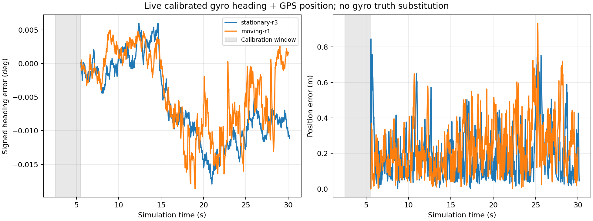

Position jitter and false stationary velocity remain. In the stationary run,
position-error p95 was **0.407 m**, maximum **0.649 m**, and estimated speed
before a GPS update reached **1.016 m/s** while physics stayed still. This
profile addresses angular behavior, not the entire inertial/velocity model.

The same-cloud stationary map audit over 8–20 s found **28 maximum map entries
and zero excess birth-identity duplicates**. The median frame's local map p95
error was 0.196 m with estimated registration, versus 0.096 m with physics
registration and 0.053 m using only the current scan. These are diagnostic
controls, not a claim that the physics-registered detector map is perfect.
No map-history implementation was changed; the initialization gate also means
there are no pre-calibration estimated observations to retain.

### Driving outcome and remaining limits

The moving run entered DRIVING after initialization and normal READY hold.
It reached **62.903 m** of truth-scored reference-route progress with **no
observed native cone contact** in the capture. It then entered EMERGENCY on
**ODOM_STALE**. Its partial-run metrics reported mean position error 0.2548 m,
maximum 0.9342 m, and outcome `emergency`. This is not a completed lap or a
successful 0.5 m maximum-position-error gate.

The stationary run remained physically still but later tripped CMD_STALE in
READY. These safety outcomes are retained; checks/timeouts were not disabled
or loosened to hide them. No separate LiDAR-stale investigation was added.
A full run and the safety-freshness limitations remain unresolved.

The experiment uses the usual accurate simulator initial heading. As the user
previously requested uncertain heading in policy comparisons, this limitation
is explicit: gyro-only heading will preserve an initial error. A survey or
validated alignment procedure remains necessary for that case. Short-term
simulator calibration does not establish physical IMU temperature behavior,
real GNSS performance or long-term gyro-only accuracy.

### Reproduce and verification

See [profile recording and analyzer commands](../../ros2/src/lhr_gazebo/README.md#calibrated-gyro-heading-visual-profile).
`analyze_gyro_heading_demo.py` independently checks the calibration window,
readiness before odometry, actual per-fix heading changes, timestamp-aligned
pose errors, contacts and metrics. A stationary mission may have no metrics
CSV because it never drove; the analyzer preserves this as unknown lap data.

Raw MCAP, probes, parameters and traces remain ignored under
`ros2/data/live-gyro-heading`. Review artifacts are `live-gyro-comparison.csv`,
two successful `live-gyro-*.json` summaries, `live-gyro-stationary-map.json`,
`live-gyro-manifest.json`, `live-gyro-verification.json` and the figure. The
manifest retains failed-attempt reasons plus final source and input hashes.
Post-capture minimum-count validation requires only three scans/two IMUs;
the successful 31-scan/3001-IMU windows already satisfied it.

All **16 packages built**. State estimation passed **63 tests**, Gazebo **325**
and metrics **74** (**462 affected tests**, including lint). The exact wrapper
passed a bounded headless smoke test. New ROS-node tests verify no odometry
before calibration, actual subtraction in the delayed history, GPS position
correction without heading change, real gyro-turn preservation and missing
LiDAR preventing startup. Default/non-default calibration controls, including
QoS, were verified through actual estimator and metrics startup in both
perception branches. Strict repository documentation passed.
