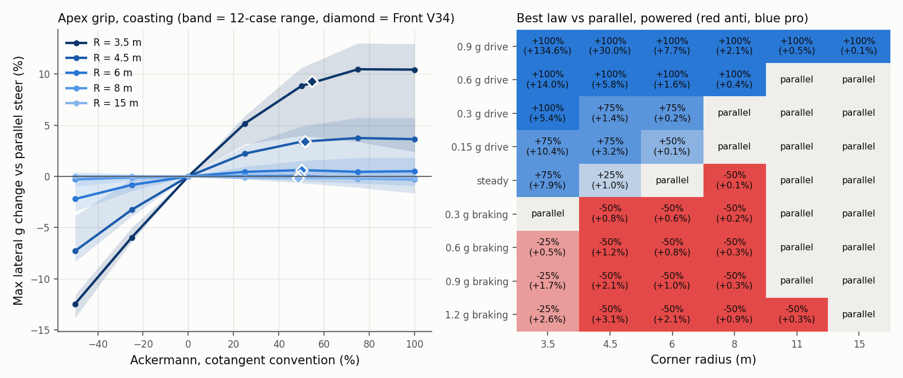
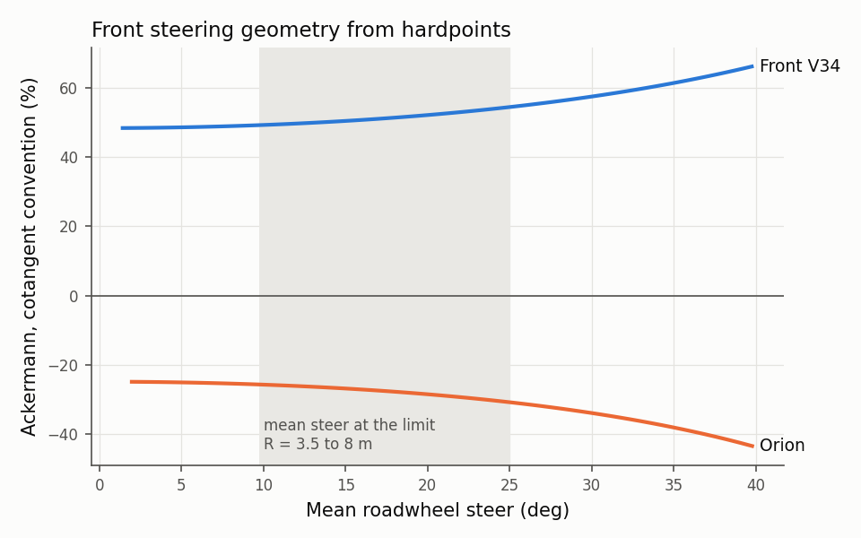

# front-ackermann

**Status: historical.** BobSim `4da577a` made these results. They are stale at BobSim `fe03bab`. BobSim changed the KinPy corner solver that the study uses (#83, #84), and other modules that it calls. See [the BobSim changes](../../docs/bobsim.md#what-changed-in-bobsim-from-4da577a-to-fe03bab). Run the study again before you use a result.

**The code changed after this run.** The numbers on this page come from the old code. The current `run.py` does these things differently (see [Trim statuses and support](#trim-statuses-and-support)):

- A law with no trim no longer scores a 100% shortfall. The comparison drops that condition for every law and shows the coverage loss.
- A trim outside the `.tir` fit ranges, or with a lifted wheel, is rejected. It is not ranked.
- Numerical failure, domain rejection and physical infeasibility are separate statuses.
- A lifted inner wheel puts its axle load on the outer wheel. The four loads sum to the weight.
- Braking cells are labeled open axle. The study does not model LSD coupling under braking.
- Front V34 trims stop at the 31.75 mm rack stop. A trim that needs more steer is `domain_rejected` (`steer_bound`). Constant laws have no linkage, so they keep the end of the `kin_py` table as their bound. A row's lock margin is measured to the bound of its own law. The lock gate still uses the full table, so it can report a need past the stop.
- A slip_norm braking trim is rejected when MF5.2 runs outside the slip fit. The 2026-10-11 slip_norm rows of `braking.csv` and `brake_model_gap_pts` had no such check. They are stale until a re-run.

## Question

Is pro-Ackermann or anti-Ackermann steering better for the 2027 car, and which laws stay good when the inputs we do not trust change? The study compares constant steering laws from −50% to +100% against parallel steer on one car, one tire and one track. Front V34 is the current design point. It is a screening model. It gives the direction and the robust range, not an exact percentage.

## Answer

| | |
| --- | --- |
| Robust region (0.5 point tolerance) | <!-- out:readme.json#robust_laws -->+50%, +75%, Front V34<!-- /out --> |
| Same, without the 3.5 m cells | <!-- out:readme.json#robust_laws_beyond_3p5 -->+50%, Front V34<!-- /out --> |
| Front V34 Ackermann over the rack travel | <!-- out:readme.json#base_ackermann_pct -->+48.9% to +53.7%<!-- /out --> |
| Mean steer at full rack / needed at 3.5 m | <!-- out:readme.json#steer_at_travel_deg|.1f -->23.4<!-- /out -->° / <!-- out:readme.json#steer_needed_3p5_powered_deg|.1f -->22.8<!-- /out -->° |
| Tightest CG radius at any speed / rule-minimum hairpin | <!-- out:readme.json#min_radius_low_speed_m|.2f -->3.83<!-- /out --> m / <!-- out:readme.json#rule_hairpin_radius_m|.2f -->3.67<!-- /out --> m |
| Endurance lap, laws tied with parallel steer | <!-- out:readme.json#lap_tied_laws -->-25%, +25%, +50%, Front V34<!-- /out --> |

- **Pro, not anti.** Every variant, rear model and brake bias keeps −50% out of the robust region. Its worst case is the 3.5 m steady cell, where it loses <!-- out:readme.json#anti50_apex_3p5|.1f -->−12.4<!-- /out -->% of grip against parallel steer and <!-- out:readme.json#lsd_anti50_apex_3p5|.1f -->−18.0<!-- /out -->% with the LSD.
- **The top is flat.** The robust region holds the laws whose worst shortfall over every design condition is within 0.5 points of the best. Choosing inside it is a packaging and steering-feel decision, not a grip decision.
- **Fast corners tie.** Every law is within 0.5% of parallel at 11 m and 15 m. The hairpins decide the direction.
- **Lock is the real gate, at low speed.** At the powered grip limit Front V34 reaches a 3.5 m hairpin with 0.6° of steer to spare. Below the limit the rear does not slide, so the car needs more steer, and its tightest CG radius at walking pace is <!-- out:readme.json#min_radius_low_speed_m|.2f -->3.83<!-- /out --> m against <!-- out:readme.json#rule_hairpin_radius_m|.2f -->3.67<!-- /out --> m for a rule-minimum hairpin. Fix that before the Ackermann value.
- **Lap time is a reference.** +25%, +50% and Front V34 tie parallel steer inside the <!-- out:readme.json#convergence_band_ms|.0f -->24<!-- /out --> ms lap grid band. +75% and +100% lose 25 to 46 ms, spread over the fast corners where they give up 0.2% to 0.3% of grip. −50% loses <!-- out:readme.json#anti50_lap_s|+.3f -->+0.064<!-- /out --> s.

**Why not copy other cars?** A video shows a law. It does not show the roll stiffness split, the tire's load sensitivity, the toe or the rack geometry, and each of those moves the answer here. Another team's law is a data point about their car. It is not evidence about ours. Formula 1 runs anti because downforce gives its outer front tire 5 to 10 times the inner's load at 50 m radii, so the load term wins there. We corner at 3.5 to 15 m with a 2:1 load split and no downforce in this model, so the geometry term wins here.

## Definitions and gates

- Ackermann % is `100 · (cot δ_outer − cot δ_inner) · L / t`, with roadwheel steer δ, wheelbase L = 1.5494 m and front track t = 1.270 m. Positive is pro, zero is parallel steer, negative is anti.
- A design condition is one car, one rear model, one corner radius and one longitudinal level. The cars are nominal, grip scale <!-- out:readme.json#mu_sensitivity -->0.75<!-- /out -->, and <!-- out:readme.json#variants -->LLTD -0.10, LLTD +0.10, LKY 0.62<!-- /out -->. The rear models are an open differential (the baseline), the planned LSD, and hydraulic brakes at 65% and 84% front bias. The levels run from 0.6 g braking to 0.6 g drive.
- Shortfall is `100 · (1 − ay / ay_best)` in a condition, with `ay_best` the best law there. In the 2026-10-11 run, a law with no trim in a condition scored 100%. The current code drops that condition for every law instead.
- The robust region is every law whose worst shortfall is within 0.5 points of the smallest worst shortfall. The 0.5 points equals the measured gap between the two combined-slip tire models (<!-- out:readme.json#brake_model_gap_pts|.1f -->0.5<!-- /out --> points). The table also shows the 1 point region.
- Grip reserve is the limit lateral g of a law against parallel steer at the same condition. Steering authority is the yaw moment per degree of mean roadwheel steer at 90% of the limit.
- Lock gate: the mean roadwheel steer at full rack must reach the steer a rule-minimum hairpin needs. The hairpin is 9 m outside diameter (FSAE rules, course specification). With the outside tire on the edge, the CG radius is <!-- out:readme.json#rule_hairpin_radius_m|.2f -->3.67<!-- /out --> m (hand calculation from t, the tire width and the CG position). 3.5 m is that radius with a margin.

## Robust region

<!-- out:robust.md -->

| Option | Worst shortfall | Binding condition | In region, 0.5 pt | In region, 1 pt | Worst beyond 3.5 m | In region beyond 3.5 m, 0.5 pt |
| ------ | --------------- | ----------------- | ----------------- | --------------- | ------------------ | ------------------------------ |
| +50% | 4.5% | grip 0.75, brakes 0.65, 3.5 m, 0.6 g braking | yes | yes | 2.9% | yes |
| Front V34 | 4.6% | grip 0.75, brakes 0.65, 3.5 m, 0.6 g braking | yes | yes | 2.9% | yes |
| +75% | 5.0% | LKY 0.62, brakes 0.65, 3.5 m, 0.6 g braking | yes | yes | 3.9% | no |
| +100% | 6.0% | LKY 0.62, brakes 0.65, 3.5 m, 0.6 g braking | no | no | 4.7% | no |
| +25% | 8.1% | LLTD -0.10, open, 3.5 m, 0.6 g drive | no | no | 3.6% | no |
| +0% | 12.3% | grip 0.623, open, 3.5 m, 0.6 g drive | no | no | 5.8% | no |
| -25% | 18.5% | grip 0.623, LSD, 3.5 m, steady | no | no | 9.8% | no |
| -50% | 27.7% | grip 0.623, LSD, 3.5 m, steady | no | no | 14.7% | no |

<!-- /out -->

The binding condition names the cell that sets each law's worst case. The second pair of columns drops the 3.5 m cells, because one 3.5 m cell can set the whole region. A smaller worst shortfall is better. The smallest is <!-- out:readme.json#robust_floor_pct|.1f -->4.5<!-- /out -->%.

## Operating map



The table gives the best law at each operating point for the nominal car, open differential and 65% front bias, at grip scale <!-- out:readme.json#mu_nominal -->0.623<!-- /out -->. "parallel" means that no law beats parallel steer by more than 0.1%. "only +50% and up" means that parallel steer holds no grip there and those laws do. F or R names the axle that limits the parallel car.

<!-- out:map.md -->

| Longitudinal | 3.5 m | 4.5 m | 6 m | 8 m | 11 m | 15 m |
| ------------ | ----- | ----- | --- | --- | ---- | ---- |
| 1.2 g braking | -25% (+2.6%) F | -50% (+3.1%) F | -50% (+2.1%) R | -50% (+0.9%) R | -50% (+0.3%) R | parallel R |
| 0.9 g braking | -25% (+1.7%) R | -50% (+2.1%) R | -50% (+1.0%) R | -50% (+0.3%) R | parallel R | parallel R |
| 0.6 g braking | -25% (+0.5%) R | -50% (+1.2%) R | -50% (+0.8%) R | -50% (+0.3%) R | parallel R | parallel R |
| 0.3 g braking | parallel R | -50% (+0.8%) R | -50% (+0.6%) R | -50% (+0.2%) R | parallel R | parallel R |
| steady | +75% (+7.9%) F | +25% (+1.0%) F | parallel R | -50% (+0.1%) R | parallel R | parallel R |
| 0.15 g drive | +75% (+10.4%) F | +75% (+3.2%) F | +50% (+0.1%) R | parallel R | parallel R | parallel R |
| 0.3 g drive | +100% (+5.4%) F | +75% (+1.4%) F | +75% (+0.2%) R | parallel R | parallel R | parallel R |
| 0.6 g drive | +100% (+14.0%) R | +100% (+5.8%) F | +100% (+1.6%) F | +100% (+0.4%) F | parallel F | parallel F |
| 0.9 g drive | +100% (+134.6%) R | +100% (+30.0%) R | +100% (+7.7%) F | +100% (+2.1%) F | +100% (+0.5%) F | +100% (+0.1%) F |

<!-- /out -->

Pro wins <!-- out:readme.json#pro_cells -->18<!-- /out --> of <!-- out:readme.json#map_cells -->54<!-- /out --> cells, anti <!-- out:readme.json#anti_cells -->17<!-- /out --> and parallel <!-- out:readme.json#parallel_cells -->19<!-- /out -->. The best law at the 3.5 m steady cell is <!-- out:readme.json#best_3p5_steady -->+75%<!-- /out --> at <!-- out:readme.json#best_3p5_steady_gain_pct|+.1f -->+7.9<!-- /out -->%. Under the hardest braking at 3.5 m it is <!-- out:readme.json#best_3p5_hard_brake -->-25%<!-- /out -->. Which side of the map anti wins depends on the brake bias, because the bias sets the axle that locks first (bias table). The rear model moves the 3.5 m steady gain of +50% from <!-- out:readme.json#pro50_apex_3p5|+.1f -->+7.8<!-- /out -->% with the open differential to <!-- out:readme.json#lsd_pro50_apex_3p5|+.1f -->+12.5<!-- /out -->% with the LSD. That is why both are design conditions.

Per 180° hairpin at the open-differential steady limit, grip scale <!-- out:readme.json#mu_nominal -->0.623<!-- /out -->:

<!-- out:hairpin.md -->

| Option | 3.5 m | 4.5 m |
| ------ | ----- | ----- |
| -50% | +116 ms | +71 ms |
| -25% | +52 ms | +30 ms |
| +25% | −41 ms | −9 ms |
| +50% | −63 ms | −9 ms |
| +75% | −63 ms | −7 ms |
| +100% | −59 ms | −4 ms |
| Front V34 | −63 ms | −9 ms |

<!-- /out -->

Why the fast corners tie, from first principles: at the limit the outer front carries about twice the load of the inner, and this tire peaks about 0.4° later at the higher load. That is anti's whole case, and it is the same at every radius. The inner wheel runs a tighter arc and needs more steer: 8.1° more at 3.5 m, 5.2° at 4.5 m, 1.7° at 8 m and 0.5° at 15 m (kinematic hand calculation about the rear axle; the sideslip at the limit trims the 3.5 m value to about 6° to 7°). In fast corners you steer about 3°, a constant law's inner-outer difference scales with the steer angle squared, so it moves the wheels by under 0.3°, and missing the peak by 0.4° costs 0.2% of that tire's force.

## Steering lock and linkage



Only this section uses the Front V34 hardpoints, through BobSim `kin_py`. Front V34 has <!-- out:readme.json#base_ackermann_pct -->+48.9% to +53.7%<!-- /out --> Ackermann from 10 mm to the full 31.75 mm of rack and reaches <!-- out:readme.json#steer_at_travel_deg|.1f -->23.4<!-- /out -->° of mean roadwheel steer there. At walking pace that is a <!-- out:readme.json#min_radius_low_speed_m|.2f -->3.83<!-- /out --> m CG radius, so the car does not reach the rule-minimum hairpin below the grip limit. At the limit the rear slides and less steer is needed: a 3.5 m hairpin needs <!-- out:readme.json#steer_needed_3p5_powered_deg|.1f -->22.8<!-- /out -->° with the open differential, which fits, or <!-- out:readme.json#steer_needed_3p5_deg|.1f -->25.0<!-- /out -->° in the coasting apex solve, which is <!-- out:readme.json#rack_needed_mm|.1f -->33.8<!-- /out --> mm of rack with the <!-- out:readme.json#arm_offset_mm|.0f -->84<!-- /out --> mm arm. The inner wheel scrub of a +50% law widens the turn, so the fix is rack travel or a shorter arm, not less Ackermann. The gate does not bind on the Michigan line, whose tightest corner is <!-- out:readme.json#tightest_corner_m|.2f -->4.47<!-- /out --> m. The 31.75 mm rack stop comes from the `.shk` file and needs a part number.

<!-- out:lock.md -->

| Option | Mean steer at the 3.5 m limit | Inner / outer |
| ------ | ----------------------------- | ------------- |
| +0% | 28.6° | 28.6° / 28.6° |
| -50% | 33.6° | 30.0° / 37.1° |
| -25% | 31.0° | 29.4° / 32.5° |
| +25% | 26.2° | 27.4° / 25.1° |
| +50% | 23.0° | 24.7° / 21.2° |
| +75% | 22.0° | 24.4° / 19.6° |
| +100% | 21.7° | 24.8° / 18.5° |
| Front V34 | 22.8° | 24.7° / 20.9° |

<!-- /out -->

An anti law needs more lock than a pro law for the same hairpin. The solver bounds each constant law at the end of the Front V34 `kin_py` table, a table property, not a physical lock. It bounds Front V34 at the rack stop. The 2026-10-11 run bounded Front V34 at the table end too. The smallest margin to a bound is <!-- out:readme.json#lock_margin_min_deg|.2f -->0.01<!-- /out -->°, for −50% in that run. Lock-limited cells: <!-- out:readme.json#lock_limited_nominal_count -->2<!-- /out --> in the nominal map, <!-- out:readme.json#lock_limited_count -->2<!-- /out --> in all.

The linkage table shows linkages solved from the Front V34 hardpoints. Each moves the tie rod outer point and the rack pickup, reaches its hairpin steer at <!-- out:readme.json#fix_rack_mm|.1f -->28.6<!-- /out --> mm of rack and keeps bump steer at zero at center. Toggle margin is how far the arm and the tie rod are from lining up. Bump toe is kinematic, with rigid links. Articulation, clearance, strength, steering effort, loaded bump steer and compliance steer are not computed.

<!-- out:linkage.md -->

| Option | Tie rod outer move | To wheel center plane | Arm to kingpin | Rack pickup move | Toggle margin at inner lock | Bump toe at inner lock, ±25 mm |
| ------ | ------------------ | --------------------- | -------------- | ---------------- | --------------------------- | ------------------------------ |
| Front V34 | – | 30 mm | 84 mm | – | 45° | +0.2° / −0.4° |
| -40% | 30 mm rearward, 35 mm inboard | 65 mm | 54 mm | 35 mm inboard, 3 mm down | 68° | +0.4° / −0.5° |
| 0% | 25 mm rearward, 24 mm inboard | 54 mm | 57 mm | 33 mm inboard, 4 mm down | 58° | +0.4° / −0.5° |
| +70% | 9 mm rearward, 9 mm outboard | 21 mm | 78 mm | 26 mm inboard, 7 mm down | 35° | +0.4° / −0.5° |

<!-- /out -->

## Limit behavior and apex sweep

<!-- out:limit.md -->

| R | -50% | +0% | +50% | Front V34 |
| - | ---- | --- | ---- | --------- |
| 3.5 m | +28.9 / 29.4 | +8.0 / 38.2 | −9.2 / 48.4 | −10.4 / 50.6 |
| 4.5 m | +10.1 / 30.9 | −4.1 / 38.1 | −13.8 / 50.0 | −13.9 / 50.4 |
| 8 m | −12.1 / 44.4 | −14.0 / 48.6 | −14.4 / 49.4 | −14.4 / 49.4 |

<!-- /out -->

Each cell gives stability / steering authority, both yaw-moment derivatives ×1000 per roadwheel degree divided by weight times wheelbase, at 90% of each law's own limit. Pro lowers the static stability near the limit and raises the authority: +50% has <!-- out:readme.json#pro50_authority_ratio_3p5|.2f -->1.27<!-- /out --> times the steering authority of parallel steer at 3.5 m. The derivatives exclude yaw damping and tire lag, so a slightly negative stability is not instability. This is not tested.

<!-- out:apex.md -->

| R | -50% | -25% | +25% | +50% | +75% | +100% |
| - | ---- | ---- | ---- | ---- | ---- | ----- |
| 3.5 m | −12.5% (−13.8 to −11.6) | −6.0% (−6.4 to −5.0) | +5.2% (+3.1 to +5.9) | +8.8% (+4.0 to +10.6) | +10.5% (+3.4 to +13.0) | +10.4% (+2.4 to +13.0) |
| 4.5 m | −7.3% (−8.3 to −3.8) | −3.3% (−3.9 to −0.3) | +2.2% (−0.3 to +3.0) | +3.4% (−0.7 to +4.9) | +3.8% (−1.1 to +5.7) | +3.6% (−1.6 to +5.7) |
| 6 m | −2.2% (−3.4 to +0.4) | −0.8% (−1.4 to +0.2) | +0.4% (−0.2 to +1.0) | +0.6% (−0.5 to +1.5) | +0.4% (−0.7 to +1.8) | +0.5% (−0.9 to +1.9) |
| 8 m | −0.3% (−1.0 to +0.2) | −0.1% (−0.4 to +0.1) | +0.1% (−0.1 to +0.3) | +0.1% (−0.2 to +0.5) | −0.2% (−0.3 to +0.6) | −0.3% (−0.4 to +0.7) |
| 15 m | 0.0% (−0.1 to +0.1) | 0.0% (−0.1 to 0.0) | −0.1% (−0.1 to +0.1) | −0.1% (−0.1 to +0.1) | −0.2% (−0.2 to +0.2) | −0.2% (−0.2 to +0.2) |

<!-- /out -->

The apex sweep coasts, so its gains differ from the powered map. Each cell gives the nominal value and the range over 12 cases: two tire cornering-stiffness scales, both slip signs and three LLTD values. At 3.5 m every pro law gains and every anti law loses in all 12 cases. The closed form for a front-limited car agrees with the solver at 3.5 m:

<!-- out:optimum.md -->

| R | Front-limited optimum | Solver optimum (10% steps) | +75% limited by |
| - | --------------------- | -------------------------- | --------------- |
| 3.5 m | 87% | +90% | front |
| 4.5 m | 86% | +80% | rear |

<!-- /out -->

## Brake bias and toe

`vehicle.yml` sets 84% front bias with no source. The study runs 65% as nominal and 84% as a second brake model. The best straight-line bias is <!-- out:readme.json#ideal_bias_pct|.0f -->68<!-- /out -->% front.

<!-- out:bias.md -->

| Front bias | Locks first | Straight-line limit |
| ---------- | ----------- | ------------------- |
| 65% | rear | 1.46 g |
| 84% | front | 1.18 g |

<!-- /out -->

<!-- out:toe.md -->

| Total toe-out | 3.5 m best | 4.5 m best |
| ------------- | ---------- | ---------- |
| −1.0° (toe-in) | +100% | +100% |
| −0.5° | +90% | +90% |
| 0.0° | +90% | +80% |
| +0.5° | +80% | +70% |
| +1.0° | +70% | +60% |

<!-- /out -->

One degree of toe-out replaces about <!-- out:readme.json#points_per_deg_toe_3p5|.0f -->10<!-- /out --> points of Ackermann at 3.5 m. A toe-only test therefore does not isolate Ackermann.

## Lap reference

BobSim's quasi-steady-state (QSS) lap solver runs each law's open-differential envelope on the Michigan 2019 endurance line (<!-- out:readme.json#track_length_m|.0f -->1989<!-- /out --> m, <!-- out:readme.json#corners_under_15m -->42<!-- /out --> corners under 15 m, 32 kW). Laws with |Δt| inside the lap grid band tie. The band is twice the largest move when the QSS speed and lateral-g grid is refined, at grip scale <!-- out:readme.json#mu_nominal -->0.623<!-- /out --> for five laws. It covers that grid only, not the map radius grid, the tire, the LLTD or the rear model. At grip scale <!-- out:readme.json#mu_sensitivity -->0.75<!-- /out --> the tied laws are <!-- out:readme.json#lap_tied_laws_sensitivity -->-50%, -25%, +25%, +50%, +75%, +100%, Front V34<!-- /out -->.

<!-- out:lap.md -->

| Option | Endurance lap, grip 0.623 | Endurance lap, grip 0.75 | Skidpad lap, grip 0.623 | Skidpad lap, grip 0.75 |
| ------ | ------------------------- | ------------------------ | ----------------------- | ---------------------- |
| -50% | +0.06 s | −0.01 s | −0.002 s | −0.001 s |
| -25% | +0.01 s | 0.00 s | −0.001 s | 0.000 s |
| +25% | −0.01 s | −0.01 s | +0.001 s | 0.000 s |
| +50% | +0.01 s | 0.00 s | +0.002 s | +0.001 s |
| +75% | +0.03 s | 0.00 s | +0.004 s | +0.001 s |
| +100% | +0.04 s | +0.01 s | +0.005 s | +0.002 s |
| Front V34 | +0.01 s | 0.00 s | +0.002 s | +0.001 s |

<!-- /out -->

## Confidence

- **Direction: medium.** The closed form and the solver agree at 3.5 m. The −50% loss holds in every car, rear model and bias. Against this: no transient, steer camber, compliance steer or aligning moment, and the inner-rear tire in the LSD cells runs past its peak slip ratio where the ellipse tire model is not valid.
- **Size: low.** The grip scale, the LLTD and the rear model are not validated, and together they move the 3.5 m pro gain from large to near zero. The robust region, not a single percentage, is the result.

## Method

`run.py` solves a quasi-steady corner at constant radius with four MF52 tires from BobSim, LLTD-split load transfer, a yaw moment balance and a stability check. Each map cell is a bisection on lateral g to the last stable trim. Drive force goes through the rear model. The open differential sends half the axle force to each wheel. The LSD follows the BobLib `Differential1D` convention: the clutch holds up to `2 · preload + lock · |T|` of left-right torque difference and slips at 0.85 of that toward the slower wheel. Hydraulic brakes split by bias and never pass through the differential, so braking cells do not depend on the rear model. Each braking cell is an open-axle cell. `vehicle.yml` enables an LSD with a preload, and a preload couples the rear wheels with no input torque. The study withholds that coupling: a braking request through a coupled differential returns `not_modeled`. For feasibility only, `kin_py` gives the Front V34 steering curve. The lap envelopes use the open-differential rows. Lap time is a reference.

Sign convention: x forward, y left, z up (BobSim `docs/conventions.md`). A positive lateral g turns left, and Fy is positive toward +y. `camber_deg` is negative when the top of the wheel leans toward the car centerline. The run gives MF5.2 an inclination of +camber on the left wheels and −camber on the right wheels, and it negates the MF5.2 Fy. BobSim dynpy does the same (`engines/kinpy/lookup.py` and `engines/dynpy/tire.py` at `fe03bab`). The slip side −1 case samples the mirror-image tire: it gives MF5.2 −α and −γ and keeps the sign of its Fy. So with −1° camber and slip side +1, the left wheels run at −1° of inclination and the right wheels at +1°. The run checks each inclination against `CAMMIN` and `CAMMAX`. The `.tir` camber fit has no negative inclination, so the −1° camber variant cannot give a ranked row: its left wheels are `camber_out_of_fit`. This study does not check which convention the `.tir` fit used.

Solver checks in every run: each trim residual under 1e-7 with a stability check, a four-tire trim at <!-- out:readme.json#coverage_demand_pct|.0f -->98<!-- /out -->% of the lap's demand exists for <!-- out:readme.json#coverage_pct|.1f -->98.1<!-- /out -->% of the cornering time inside <!-- out:readme.json#coverage_radius_max_m|.0f -->15<!-- /out --> m, an envelope gap stops the run, <!-- out:readme.json#caps_count -->1<!-- /out --> envelope caps and a cap check that changes the lap by <!-- out:readme.json#cap_check_max_ms|.1f -->0.0<!-- /out --> ms, the braking clip binds in <!-- out:readme.json#clip_cells -->14<!-- /out --> of <!-- out:readme.json#clip_of -->384<!-- /out --> solves (up to <!-- out:readme.json#clip_anti50_g|.2f -->0.21<!-- /out --> g for −50%), every QSS lap converges, and a QSS lap on an 8 m circle differs from 2πR/v by <!-- out:readme.json#circle_check_error_pct|+.3f -->+0.008<!-- /out -->%.

Before a full run: `make study S=front-ackermann ARGS="--quick" V=smoke`.

### Trim statuses and support

Each trim attempt ends in one status from `tools/trim_status.py`:

| Status | Meaning |
| ------ | ------- |
| `accepted` | The residual is under 1e-7, every wheel is inside the tire fit, and both axles are on the rising branch. |
| `domain_rejected` | The solve left the model domain: a wheel outside the `.tir` load, slip-angle, slip-ratio or camber range, a lifted wheel, or a solver bound (steer, sideslip, longitudinal force) at a stationary point. |
| `physically_infeasible` | A converged in-domain state uses more than the tire can give or is past the peak, or a start stopped at a stationary point with a nonzero residual and every wheel inside the fit (`no_equilibrium`). The last case is local evidence of saturation, not a global proof. A stationary point outside the fit is `domain_rejected`. |
| `numerical_failure` | The solver stopped on its evaluation limit or did not reach a stationary point, with or without an active bound. Nothing is known about the physics. |
| `not_modeled` | The study withholds the capability, for example LSD coupling under braking. |

A limit search bisects lateral g. Only a search whose failing bracket is `physically_infeasible` gives a grip limit. Rows keep `ay_accepted_g`, `trim_status`, `bound_kind`, `upper_status`, `upper_reason` and the per-wheel load, slip angle, slip ratio, camber, use and support flags. `ay_max_g` is empty unless the row is a grip limit.

`tools/tire_support.py` reads `FZMIN`, `FZMAX`, `ALPMIN`, `ALPMAX`, `KPUMIN`, `KPUMAX`, `CAMMIN` and `CAMMAX` from the `.tir` file. A missing range stops the run. The peak tables and peak searches stay inside these ranges.

The `kappa` column is the slip ratio that the combined-slip model uses. The ellipse model reports the pure-slip slip ratio that gives the wheel's Fx. The slip_norm model solves its own slip ratio and evaluates MF5.2 at a larger slip ratio and slip angle. The run checks those evaluated slips against the fit too (`kappa_eval_out_of_fit`, `alpha_eval_out_of_fit`).

`tools/support.py` compares laws on common support. A condition counts only when every law, the baseline included, has a grip limit there and the baseline is at or above the floor. The result lists each excluded cell and its kind. With no common support, or with coverage under the minimum, the region is empty and the README shows "No recommendation". The minimum coverage (1.0) and the floor (0.2 g) are study choices. Nobody has reviewed them.

An envelope cap in the lap reference needs a `physically_infeasible` cell with no accepted trim. Any other failure removes that law from the lap reference.


## Before design freeze

1. **Lock.** Add rack travel or shorten the arm until the rule-minimum hairpin fits. Confirm the rack stop and measure the steering curves on turn plates.
2. **Roll stiffness split.** Measure the installed bar rates and rerun at that LLTD. It moves the result the most.
3. **Brake bias and differential.** Get the 2027 hydraulic bias and the diff preload and ramps. Log rear wheel speeds in 3.5 to 8 m corners to see whether the axle locks.
4. **A/B on track.** Compare two linkages with the same static toe at 3.5 and 4.5 m: steer gradient, yaw rate, lateral g and wheel speeds, A-B-A order, several runs, accept only differences above the run-to-run scatter.
5. **Geometry.** `run.py` holds a copy of the Front V34 hardpoints. Copy any `.shk` change into it.

## Inputs

| Input | Value | Source |
| ----- | ----- | ------ |
| Mass with driver, CG height, front weight | 263.1 kg (430 + 150 lb), 0.279 m (11 in), 45% | team 2027 estimate |
| Front hardpoints and rack, feasibility only | `2027_FrontV34.shk`, `FRONT SUSPENSION`, SHA-256 `95063c3b…`, front track 1270 mm, rack travel 31.75 mm each way | Front V34 |
| Wheelbase, rear track, rear suspension | 1.5494 m, 1.2122 m, Orion rear | Orion carryover |
| Tire | `16x7p5_10_12psi`, SHA-256 <!-- out:readme.json#tire_sha256 -->f38da74e929e4a1a<!-- /out -->… | Orion carryover |
| Grip scale | <!-- out:readme.json#mu_nominal -->0.623<!-- /out --> nominal, <!-- out:readme.json#mu_sensitivity -->0.75<!-- /out --> variant | 0.6225 correlated by Abishek Rathnakumar (unreviewed), not validated |
| LLTD | <!-- out:readme.json#lltd_front_pct|.1f -->34.4<!-- /out -->% front, balanced at 15 m with parallel steer, held at both grip scales | assumption, not measured |
| Brake bias | 65% front nominal, 84% second model (`vehicle.yml`, no source) | assumption |
| Differential | open (baseline) and planned LSD: preload 5 Nm per side, lock 0.60, kinetic 0.85 (`vehicle.yml` differs) | assumption |
| Static toe and camber, aero | 0, 0, none | assumption |
| Track, power limit | Michigan 2019 endurance, 32 kW | BobSim lap config |

`out/front-ackermann/vehicle_front.yml` holds the front geometry only. `summary.json` `effective_inputs` holds every value the run used. BobSim interfaces: public `solve_qss_lap`, `GGVMap.from_arrays`, `optimize_racing_line`, `CornerKinematics`, `project_vehicle_yaml` and the loaders, plus private `_mf52_fx_pure` and `_mf52_fy_pure` from `app.tire_eval` (see the [bobsim-boundary skill](../../docs/skills/bobsim-boundary/SKILL.md)).

## Provenance

<!-- out:provenance.json -->

```json
{
  "study": "front-ackermann",
  "bobsim_sha": "4da577af1b04d86c53706eb6e80fb0064f71cee6",
  "vehicle_sha256": "3ab02bbf3e573aad0330bc37ce40fd254090d33dabd3760462c51da74e30afe8",
  "utc": "2026-10-11T20:15:27+00:00"
}
```

<!-- /out -->
